# Spear: End of Destiny: Hint Book

*From [areyep.com](https://www.areyep.com/RIPandMCS-EoD-HintManual-level1.html), by AReyeP and MCS, reproduced here for players of the TC port. Text and pictures are theirs; the links to downloads go to their site.*

> **Spoilers.** Every level's map, secrets and route are below.

**Levels:** [1](#level-1) · [2](#level-2) · [3](#level-3) · [4](#level-4) · [5](#level-5) · [6](#level-6) · [7](#level-7) · [8](#level-8) · [9](#level-9) · [10](#level-10) · [11](#level-11) · [12](#level-12) · [13](#level-13) · [14](#level-14) · [15](#level-15) · [16](#level-16) · [17](#level-17) · [18](#level-18) · [19](#level-19) · [20](#level-20) · [21](#level-21) · [22](#level-22) · [23](#level-23) · [24](#level-24) · [25](#level-25) · [26](#level-26) · [27](#level-27) · [28](#level-28) · [29](#level-29) · [30](#level-30) · [31](#level-31) · [32](#level-32) · [33](#level-33) · [34](#level-34) · [35](#level-35) · [36](#level-36) · [37](#level-37) · [38](#level-38)

## Level 1: Estate Entry

**1.** You start here. If you move on forward you'll soon find a patrolling guard outside the front of the estate - take' care of him and his pistol is yours.

**2.** The "courtyard". From here the only way onwards is through the minefield. Watch out for the guards in the guardhouse nearby - it may be best to just leave them be and move on through the minefield as ammo will be scarce at this early stage. You can always come back for 'em later on :)

**3.** Make your way through the minefield to this point here.

**4.** Over to the exit stairway that descends into the basement of the estate, and you're on your way to level 2!

**5.** Ahhh ... a nice little remote corner of the forest brings you to this area, but how to get through the minefield here to the goodies beyond?

**6.** The trick is to run to area 6, and make sure all the guards inside the room here see you ... ignore them and run back to area 5 and hide behind some dense shrubbery ... the guards will come looking for you, and in their enthusiasm to put a bullet through your skull will conveniently forget the mines they'd planted in the minefield here. Boom, boom, boom, boom ... minefield cleared, enemies eliminated,and you didn't even need to fire a single shot! Proceed on and enjoy the treasures within oh smart soldier!!!

**7.** This secret pushwall leads to other secrets that will take you the gatehouse, and some other nice trinkets :)

**LEGEND**

| 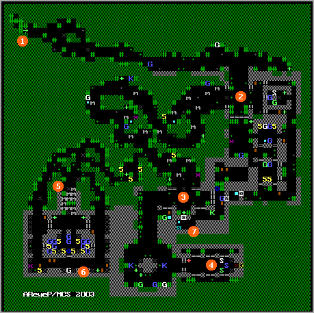 | 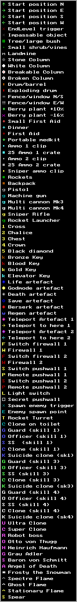 |
|---|---|

Enemies marked in blue appear in all difficulty levels. Enemies marked in green appear only in difficulty levels "I'm a Hero" & "Suicidal Tendencies". Enemies marked in white appear only in the difficulty level "Suicidal Tendencies" and "Tournament" mode.

## Level 2: Entryway

**1.** You start here.

**2.** A secret pushwall here will yield a handy portable medkit as well as some nice treasure goodies.

**3.** Ahhh ... your first encounter with some nasty balls o' fire! Lure the SS out of the small room here and he'll meet his demise as the fire balls roast him! You can then run across into this area (time it so that you run across the passage so the fireballs miss you) where you'll find a wall switch that will deactivate/activate the fireballs.

**4.** Grab the blood key and then proceed to point 5 to collect the bronze key.

**5.** The bronze key.

**6.** The bronze key allows access to this area, and the wall switch at point 6 here opens a pushwall that will allow access to the gold key you see behind the grille here. Use the gold key to open the gold locked door near point 3 ... oh, and when you open it, it may be fun to run back and use the nearby switch to re-activate those fireballs ... after all, why waste ammo on those pesky SS in the next room?

**7.** The exit elevator leading to level 3 is here.

**8.** This secret pushwall leads to some very nice goodies, including the first rocket launcher you'll get in the game.

**9.** How to clear all these SS? Well, that rocket launcher behind that secret pushwall nearby shouldn't be THAT hard to find!!! The reward for making it past these guys is an MKS Mk3. That's two super weapons - how generous can a secret area be?

**10.** Ahah ... a hidden elevator key ... this can only mean a hidden elevator somewhere!

**11.** To access this secret area you have to break a few columns and throw a switch to activate the nearby remote pushwall. Some nice treasure trinkets and a life artefact await.

**12.** Yes ... the secret elevator to your first secret level!!!

**LEGEND**

| 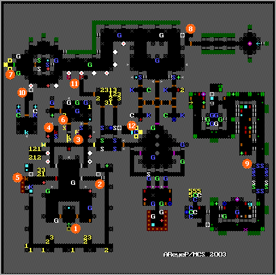 |  |
|---|---|

Enemies marked in blue appear in all difficulty levels. Enemies marked in green appear only in difficulty levels "I'm a Hero" & "Suicidal Tendencies". Enemies marked in white appear only in the difficulty level "Suicidal Tendencies" and "Tournament" mode.

## Level 3: Flame Tunnel

**1.** You start here.

**2.** If you're low on ammo, or are starting the level with only a pistol, then this hidden stash of ammo is a good place to visit first up. Mind you, you'll have to deal with a few enemies first ... did you expect such goodies to be just handed to you on a platter?

**3.** Make your way to here and prepare to cross the "Flame Tunnel". It's best to use the doors on the left to do so as there's a space on the other side of the tunnel before the door on the opposite side, allowing you to quickly dive across between fireball bursts.

**4.** Now, if you're adventurous, at point 3 you would have been tempted to run up that corridor with the fireballs. Nothing ventured, nothing gained! Using the run feature, you can race the fireballs up the tunnel to point 4 here without being hurt, and you'll find a switch here that turns the fireballs off, and access to a heap of rooms with nice treasures (and an MKS Mk3 if you expore thoroughly).

**5 & 6.** These two areas are easily accessed once you've been to point 4 to turn off the fireballs. Not only can you get a very handy Artefact of Invulnerability at point 5, but point 6 gives you a nice Stealth Rifle to play with!!!

**7.** The wall switch here opens a pushwall in the adjoining corridor, allowing you access to the blood key. It also releases 4 suicide clones in the same corridor - bummer!

**8.** The blood key.

**9.** The blood key allows you to access this area where you'll find the gold key.

**10.** And the gold key allows you to access this area where you'll find the bronze key.

**11.** Once you have the bronze key, you can access the exit to the level here, or you can remove the two rocket turrets nearby and access the secret wall switch in this area.

**12.** The secret wall switch at point 11 opens the pushwall here ... eliminate the clones inside, and the goodies are yours!

**LEGEND**

| 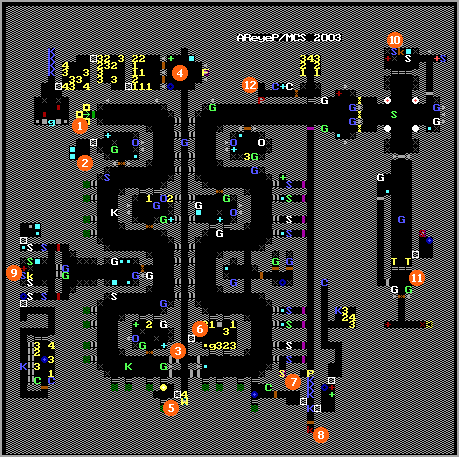 |  |
|---|---|

Enemies marked in blue appear in all difficulty levels. Enemies marked in green appear only in difficulty levels "I'm a Hero" & "Suicidal Tendencies". Enemies marked in white appear only in the difficulty level "Suicidal Tendencies" and "Tournament" mode.

## Level 4: Prison Cellar

**1.** You start here.

**2.** This storage room is a handy stopover point for stocking up on ammo.

**3.** The secret pushwall here leads to not only some nice trinkets, but to a sneaky way of getting the bronze key later on.

**4.** Ahhh yes!!! Not only an Artefact of Life to be collected here, but a secret back entry way to collecting the bronze key! There's only one problem ... you need the gold key to open the door here. Major bummer!

**5.** Make your way to here to collect the blood key. Shooting the explosive barrels in the room will help clear the room of enemies and save on ammo.

**6.** The blood key will allow you to access the prison areas, and the gold key can be found here.

**7.** Now you have the gold key, you can access the next area here, OR you can proceed to the door near point 4 that was in the secret area mentioned earlier.

**8.** The bronze key!

**9.** With the bronze key in your possession, you can access the final area. Now, you can be dumb, and take on the SS face to face among the explosive barrels (and probably blow yourself up in the process as well), or you can be smart, and throw the wallswitch here to activate a stream of fireballs that conveniently take care of all the SS for you. Mind you, the blast from those barrels as the fire toasts them will probably take a bit of your health, so be warned!

**10.** Now here's something new ... an Artefact of Regeneration! Stand on top of this for a while and you'll soon be feeling 100%.

**11.** Take the stairs down to level 5!

**12.** The Artefact of Invulnerability here will come in handy during your exploits in this level.

**13.** The secret pushwall here leads to a number of goodies, including an MCS Mk3, and a stealth rifle.

**LEGEND**

| 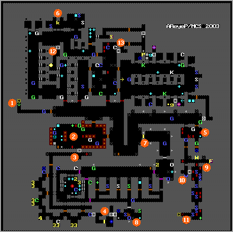 |  |
|---|---|

Enemies marked in blue appear in all difficulty levels. Enemies marked in green appear only in difficulty levels "I'm a Hero" & "Suicidal Tendencies". Enemies marked in white appear only in the difficulty level "Suicidal Tendencies" and "Tournament" mode.

## Level 5: The Mines

**1.** You start here. And you'll die here also if you don't get your arse moving, as that "pretty light" in the distance will toast that butt of yours if you hang around here too long!

**2.** The more agile player will make their way up the passage along here dodging fireballs as they go by making use of the alcoves to either side. Or, if you're fast enough, you can run to this point as soon as you start the level and get here before the fireballs do! Inside the hidden room here is a switch that will open up the area at point 14, allowing you to get three Artefacts of Life! Definitely worthwhile going for!

**3.** If you're not game enough to try playing with fire as in step 2 (or you've already completed step 2), then enter the mines at point 3 here.

**4.** Make your way through the dank mine passages to here, where you'll have to leap across the passage of fireballs with good timing.

**5.** The blood key here should be your next stopover. Just watch for some rather upset SS guys who'll come looking for you to object to your taking their key!

**6.** The blood key will allow you to access this area - hop into the Artefact of Displacement here, and you'll find yourself transported to the great outdoors at point 7.

**7.** Time to trudge through the snow to get the bronze key. Don't miss the hidden area to the right where you can obtain a rocket launcher.

**8.** The bronze key!

**9.** Hop into the Artefact of Displacement here to teleport back to point 6.

**10.** With the bronze key in your pocket, head to here where you can now gain access to where the gold key is stored.

**11.** The stairway to heaven (or should that be "more hell"?!!!)

**12.** Now, before you go exiting this level, maybe you should be curious as to what other things may be hidden along the passage of fireballs? If you race to this point here from point 4, then you'll find a clone guarding a wall switch ... throw this switch and a remote pushwall will block the fireballs from travelling up the passageway.

**13.** Not only will you find two crates of ammo as reward for throwing the switch, but you'll now have access to the secret pushwall at this point. Slide this back, and you've found your first "super secret" area! Proceed onwards oh daring warrior ... as reward you'll find a stealth rifle, 2 Artefacts of Life, a backpack of ammo, and some juicy treasure items (oh and some clones and SS too!)

**14.** Refer to step 2 to get the three Artefacts of Life located here.

**LEGEND**

| 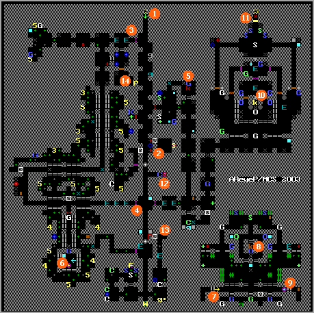 |  |
|---|---|

Enemies marked in blue appear in all difficulty levels. Enemies marked in green appear only in difficulty levels "I'm a Hero" & "Suicidal Tendencies". Enemies marked in white appear only in the difficulty level "Suicidal Tendencies" and "Tournament" mode.

## Level 6: The Basement

**1.** You start here.

**2.** Make your way through the dark passageways and rooms to the bronze key stored here.

**3.** The bronze key will open the door here.

**4.** Now, before you go barging into the passageway here, be warned! There's a rocket turret up the end of the passage - you'll have to make your way up here, so use the alcoves to take cover from any rockets that come your way (just watch for any clones occupying said alcoves should you be on the harder skill levels :) Oh and there's a handy rocket launcher in the room at the end of the passage that will make taking out the turret a lot easier.

**5.** The blood key. There's also a small winding passageway through the door adjacent this area that leads to two secret areas where a nice Artefact of Life and a stealth rifle can be found.

**6.** The "Switch Room". The blood key will allow you to access this area - throw the two switches and then sit back and wait for a nice group of enemies to come to greet you :)

**7.** The switches at point 6 open the remote pushwalls here ... take the passage to the right to grab the gold key at point 8.

**8.** The gold key.

**9.** Go back to point 7, and take the left passage to make your way to point 9 here.

**10.** Fight your way through to this point where the elevator key is kept ... not far to go now!

**11.** On to level 7!

**12.** Now, if you find this secret area, then there's a trick to getting through unscathed. All the treasures around the walls here look tempting, but you'll have a horde of SS in the central room in this area trying to fill your body with lead! The trick to this area is to stay quiet so as not to alert the SS, open the pushwall into this inner room, and then creep along the wall behind the SS to the Artefact of Fury inside here. Then, just sneak up behind each SS and eliminate each of them with just one stab! The treasure is now all yours :)

**LEGEND**

| 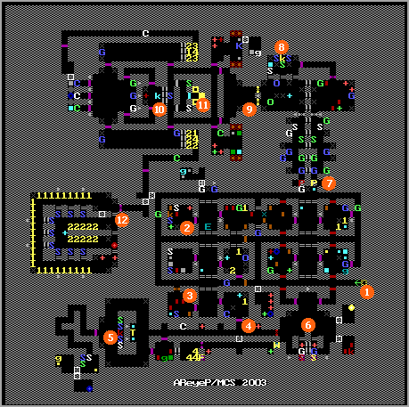 |  |
|---|---|

Enemies marked in blue appear in all difficulty levels. Enemies marked in green appear only in difficulty levels "I'm a Hero" & "Suicidal Tendencies". Enemies marked in white appear only in the difficulty level "Suicidal Tendencies" and "Tournament" mode.

## Level 7: Feculent

This is the first "Boss" level, and earns its name from the composition of the occupants of this dank lair!!! (if you don't know what "feculent" means, look it up in the dictionary, and then think of what the clones are made of :)

**1.** You start here.

**2.** There's a machine gun here, but the hidden cache of machine gun ammo hidden behind this pushwall is a handy first stop over if you're starting with only a pistol and 8 rounds.

**3.** A nice secret area with lots of health (plus an "Artefact of Preservation" for making a savegame if you're on the "Tournament" skill level). You should notice hopefully that most of the secret pushwalls in this level conveniently have a bloodied skull hanging from the ceiling just in front of them - how convenient for you (but not so convenient for whoever it was that provided the skull!)

**4.** A wall switch ... hmmm, I wonder what it does? The level has been rather devoid of action so far ... well, go on, throw the switch - it's time to get some shooting practice! Just watch your back, OK?

**5.** After all hell has broken loose and you've dealt with the problem with some hot lead, access this area opened up as a result of throwing that switch. Inside you'll find the bronze key (and some ammo and health to replenish what you lost in your fight to get this damned key!!!)

**6.** The bronze key will allow you to access this centrally located room where you will be welcomed by a number of clones. Unless you're a glutton for punishment in that you like to promote multiculturalism, spare yourself some grief and eliminate these buggers as they'll refuse to assimilate!!! Once the job is done you can take possession of the blood key inside.

**7.** Ahhh ... now onto the BIG stuff :) Go on, open the door with the blood key. But, don't be too entranced by what you see, or it may be the LAST thing you see! The new improved Superclone with rocket launcher awaits you ... you do have your own rocket launcher or an MCS weapon don't you?

**8.** Once you've defeated the Superclone, pick up the gold key and open the door here. Throw the switch and wait to see what happens. If you've been a stealthy quiet type of fighter and didn't get trigger happy when you first saw the Superclone in his lair, then nothing may happen, but if you made a noise firing your guns back there then there's a good chance someone will be paying you a visit soon after you throw this switch!!! And you thought the Superclone was bad? See point 9 for more details!

**9.** The lair of the Ultraclone. This guy is tough, and will take some bringing down. But once he's down, don't think he'll just stay that way!!! An Ultraclone can reanimate from death a number of times before staying down for good. Sometimes they won't reanimate at all, other times they will any number of times. Be patient, and be vigilant - you'll eventually stop his reanimation antics, and use the breaks in between reanimatons to stock up on ammo and health. But learn to fear that corpse, for if you return later and find it's not there anymore, then you know he's on the prowl looking for you!

**10.** Grab the elevator key in his lair and get the hell outta here!

**11.** On to level 8!

**LEGEND**

| 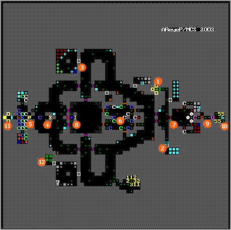 |  |
|---|---|

Enemies marked in blue appear in all difficulty levels. Enemies marked in green appear only in difficulty levels "I'm a Hero" & "Suicidal Tendencies". Enemies marked in white appear only in the difficulty level "Suicidal Tendencies" and "Tournament" mode.

## Level 8: Powder Keg

**1.** You start here.

**2.** You die here.  
Unless you run like hell when you throw that switch on the wall that is!!! Didn't your mummy tell you that throwing switches when you're in a room full of explosive barrels isn't a good idea? Of course you could try shooting one of the barrels if you wish to get past them ... just don't try to buy life insurance off me if you plan to do so! So, do what you must, and throw the switch, but make your way back IMMEDIATELY to where you started the level. Wait a few seconds, and then come back and have a look at all the pretty fire :)

**3.** Ahhh, now here's the cowardly but smart way to deal with all those damned barrels - a hidden rocket launcher! Take the rocket launcher, stand back against the wall in here, and fire a rocket into the area where the barrels are. The splash damage from the rocket's explosion should set all the barrels off, and at a safe enough distance so as not to hurt you!

**4.** The bronze key is here, but you'll have to fight for it as it's heavily defended. Use your brains - when you first alert the enemies in this room, run back to point 2 and throw the switch ... the nice fireballs will roast your enemies as they come pouring out :) Oh and you'll see the blood key in here behind a grille, but you won't be able to access it just yet ...

**5.** The bronze key will allow you to access this room where there's a wall switch - throw it, and a remote pushwall will slide open to make the blood key accessible.

**6.** Return to this point where you found the bronze key before, and you'll find the blood key is now accessible. Oh and those annoying clones you'll encounter were hidden in this area - it's a right pain finding enemies in places you thought were now safe isn't it? :)

**7.** Make your way to this door unlocked by the blood key through this dangerous corridor carefully. If you are feeling like taking on the rocket turrets, then there's some very nice goodies to reward you, including some hidden ammo supplies of rockets and MCS ammo, an MCS Mk 4, and even an Artefact of Invulnerability!

**8.** Make your way through the prison complex to this point here where you'll find an Artefact of Displacement. Hop in, and to the great outdoors you'll go.

**9.** Move carefully through the outdoors area here watching for suicide clones, guards taking potshots at you from both sides, and landmines.

**10.** Eliminate the SS in here and the gold key is yours!

**11.** Jump into the Artefact of Displacement here, and you'll be back at point 8.

**12.** Back through the prison complex to the door the gold key will unlock here. All's quiet, so throw the switch behind the door to your right (as you open the locked door).

**13.** Throwing that switch will open up this area, and you'll be able to grab the elevator key here. Just don't get blown up by the suicide clones in the process.

**14.** You can take the exit to the next level here if you wish, or you could check out what's behind those doors adjacent to the elevator door. There's a nice Artefact of Regeneration to be found in there.

**15.** And if you search the walls for secrets, here's the way to the second secret level!

**LEGEND**

| 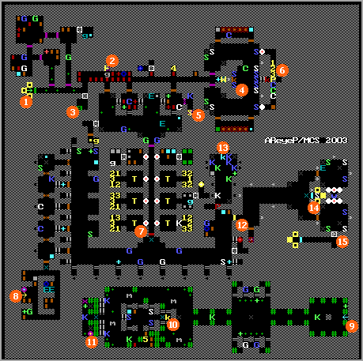 |  |
|---|---|

Enemies marked in blue appear in all difficulty levels. Enemies marked in green appear only in difficulty levels "I'm a Hero" & "Suicidal Tendencies". Enemies marked in white appear only in the difficulty level "Suicidal Tendencies" and "Tournament" mode.

## Level 9: Room of 3 Keys

**1.** You start here.

**2.** It may not look so obvious at first, but the one door leading out of this room is NOT the way to go! Now although the exit to the level is just down that corridor, those fireballs will toast you to a crisp before you can make your way there unless you have super health! There must be another way! The 3 keys you'll need to accomplish your mission are all sitting so invitingly in full view here, but you won't be able to access them just yet. Only one way to go - open the pushwall at this point here and venture forth.

**3.** You'll find a handy MCS Mk 3 here being guarded by a clone or two.

**4.** The bronze key! Grab it, and then go back out to the main central room from where you started off from. You will now be able to open the other door here requiring the bronze key, and throw the switch inside.

**5.** A pushwall will slide back here once you throw that switch - make your way inside to continue in your quest.

**6.** Those filthy clones are at it again eating meals in the toilet cubicles!!! Plenty of first aid items and food to be found in the toilet block, so stock up and hope you don't get salmonella poisoning!

**7.** The gold key! Make your way back out to the room you started this level from, and then open the other door requiring the gold key. Throw the switch inside.

**8.** The switch will open the pushwall here, and then it's on to explore the mazelike area ahead to reach the final key. The maze may seem easy to get lost in, but it seems Hansel and Gretel (Grosse) were here before, and instead of leaving breadcrumbs, in traditional Grosse fashion, they left a trail of skulls instead so as to mark their way ... just follow the skulls on the floor, and you can't go wrong (unless a sneaky suicide clone gets the better of you :)

**9.** Hear the sound of breaking stone columns? Rocket turrets!!! The fences will keep you safe for now, but you're going to have to make your way through this area to reach the blood key. Thankfully there are plenty of walls to take cover behind as you move in to take the turrets out.

**10.** Now there's a handy rocket launcher here that will make eliminating those turrets an easy task. In addition, there's another secret pushwall here that will lead you to a nice Artefact of Regeneration, and then another secret pushwall to lead you to some nice trinkets!

**11.** Finally - the blood key! Not too far to go now. Grab it and back out to the room from where you started.

**12.** Open the door requiring the blood key here, and throw both the switches inside. Voila! Fireballs now deactivated! That door nearby can now be opened safely, and you can proceed up the corridors without fear of fire.

**13.** Grab the elevator key being guarded by a clone here, and then to the exit elevator - on to level 10!

**LEGEND**

| 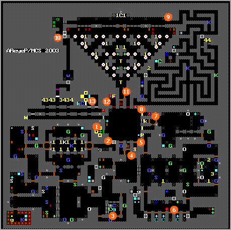 |  |
|---|---|

Enemies marked in blue appear in all difficulty levels. Enemies marked in green appear only in difficulty levels "I'm a Hero" & "Suicidal Tendencies". Enemies marked in white appear only in the difficulty level "Suicidal Tendencies" and "Tournament" mode.

## Level 10: Tribulations

**1.** You start here. There's an Artefact of Fury right outside the lift door here, but don't be tempted by it as it won't really do you that wmuch good by itself - save it for a little later.

**2.** Now you should have learnt by now that throwing switches can have all kinds of effects ... if I were you, I'd throw it, and run! You'll soon see why :)

**3.** How to get past the fireballs to the next area? See the Artefact of Invulnerability behind the stone column here? Run in through the fireballs and grab it! Sure, you may cop a little bit of damage in doing so, but it will give you safe passage through the fireballs to the alcove at the end of the corridor where you'll find a switch to turn the fireballs off. Oh, and before doing this, you may want to grab that Artefact of Fury near the elevator from where you started the level from, as this, combined with the invulnerability, will mean you can tackle the enemies guarding the blood key without being hurt, and without using ammo. One knife stab will finish 'em off - absolute power!!! But watch that timer, as you'll only have 30 seconds tops to do the dirty work!

**4.** The blood key!

**5.** Next it's on to this area in a grand castle hall. Clear out all the enemies and have a good look around for other things worth grabbing, then it's on to point 6.

**6.** Navigate your way through this zig zagging group of rooms, watching out for the clones taking potshots at you as you go.

**7.** Some generous supplies of ammo here ... you have no excuse for running out of ammo in this game!

**8.** The bronze key!

**9.** Make your way back to this point where the bronze key will now allow access.

**10.** A room full of rocket turrets and explosive barrels! There's a few ways to get through here ... firstly you can just run through to the door at the far end and avoid the turrets altogether. Or, you can try taking out the turrets with your weapon - dicey, and wasteful of ammo. Or, you can try shooting one of the explosive barrels and let the subsequent explosion take care of the rest. Or ... you can be smart, and throw the wall switch located behind a broken stone column here - problem solved!!! How nice of them to put a fireball shooting wall device there!

**11.** The gold key!

**12.** This secret pushwall conceals a shortcut path to the area sealed off by the doors requiring the gold key. It also leads to a series of other secret pushwalls that lead to some other interesting things ...

**13.** The elevator key!

**14.** And in the secret area here, you'll find a wall switch ... go on, throw it ... it's the first step to accessing the next secret level!

**15.** Ahah! So that's what the remote switch at point 14 did - it opened a remote pushwall here! Stock up on ammo, and open the door ... 3 Ultraclones await you!!! And remember, brains will always beat brawn - so don't stand there like a goof and take these 3 on - back off, and start those fireballs going by throwing the switch at point 10! And should one of the 3 get through, then lure him to the fireball passage near where you started the level, and toast him there. You should be able to beat these 3 monstrosities without even firing a single shot! Once they're gone, use the elevator key to access the elevator at the end, and on to the third secret level you'll go!

**16.** If you don't want to take on the secret level (or you're just afraid of the big bad Ultraclones), then take the elevator exit here to level 11.

**LEGEND**

| 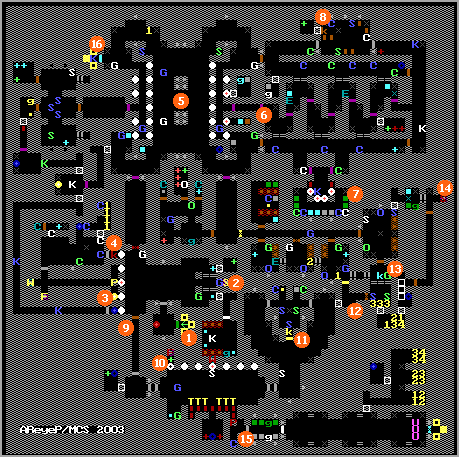 |  |
|---|---|

Enemies marked in blue appear in all difficulty levels. Enemies marked in green appear only in difficulty levels "I'm a Hero" & "Suicidal Tendencies". Enemies marked in white appear only in the difficulty level "Suicidal Tendencies" and "Tournament" mode.

## Level 11: Hidden Vault

**1.** You start here. The exit elevator is right opposite you, so your mission is to locate the elevator key and return here.

**2.** Looks like its time to start dodging some fireballs :) Time things nicely to run between bursts and use the alcoves on either side of the passages the fireballs travel down for cover. Don't forget to watch for enemies that may be lurking in the area as you do this.

**3.** Make your way through to here and you've cleared the fire hazard. There's also a secret pushwall here that hides a pair of switches you can use to turn off the fireballs.

**4.** Ahhh ... a handy secret area - there's an Artefact of Displacement in here that'll transport you through to point 3, saving you having to dodge the fireballs all the way there.

**5.** The bronze key!

**6.** The blood key can be found in this area ... there's also an Artefact of Death and a secret pushwall that, if you use your brain and not your brawn, may help you eliminate a few pesky clones without wasting ammo :)

**7.** The blood key will allow you to access this area.

**8.** Navigate your way through to here where the gold key is kept.

**9.** The gold key will get you into here where the elevator key is ... just be warned that this area is a potential deathtrap! A stealth rifle here will make things very easy :)

**10.** On to level 12! But ... there are a lot of goodies you may have missed along the way ... sure you want to go on just yet?

**11.** If you found that secret area at point 3 and turned off the fireballs, some goodies await you in this area here.

**12.** And if you found the secret pushwall here and threw the switch on the wall ...

**13.** ... then the remote pushwall in this secret area here will have opened up! It's a super secret area and you've done well to find it - enjoy the treasures within! This level wasn't named "Hidden Vault" for nothing :)

**14.** Cocky bugger!!! Didn't think we'd give you all the goodies for nothing eh? Enjoy the Ultraclone!!! But ... there's an Artefact of Fury and an Artefact of Invulnerability in this area that, combined, can make things very easy for you ... there's always an easier way isn't there? :)

**LEGEND**

| 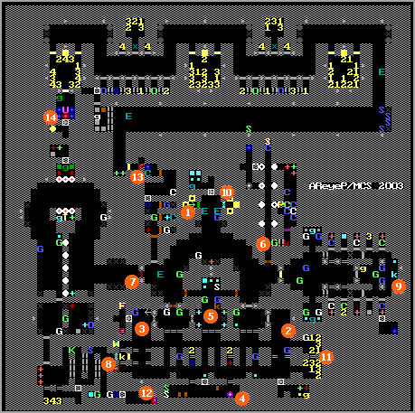 |  |
|---|---|

Enemies marked in blue appear in all difficulty levels. Enemies marked in green appear only in difficulty levels "I'm a Hero" & "Suicidal Tendencies". Enemies marked in white appear only in the difficulty level "Suicidal Tendencies" and "Tournament" mode.

## Level 12: Vault of Death

**1.** You start here. As with level 11, the exit elevator is right nearby, so your mission is to retrieve the elevator key.

**2.** Here's the bronze key ... mind you there's a nasty piece of experimental cyber technology looking on as you open the door here to grab the key. He'll walk into an Artefact of Displacement and you may wonder where he's gone to ... don't wonder for too long though as he'll soon be standing right behind you waiting to fill you with lead! In other words, run!

**3.** The bronze key allows access to this area, and this is where you'll find the blood key and some handy portable medkits for those occasions where you're cornered and need a bit of a boost. Make sure you've dealt with the Cyber Trooper before going on to step 4 though, as you don't want that pest running around bothering you!

**4.** The blood key will allow access to this area, and here you'll find an important wall switch that you must throw to allow access to where the gold key is stored. But, just as before, there's a Cyber Trooper watching you here ... same advice as before, run! You did destroy the first one, didn't you? What??? You didn't??? Well, now you have two of them to worry about - I told you to get rid of the first one, but you didn't listen!!!

**5.** The gold key! The switch at step 4 makes this area accessible, and now with the gold key you can grab that MCS Mk 3 nearby. Don't forget the hidden MCS Mk4 off the same room - very handy for those errant cyber pests!

**6.** The gold key will allow access to this area where you'll find another very important switch to throw. This switch will allow access to the elevator key. But once again, another Cyber Trooper is watching!!! Errr, you did get rid of the other two, didn't you?

**7.** The elevator key (and don't forget the handy rocket launcher nearby too)! You have a choice now ... you can run for the exit elevator and forget the Cyber Trooper, or you can stay and fight ... there's a lot of goodies to be discovered still after all!

**8.** Navigate your way through this series of pushwalls. You may even have to push one wall twice to get to the best stuff! (And what's a dunny doing in here?!! Write it off to poor design ethics :) You'll soon find you can access the areas where the Cyber Troopers started from, and collect some valuable trinkets and ammo in doing so.

**9.** And now the best secret ... a secret elevator! This will take you to the second Challenge level ... are you sure you want to try? You'll have to sacrifice all your ammo and weapon goodies should you do so (and there's always a coward's exit elevator at the start of a Challenge level should you find the going too tough), but nothing ventured, nothing gained, right?

**10.** Coward!!! So you're too afraid to try the Challenge level? Go on then you big baby! Level 13 awaits!!!

**LEGEND**

| 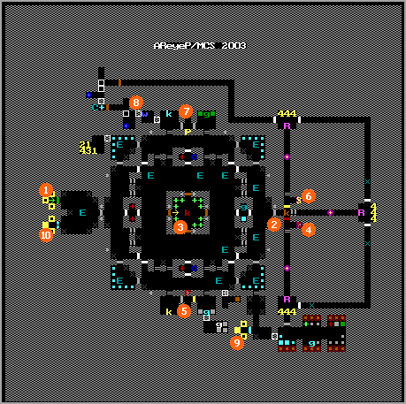 |  |
|---|---|

Enemies marked in blue appear in all difficulty levels. Enemies marked in green appear only in difficulty levels "I'm a Hero" & "Suicidal Tendencies". Enemies marked in white appear only in the difficulty level "Suicidal Tendencies" and "Tournament" mode.

## Level 13: Run & Gun!

**1.** You start here. Now a little word of advice ... if you're the type who likes to "test the waters" by firing a warning shot at the start of a level to see who comes running, well then you'll probably sink in the waters too! Explore the surroundings, and don't be afraid to see where the Artefacts of Displacement take you - they're there to help you! This level was named "Run & Gun" based on the tactics you may need to employ here!

**2.** If you haven't made any noise yet, then this is where the fun will start! Grab the rocket launcher and run, as the SS are on to you! Now you'll have to face a horde of them (of course if you have a stealth rifle things may be easier, but it's a lot more fun just using a machine gun or an MCS weapon - are you up to the challenge?) Now, when the SS converge on you at one end of the hallway, use the Artefacts of Displacement to teleport to the other end of the hallway! Keep moving, and keep pumping them full of lead as they descend on you, and use the rooms stocked with health and ammo at each end to replenish your reserves as the battle wears on. Eventually their ranks will thin and you should be in for a simple mop up operation :)

**3.** Now it's on to the next area ... and as soon as you enter here you'll have the SS pouring down on you once again! You can take them on with what you have, or you can just throw that switch on the wall here ... ahhhh ... the smell of burning flesh!!! Don't be surprised if a few officers and guards come running to see who in blazes activated the fireball machine on their SS mates :)

**4.** The bronze key!

**5.** The bronze key allows access here.

**6.** OK ... a couple of wall switches ... how to use them? There's a remote pushwall at point 9, which moves back and forth depending on which switch is thrown (let's just call it a security measure that's been put in place by order of Heinrich Haufmann himself :) The switch on the left moves the wall to the east, and the switch on the right moves it to the west. Similar switches are located at points 7 and 8. You'll need to use these switches to access the area at point 7 first, then use the switches here to access the area at point 8. From here you'll be able to access the office area where the blood key is located.

**10.** The blood key!

**11.** You'll have to use those wall switches again to get through to this point to use the blood key to open this door. Be careful ... there's potential for quite a bit of crossfire in the passage ahead if you use a noise making weapon! There's a hidden Artefact of Life and also one of Invulnerability you can find in the prison cells in this area which may come in handy.

**12.** The gold key!

**13.** Make your way to here ...don't be surprised if the SS have sent in reinforcements to inspect the carnage you meted out at the start of this level!

**14.** The exit stairway to this level is in this room - on to level 14!

**LEGEND**

| 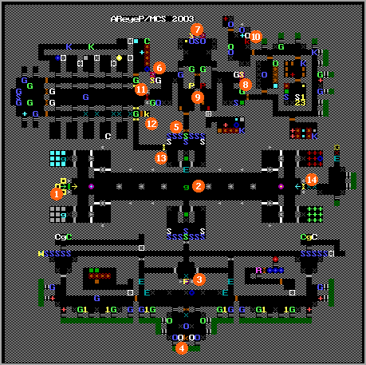 |  |
|---|---|

Enemies marked in blue appear in all difficulty levels. Enemies marked in green appear only in difficulty levels "I'm a Hero" & "Suicidal Tendencies". Enemies marked in white appear only in the difficulty level "Suicidal Tendencies" and "Tournament" mode.

## Level 14: The Old Stalag

**1.** You start here.

**2.** The fireballs here are going to be a problem dodging, and as you need to pass them, these are the first things you'll need to deal with. Unless you want to risk some damage and run through, it's time to find a switch!

**3.** The switch room here will turn those fireballs on and off. Flick both switches and now you'll be able to pass through area 2 safely. But before you do, on to step 4!

**4.** Navigate your way through the old run down stalag to this point her where you'll find the blood key. This area was once used to hold prisoners, but years of neglect have seen the buildings fall into a state of bad disrepair. This doesn't mean the place is abandoned though - be careful - your gunshots from earlier have been heard, and the enemy will be out in force looking for you, so be alert and watch your rear!

**5.** Once you have the blood key, it's time to backtrack to this point here and jump into the Artefact of Displacement. If any pesky SS come following you, you can use the switches in the gatehouses to fry 'em!

**6.** The blood key will allow you to access this switch room ... go on, throw the switch! What did it do? Well, we'll soon find out :) Use the Artefact of Displacement in the area here to warp back to the great outdoors.

**7.** The switch at point 6 opens this pushwall here which allows access to the gold key you would have seen through a window if you'd been exploring earlier. Grab the gold key, and head back to the Artefact of Displacement at point 5.

**8.** The gold key allows access to this switch room - throw the switch and then exit via the Artefact of Displacement again.

**9.** The switch you just threw will have opened the remote pushwall located in this area ... now you'll be yelling "Danger Will Robinson" as there's a nasty robot that's waiting to greet you! Oh and just for good measure, an Ultraclone ... awww, diddums!!!

**10.** Now ... did you notice all the Artefacts of Death here before? Did you wonder why there were so many? You have a Cyber Trooper and an Ultraclone hot on your tail ... Brains > Brawn ... go on, you figure out what to do!!! Geeeez ... still don't get it? Just run around to the other side of the fence near point 3 and lure the big baddies into the Death Artefacts, OK? Enough hints!!! :):):) Well ... maybe one more ... that Artefact of Invulnerability inside the area where the Cyber Trooper and the Ultraclone were will allow you to grab those 3 Artefacts of Life - too easy!!!

**11.** The exit stairway to level 15!

**12.** Oh and don't forget - if your health is getting low at any point during this level, there's an Artefact of Regeneration located here in the garden maze.

**LEGEND**

| 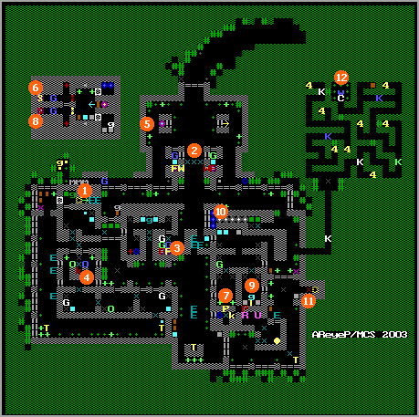 |  |
|---|---|

Enemies marked in blue appear in all difficulty levels. Enemies marked in green appear only in difficulty levels "I'm a Hero" & "Suicidal Tendencies". Enemies marked in white appear only in the difficulty level "Suicidal Tendencies" and "Tournament" mode.

## Level 15: The Underworld

**1.** You start here. You'll see a guard in front of you ... you can shoot him if you wish, or you can watch him disappear into the Artefact of Displacement he's heading for!

**2.** Curious? Where did that guard go to? (assuming you didn't shoot the poor fellow!) But then you've heard the saying "curiosity killed the cat," haven't you? Feeling like a cat? Go on - jump in!!!

**3.** OK, assuming you did take the dare in step 2, then you'd be feeling a little sore and sorry for yourself once these guys here introduce themselves to you! But, if you hit the ground running, and I do mean RUNNING, then you can race in to grab the Artefact of Fury in this area, and eliminate these guys with just one knife stab, and then grab the blood key and run. This isn't so hard to do on the easiest skill level, but there must be an easier way, as this isn't exactly fair, is it?

**4.** There's gotta be a better way than steps 2 and 3!!! And there is :) Instead of jumping into the Artefact of Displacement as described in step 2, make your way here to get the bronze key. You don't need the bronze key to complete this level, but it will make life a lot easier for you when it comes to getting the blood key!

**5.** Now navigate your way through the passages and rooms to this point here ... the bronze key will open this door. Go on, throw the switch inside and check outside the door ... now you know what this switch does :) Throw the switch again as you don't want those fireballs spewing out when you open the door to the room containing the blood key. Now, with the fireballs off, open that door leading into the blood key room ... stick your head in quickly and then run!!! Four bosses - and two of them are Ultraclones capable of regeneration! This is too much!!! Run back to the switch now, and throw it el pronto! Ahhhh, yes ... the smell of roasting robots and clone poops greets your nose as you watch the fireballs make light work of a nasty situation :) Just pray though that those Ultraclones don't regenerate too many times, or they just may get through!!! I wouldn't hang around in this area if I were you - retreat to a more remote location first and then check in periodically for the next couple of minutes just to make sure these guys stay down ... if they somehow make it through you may have to finish the job with a few bursts of firepower. Once the coast is all clear, the blood key is yours (and make sure to turn the fireballs off before going in to get it, won't you? BJ's skin burns easily after all!) Oh and that Artefact of Fury may come in handy if you rush out with the blood key only to find an Ultraclone has decided to make one last go of reincarnation ...

**6.** The blood key will open the way to this area here ... proceed onwards eliminating the pests as you go.

**7.** You'll come to this prison area next. An elaborate system of secret pushwalls has been constructed here ... the rewards to be found are not only an Artefact of Invulnerability, but a secret elevator! But you still need a key to open that lift door so don't get too excited just yet ...

**8.** Continue on your journey through this area ...

**9.** And down through here too ... not far to the gold key now ....

**10.** The gold key!

**11.** The gold key will allow access to a number of secret pushwalls in this area where you'll find the elevator key needed for the lift to the secret level.

**12.** The elevator to the fourth secret level!

**13.** And to get to the normal exit, make your way here - you'll have to do so anyway if you want 100% kills :)

**14.** On to level 16!

**LEGEND**

| 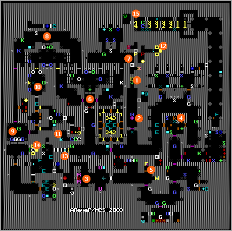 |  |
|---|---|

Enemies marked in blue appear in all difficulty levels. Enemies marked in green appear only in difficulty levels "I'm a Hero" & "Suicidal Tendencies". Enemies marked in white appear only in the difficulty level "Suicidal Tendencies" and "Tournament" mode.

## Level 16: Room of Stealth

**1.** You start here.

**2.** Now you COULD go this way ... but it's not going to be too easy! You'll have SS peppering you from inside their lair as you try to make your way around to get inside to them!

**3.** Now ... THIS is the smart way to do things! The Artefact of Displacement here will take you into the heart of the SS lair, but fear not - on to step 4 to understand all!

**4.** You warp in here, but be quiet now ... the SS all have their backs to you, but one noise and you'll have them all blasting away at you! However, there's a stealth rifle conveniently located on the floor in front of you ... pick it up, and use it! This is how this level derived the name "Room of Stealth". Pop those SS one by one. Yeah, OK, it's cowardly to shoot them in the back while they're not looking, but considering you're badly outnumbered, then I wouldn't think being a good sport is going to get you too far! Oh and don't forget the blood key in this room!!!

**5.** A secret area full of nice treasure goodies! But how to get in here? Well, just let the guard inside see you, but don't shoot him just yet! Instead, lure him out of the area so that he opens the locked door, and then eliminate him as he's coming through. Run through the door before it closes (if his body hasn't jammed it open that is) and all the treasure is yours! There's a gold key in this area too which will prevent you from becoming locked in, and will also allow you to access a secret armoury later on in the level.

**6.** You don't have to enter this area to complete the level, but there's a number of goodies including an MCS Mk 3, an Artefact of Life, an Artefact of Invulnerability, plus other little rewards that may make it well worth your while.

**7.** The bronze key! All's quiet, and it seems unguarded. It could be a trap, so be alert!

**8.** There's a spare bronze key here for those of you who manage to access this area and may find themselves "locked in".

**9.** Throw the switch here to move a remote pushwall which will allow access to the next area you need to visit.

**10.** The elevator key! Nearly done now ...

**11.** If you were able to get the gold key earlier on from the secret area at step 5, then you'll be able to open this armoury here. There's even an Artefact of Invulnerabilty and an Artefact of Fury hidden inside the armoury - the two combined will allow you to storm the remaining enemy survivors in this level without fear!

**12.** Throw this switch here to open the area where the exit elevator is located.

**13.** The exit lift - on to level 17!

**LEGEND**

| 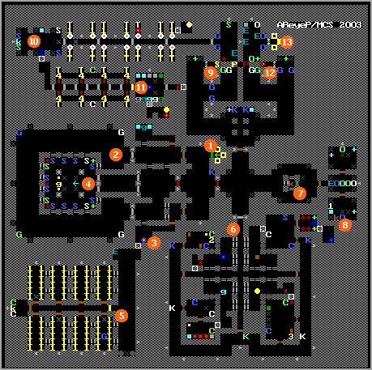 |  |
|---|---|

Enemies marked in blue appear in all difficulty levels. Enemies marked in green appear only in difficulty levels "I'm a Hero" & "Suicidal Tendencies". Enemies marked in white appear only in the difficulty level "Suicidal Tendencies" and "Tournament" mode.

## Level 17: Ambuscade

**1.** You start here. Timing is critical ... provided you don't loaf around inside the elevator for too long at the start, then as you open the elevator door you'll see a patrol of SS marching through the locked doorways in the large room in front of you. But once they leave this area, they won't be gone for long - they'll be back! Use the time you have to break some of those stone columns nearby to stock up on ammo if need be, and then grab that Artefact of Invulnerability!!! Now you're ready for them when they do return.

**2.** The blood key is located in this room - grab it!

**3.** I hate it when you get stuck in an area without a key, don't you? So, if you've rushed out into the corridor here and found yourself locked in and stuck without the blood key, there's a spare one hidden here.

**4.** Ahhhh ... looks like it's time for some fun!!! Throw the switch, and watch the barrels explode (and that poor SS guy with his back to you cop a nasty surprise!) And then, once you've played with the switches here and know what they do, it's time to proceed to the next step ...

**5.** Egads!!! A horde of SS and THREE Ultraclones!!! This is the ambush that the level derived its name from! Now unless you're brave (or just plain stupid), you'll realise this is a firefight you can't hope to win! Firefight? Did someone say "fire"? Ahah!!! Yes - brains > brawn! Once you've opened the door to this area and these guys are all coming for you, proceed back to the switch at point 4, and be quick about it too as they'll be hot on your heels! Throw the switch,and then peek through the window near the switch and relax ... it's fun watching what seemed an impossible task being dealt with so easily, isn't it? But, don't get too cocky! Just watch those Ultraclones, after all, you never know if one of them may just get through!

**6.** The next port of call is to here, where you'll find the bronze key. There's a rocket turret guarding the hallway leading to this office, so dodge any rockets as you head for here (and remember that the rockets can also eliminate any enemies you may encounter in the hallway should they be caught between you and the rocket turret - you can save ammo this way).

**7.** The bronze key will allow you to open a number of doors in the level and will make for some shorter travelling distances. Most importantly though, it will allow you to access this room here, where the gold key is stored.

**8.** You can access the area secured by the gold key here (or you can proceed to point 5 if you wish and do the same).

**9.** The elevator key!

**10.** The exit lift - on to level 18!

**11.** And for those who are into finding secret areas, this point here leads on to a series of nice little goodies :)

**LEGEND**

| 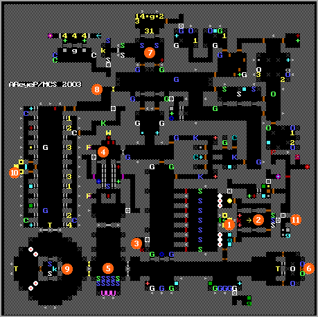 |  |
|---|---|

Enemies marked in blue appear in all difficulty levels. Enemies marked in green appear only in difficulty levels "I'm a Hero" & "Suicidal Tendencies". Enemies marked in white appear only in the difficulty level "Suicidal Tendencies" and "Tournament" mode.

## Level 18: Library Wing

**1.** You start here.

**2.** A quick trip through the corridors will bring you to the bronze key here.

**3.** And with the bronze key you can now access the library! Stop over here for a while (once those officers are out of your hair that is) and enjoy some good reading - there's Adolf Hitler's "Mein Kamph", Joseph Stalin's "A red night in Siberia", Mao Tse Tung's "A Bullet for your Brain", and Nelson Mandela's "From neckties to sainthood - fooling the western world made easy" to read and enjoy!

**4.** After all that enlightening reading, it's back to business! The blood key here is your next stop.

**5.** The blood key allows you to open this door where you'll find a wall switch. No doubt you've seen the gold key through the window here, well, throwing the switch will open a remote pushwall that will enable you to access the gold key.

**6.** Of course you'll have to navigate your way to this point to access the room with the gold key. It may have appeared as a simple storage room if you'd checked it earlier on, but the remote pushwall is out of the way now :) Oh, and there's a secret room here with an elevator key ... hmmm, elevator to a secret level somewhere perhaps?

**7.** With the gold key, you can now access this area.

**8.** The exit stairway! On to level 19!

**9.** Oh, and secrets ... if you found this switch earlier on, then throwing it will ...

**10.** ... open the remote pushwall here and reveal a secret Artefact of Displacement! This will take you to ...

**11.** ... this little room here. Did you find that hidden elevator key in the gold key room? If so, then open the door ... dare you try it? It's a secret elevator that will take you to Challenge Level number 3! Remember ... you'll lose all weapons and ammo if you take the challenge, and if it's too tough, theres a coward's exit near the start of the Challenge Level. You'll still get a 30000 point reward though. So, what have you got to lose? Its not that tough, really ... :)

**LEGEND**

| 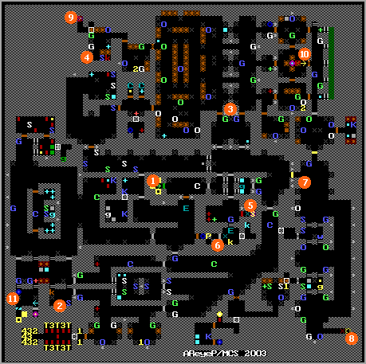 |  |
|---|---|

Enemies marked in blue appear in all difficulty levels. Enemies marked in green appear only in difficulty levels "I'm a Hero" & "Suicidal Tendencies". Enemies marked in white appear only in the difficulty level "Suicidal Tendencies" and "Tournament" mode.

## Level 19: Central Office

**1.** You start here.

**2.** Although you can explore a large part of the level first, if you'd like to get things achieved quickly, then head towards this point here first.

**3.** This is the Grand Hall for motivational speeches. Pass through here - the gold key is not far away now.

**4.** The gold key!

**5.** The gold key will allow access to this area which is heavily guarded by a group of SS. They're guarding the bronze key, so take 'em down and the key is yours. And how do you get into that central office area where the officers in there are running around taking potshots at you? We'll get to that later :)

**6.** The blood key!

**7.** The blood key will allow you to access the area here - this is the "central office switch control room" :)

**8 & 9.** These switches will open the remote pushwalls at points 10 and 11 respectively.

**10 & 11.** Once these remote pushwalls are opened as in the previous steps, this central office area will be accessible.

**12.** The elevator key. Warning! There's a Cyber Trooper here! But also in this central room is an Artefact of Invulnerabilty, and an Artefact of Fury - if you can lure the Cyber Trooper out of his lair and then get in there yourself, then you can grab these two artefacts and that Cyber Trooper is at your mercy!!!

**13.** On to level 20!

**LEGEND**

| 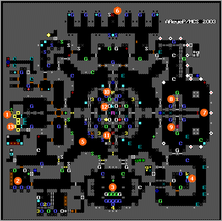 |  |
|---|---|

Enemies marked in blue appear in all difficulty levels. Enemies marked in green appear only in difficulty levels "I'm a Hero" & "Suicidal Tendencies". Enemies marked in white appear only in the difficulty level "Suicidal Tendencies" and "Tournament" mode.

## Level 20: Roundabout

**1.** You start here. The exit elevator is right next door, so the mission is to locate and retrieve the elevator key. If you're starting this level with only a pistol, then grab the pistol and ammo clip just outside the lift, and keep on the move, as the guards in this area will descend upon you as soon as you make an appearance! Also be on the alert for patrolling SS!

**2.** Make your way to this little room here, and throw the wall switch - this will activate a remote pushwall in the room just behind you.

**3.** With the remote pushwall moved out of the way, you can now access the blood key here.

**4.** The blood key will allow you to open the small switch room here. Throwing the switches will turn off those annoying fireballs in this area, and will allow you to move freely to point 5 (well, freely to a point anyway, as those SS in this same area will try to make life difficult!)

**5.** The bronze key!

**6.** The bronze key will allow you to access this area where the gold key is kept.

**7.** With the gold key in your possession, you can now access the office area behind the locked door here, but there's a better way as described in the next step ...

**8.** By accessing this secret area, you'll be able to grab an MCS Mk4, stock up on ammo, then use the Artefact of Displacement to teleport into the area at point 9 ...

**9.** ... and lookey lookey lookey! A nice Artefact of Invulnerability and also an Artefact of Life!!! Grab them, and then use your firepower to mow down all the office inhabitants with impunity!!! Once all is quiet, just use the Artefact of Displacement here to warp back to the secret area at point 8, and then make your way back to the office area via the locked door nearby, or via the one at point 7. All the hard work has been done, and you'll just need to carry out a simple mop up operation!

**10.** The elevator key, and also a spare gold key should you have somehow found yourself locked in this area.

**11.** Don't forget to throw the switch in this hidden alcove ...

**12.** ... as it'll open up this area (as well as let loose a lot of clones!) which is the gateway to lots of goodies!!!

**LEGEND**

| 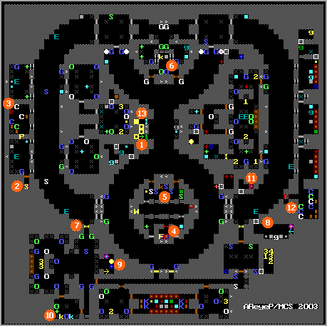 |  |
|---|---|

Enemies marked in blue appear in all difficulty levels. Enemies marked in green appear only in difficulty levels "I'm a Hero" & "Suicidal Tendencies". Enemies marked in white appear only in the difficulty level "Suicidal Tendencies" and "Tournament" mode.

## Level 21: A Little Secret

**1.** You start here. There's a handy secret area just to the left as you exit the elevator where you can pick up a machine gun and ammo as well as some first aid - very nice should you be starting the level with only a pistol.

**2.** The bronze key is here, but you'll have to watch carefully for enemies shooting at you from various adjoining rooms as you make your way to this point.

**3.** The bronze key will allow access to this area.

**4.** The gold key!

**5 & 6.** These steps aren't necessary for completing the level, but before you leave this area, why not throw the switches in these hidden rooms first? This level wasn't named "A Little Secret" for nothing, and these two switches are the first step you need to take in order to find a Super Secret area! But you must throw them in a certain order ... the switch at point 5 first, followed a few seconds later by the switch at point 6. Why you ask? Well, the switch at point 5 slides a remote pushwall to one position, whilst the switch at point 6 moves it from this new position to another position.

**7.** With the gold key in your possession, you can now access the exit elevator "foyer" area.

**8.** The exit elevator - on to level 22! But ... you are missing the best parts of this level if you haven't followed steps 5 and 6, and then all the steps to follow ...

**9.** That's the way!!! Curiosity may kill the cat, but it can also reward a very careful cat ... sometimes :) If you threw the switches as instructed in steps 5 and 6, then this area will now be open. But that locked door requires the blood key!!! Only one thing to try - jump into the Artefact of Displacement here and see where it takes you to ...

**10.** OK ... now this will require a little careful shooting. An MCS Mk4 plus two crates of MCS ammo have been generously provided here for your overkill convenience. The suicide clone you'll see running around here is no immediate threat as the railing in this room will prevent him from getting to you. But look - he has the blood key in there with him!!! If you shoot him while he's standing in front of that secret pushwall, then his body will block that pushwall and you won't be able to open it later on to get to the key! So wait until he moves away from that wall, and then let him have it! Or, you can just let him run around if you wish and deal with him after you open the pushwall (provided he doesn't block it while he's running around that is!) Whatever your choice, jump into the Artefact of Displacement here to exit the area and teleport back to the area at point 9.

**11.** Return to this room that you'd have visited earlier - with the clone behind the pushwall now either dead or on the move, try sliding the pushwall back. Provided the clone isn't blocking it anymore after you completed step 10, then it should slide back. And if so, then the blood key is yours!!!

**12.** Ahhh yes!!! Now you can open the locked door that required the blood key! But, if you do, you'll have a few Superclones to deal with! So, what to do??? Well, you can try wasting heaps of ammo and eliminating them the hard way, or you can do it the easy way. And just what is this easy way? Well, there's a secret pushwall behind one of the explosive barrels in this area that will solve your problem. This pushwall reveals a hidden wallswitch that activates a stream of fireballs to toast those nasty Superclones for you. How simple! The only problem now though is how to destroy the barrels so as to access the pushwall without destroying yourself? Trying to destroy the barrels from in the same room is suicidal as the blast from them will likely kill you (unless you're lucky or are playing on the easiest skill level), and, given there's a suicide clone in this room also, things are made even tougher. So, how do we get around this? Well, onto step 13 to find out!

**13.** Now, if you'd found this secret area before, then you'd have been able to shoot at those explosive barrels from a safe distance through the window without any risk of harming yourself. The pushwall at point 12 can now be safely accessed, and the Superclones toasted!!! Proceed onwards to step 14!!!

**14.** Some treasures to reward all your hard efforts so far, but the best is yet to come ... open the pushwall here, and you've finally found the Super Secret area! Considering all that you've had to go through to get to this point, then you deserve a good reward, don't you think? :)

**15.** There are six small rooms adjoining here where you'll find every weapon in the game from a lowly pistol upwards, plus ammo for each of them. That's the reward for finding the Super Secret area! But ... yep, you guessed ... there's more :)

**16.** There's a heap of SS here and no Artefact of Invulnerabilty to help - yet they guard the elevator key that can take you to a secret level!!! How to deal with these guys? On to step 17!

**17.** Now, near here you will see a small alcove with a machine gun, and an MCS Mk3. There are also 2 Artefacts of Death nearby - avoid them as they'll kill you immediately. But, stop and think ... these Artefacts of Death also kill the enemy!!! So, move out into a position where all those SS guys can see you, and then run and hide where the machine gun and MCS Mk 3 are located! The SS will come looking for you, but the Artefacts of Death will finish 'em off! Mind you, an Artefact of Death disappears after it's killed a certain number of enemies, so a number of stragglers will no doubt get through - have your weapon ready for them! Once they've all been eliminated, the elevator key (and 3 Artefacts of Life hidden nearby) are yours for the taking!

**18.** Finally, finally, FINALLY!!! After navigating the labyrinth of passages to get to this point, you'll find the elevator key will open this lift, and you're on your way to Challenge Level 4!!! You'll lose all your weapon goodies should you take the challenge ... but hey, there's a coward's exit elevator right near the start of the Challenge Level, so you'll at least earn bonus points for it. Go on!!! After all, nothing ventured, nothing gained, right?

**LEGEND**

| 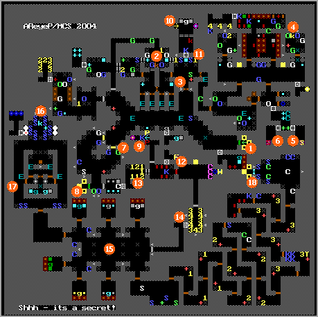 |  |
|---|---|

Enemies marked in blue appear in all difficulty levels. Enemies marked in green appear only in difficulty levels "I'm a Hero" & "Suicidal Tendencies". Enemies marked in white appear only in the difficulty level "Suicidal Tendencies" and "Tournament" mode.

## Level 22: Otto

There's not much to this level, just you, and Otto von Thugg! Welcome to his Dungeon of Death!

**1.** You start here. You have only a pistol, and a tough fight ahead.

**2.** As soon as you open the lift door, you'll have Otto right in your face!!! And you'll have some rockets in your face too if you just stand there staring!!! So jump into that Artefact of Displacement that's right in front of you without delay!!! Don't worry, Otto won't follow - he hates teleporters!

**3.** You've been warped to the other side of the level. And here, right behind you, is the exit elevator, but there's only one problem ... Otto has the key needed to unlock the elevator door! You have no choice ... Otto is on the move and is hunting you ... you'll have to navigate this dank dungeon that's littered with the remains of Otto's previous hunts, and search out weapons and ammo as you go, and be alert!!! Otto could be just around that next corner ...

**4.** Once Otto has been defeated and you have the key, it's to the exit elevator here and on to level 23!

**LEGEND**

| 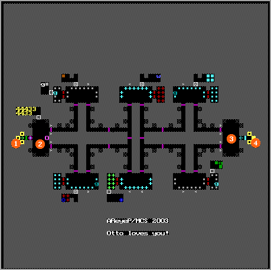 |  |
|---|---|

Enemies marked in blue appear in all difficulty levels. Enemies marked in green appear only in difficulty levels "I'm a Hero" & "Suicidal Tendencies". Enemies marked in white appear only in the difficulty level "Suicidal Tendencies" and "Tournament" mode.

## Level 23: UC Blue, IC Red

**1.** You start here.

**2.** This large outer corridor area is the central hub of the level, so it'd be best to clear this area of all guards first, and search for some secret pushwalls to stock up on ammo and first aid. You'll soon find why this level was given it's name also, as it's divided into distinctive halves of blue and red wall texturing. Although you don't have to follow the exact order of the steps below to proceed through the level, they're provided as a recommended course you can follow.

**3.** The blood key!

**4.** The gold key! Gee, this is easy so far!

**5.** Hmmm - there's a LOT of SS guys in here ... plus a rocket turret at either end of the hall! There must be an easier way ... and there is!!! In the corridor just to the left (or west if you prefer) of this room are a couple of breakable stone columns - behind these columns are a fireball wall device and a wall switch to operate it. Just break the column in front of the wall switch, open the door to the room with all the SS, let 'em know you're there, and then run back and throw the switch. Then just lean back against the wall and say to yourself "I love the smell of napalm in the morning!" Throw the switch again to turn the fireballs off and other than one rocket turret at the other end of the hall, and maybe a straggler or two, the area here at point 5 will be clear. Too easy!!!

**6.** The bronze key! Mind you, the rocket turrets on either side will make things difficult for you if you drag your feet - you can run in, grab the key, and run out again, or you can grab that rocket launcher hidden behind where the key is and take those turrets out and then grab the treasure goodies next to them :)

**7.** The elevator key!

**8.** On to level 24!

**9.** Bugger level 24!!! There's other things to be discovered! Such as a secret level! Now this chain of secret areas here won't lead you to any secret level, but there are 3 Artefacts of Life and a rocket launcher to be discovered. If you're wondering how to get by these rocket turrets surrounded by deadly explosive barrels, then use that Artefact of Invulnerability hidden nearby to make the task easy.

**10.** Now we're getting into the nitty gritty of how to get to the secret level! When you access this secret area, you'll notice that the Artefacts of Death here form an impenetrable barrier. Of course you could use the Artefact of Invulnerability near point 9 to get through, but the time it takes to get to this part of the level from there will mean you'd have to be quick. But, there's another way (ain't there always? :)

**11.** Hidden behind a secret pushwall here is a wallswitch ... throw it and this will open a secret pushwall near point 12.

**12.** This hidden alcove is revealed after throwing the switch at point 11. Jump into the Artefact of Displacement here (don't forget to grab the Artefact of Life also if you want a health boost) and you'll be warped to point 13.

**13.** Grab the treasure goodies in this area, and eliminate the SS in the small adjoining room.

**14.** Access this secret room and throw the hidden wallswitch. Then jump into the Artefact of Displacement in the adjacent small room.

**15.** That last wall switch opened the remote pushwall here, and now you have 3 Artefacts of Invulnerability at your disposal!!! That's 90 seconds of God mode!!! Grab them, and back to point 10 to go through those Artefacts of Death that previously blocked your way! But leave a few Artefacts of Death as you'll find they may just help with the next step, as you're about to encounter TWO Cybertroopers once you open that door just behind the Death Artefacts!!! Lure the Cybertroopers into the Artefacts of Death just outside the room - they'll soon be a thing of the past :) If however you fail to lure them into the Death Artefacts, then use your firepower combined with those Artefacts of Invulnerability to bring 'em down. Once that's done, all the treasure goodies in their lair are yours for the taking. Congratulations - you've found a Super Secret!!!

**16.** A secret elevator as a reward for finding a Super Secret! On to Super Secret Level 4!!!

**LEGEND**

| 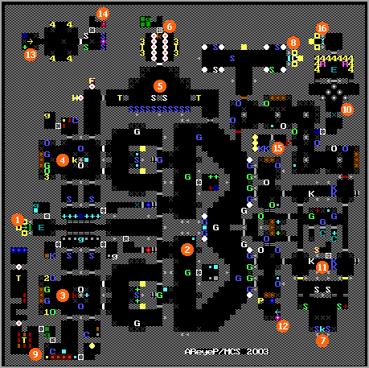 |  |
|---|---|

Enemies marked in blue appear in all difficulty levels. Enemies marked in green appear only in difficulty levels "I'm a Hero" & "Suicidal Tendencies". Enemies marked in white appear only in the difficulty level "Suicidal Tendencies" and "Tournament" mode.

## Level 24: Heinrich's Admin

**1.** You start here.

**2.** This storage room is a good little spot to replenish your health and ammo, as once the firefight starts, you'll find you'll have a number of enemies to deal with as they come to investigate the disturbance you'll inevitably create.

**3.** Make your way down here (destroy that pesky rocket turret too) ...

**4.** ... and then battle your way through to this point where you'll find the blood key. You'll notice the exit elevator is in this area too, but you won't be able to access it without the elevator key. Now you'll have to backtrack along the way you came to get here to move on to step 5.

**5.** The blood key will allow you to access this area. There's an Artefact of Invulnerability hidden nearby too that may come in handy.

**6.** The bronze key!

**7.** Make your way down to the library here which will now be accessable with the bronze key.

**8.** The gold key! Just one more key to go now ...

**9.** With the gold key you can access this area.

**10.** The elevator key!

**11.** On to level 25! This level wasn't so bad was it?

**12.** Mind you, there's a Super Secret area to find in this level, so before proceeding on to level 25, let's discover this! The switch located in this hidden area here can be accessed earlier on in the level. By throwing it, you open a pushwall just behind you - be careful!!! There's a rocket turret that will be waiting to launch it's deadly arsenal right up your rear end if you stand there scratching your head! Take out the rocket turret and then proceed to the next step.

**13.** By moving another pushwall a couple of times (first sliding it back to reveal a backpack of ammo, and then sliding it sideways), you'll find this wallswitch. Throw it, and then on to the next step!

**14.** Break the stone columns here, as this is where the remote pushwall you activated in the last step has now moved back, revealing a narrow corridor. Congratulations, you've found a Super Secret area!

**15.** Lots of clones to deal with, but lots of valuable treasure goodies to collect too! Plus an Artefact of Life to replenish any health those inconsiderate clones took from you :)

**LEGEND**

| 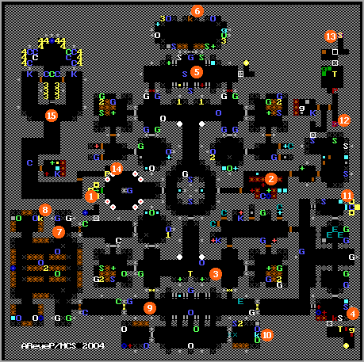 |  |
|---|---|

Enemies marked in blue appear in all difficulty levels. Enemies marked in green appear only in difficulty levels "I'm a Hero" & "Suicidal Tendencies". Enemies marked in white appear only in the difficulty level "Suicidal Tendencies" and "Tournament" mode.

## Level 25: Heinrich

Finally you are about to face Heinrich Haufmann himself. He's laid an ambush for you. Grit your teeth, and prepare for the fight of your life!

**1.** You start here.

**2.** This secret area is a handy stopover if you're starting this level with only a pistol and 8 rounds of ammo.

**3.** Throughout the level you'll notice a few locked doors that require the blood key to open them. There are handy items to be picked up in these rooms, so when things start to get chaotic, remember to check these rooms out for essential goodies!

**4.** From this area you'll be able to see the object your entire quest has revolved around - the Spear of Destiny itself!!! But without the gold key, you won't be getting in there. And you can just back it in that Heinrich Haufmann himself will be in possession of that key!

**5.** The "Chapel of the Spear". Here you'll find a lot of portable medkits - what a pity you can only carry two at a time! Plus, in the centre of the chapel, you'll find an Artefact of Regeneration that may come in handy for "spiritual healing" :)

**6.** At the altar of the chapel you'll find the bronze key.

**7.** Stock up on stealth rifle ammo here and wherever else you may find it - you'll find it may come in very good use soon!

**8.** Ahah!!! The blood key!!! But as you run in to get it, you'll hear an ominous voice from behind ... it's none other than Heinrich himself! All Hell is about to break loose, as the ambush Heinrich has put in place has been triggered! There's a stealth rifle in this small room too - grab it now and get ready to run, for Heinrich is on your heels!

**9.** Run through to here. Grab the MCS Mk3, but my advice is to stick to the stealth rifle for the time being. Then, exit via the locked door - you have the blood key now and you'll be able to open it!

**10.** Run along here and use the stealth rifle to pick off enemies as they come. There'll be quite a few coming from all directions now that Heinrich has set off the alarm! Keep going forward - remember, the stealth rifle is useless against bosses, and the best bet is to eliminate all the other guys running around before you try to take him on.

**11.** Run into this room and eliminate any pests that may try to stop you. There's a small storage room here and you'll find a very handy rocket launcher in here - just the type of thing to take Heinrich on with!

**12.** A cache of MCS ammo can be found here, and an MCS Mk4 behind an explosive barrel. Grab it if you can, but be aware, Heinrich will still be hot on your heels and so you can't afford to drag your feet! It may be an idea to circle around the level with your stealth rifle picking off all the other enemies as you go, and save Heinrich for last.

**13.** There's a hidden wallswitch here you can access at any time after you have the blood key, but it'd be best to have Heinrich dealt with first, as the pushwall this switch opens will reveal another nasty that's best dealt with seperately :) Oh and don't forget to pick up the gold key Heinrich drops once you've floored him!

**14.** And that switch at point 13 reveals ... a Superclone!!! If you can lure him out, there's an Artefact of Fury in his lair that you can use to bring him down with one stab if you'd like. Once he's dealt with, there's an Artefact of Life in here and a nice treasure trove to raid :)

**15.** The gold key will now allow you to access this area - slide the pushwalls back and collect the treasure goodies you find.

**16.** Now ... there's a trick to this switch. It won't do anything unless you first slide back every pushwall in the vicinity of point 15, finishing with the one at point 17. Once you've slid that pushwall back, then the switch here will slide it back one more position, revealing a Super Secret area!

**17.** The switch at point 16 will open the way to accessing this area - you've just found a Super Secret!

**18.** A room full of treasure goodies. Just watch the SS inside guarding it :)

**19.** Finally!!! The Spear of Destiny. It's yours for the taking. Go ahead - you deserve it. But what horrors await you once you do take it? The game isn't over yet ...

**LEGEND**

| 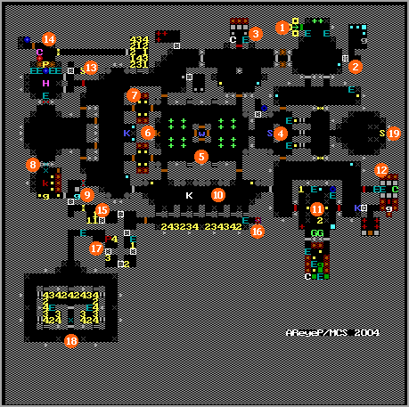 |  |
|---|---|

Enemies marked in blue appear in all difficulty levels. Enemies marked in green appear only in difficulty levels "I'm a Hero" & "Suicidal Tendencies". Enemies marked in white appear only in the difficulty level "Suicidal Tendencies" and "Tournament" mode.

## Level 26: Hell on Earth

You have the Spear of Destiny, but now, you have to FIGHT to earn the right to possess it!!!

**1.** You have the Spear of Destiny now ... and you'll have to use it!!! That's right - no longer do you have rocket launchers or MCS weapons to aid you - the Spear has it's own powers, and now you'll have to use them!

**2.** From here you'll warp into Hell on Earth itself!

**3.** And now there's no turning back. Flames, and red hot scorching walls of lava lay ahead of you. What was once the realm of Heinrich Haufmann has been consumed by the evil of Hell itself. There are roaming flame spirits you'll need to avoid as you explore, so keep an eye out for them. A blast from the Spear will stifle them momentarily, but not for long. And the lava walls are so intensely hot that standing too close to them will scorch you, so keep your distance where you can.

**4.** The centre of what was the "Chapel of the Spear". The Artefact of Regeneration is still here though - you may need it as there's no first aid kits around! But there are a number of other Artefacts of Regeneration around that you may need, and also some Artefacts of Life that will be Godsends in the battles that await you!

**5.** What??? You've met this guy before, but this time, he's the epitome of Hell! The Hellspawn of Grau Adler awaits you!!!

**6.** Once you've eliminated Grau Adler, then the Hellspawn of Baron von Schmitt will be waiting here for you! He promised Heinrich Haufmann with his dying words that he'd be waiting for you in Hell, and he's keeping his word!

**7.** With Baron von Schmitt out of the way, you'll now face your final challenge at this location. When the minions of Hell can't destroy you, Hell sends it's best, and this is it - good luck! And should you succeed, congratulations. You've seen the End of Destiny.

**LEGEND**

| 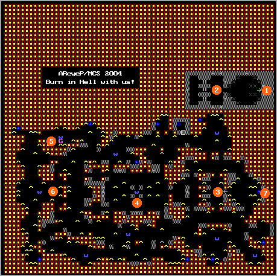 |  |
|---|---|

Enemies marked in blue appear in all difficulty levels. Enemies marked in green appear only in difficulty levels "I'm a Hero" & "Suicidal Tendencies". Enemies marked in white appear only in the difficulty level "Suicidal Tendencies" and "Tournament" mode.

## Level 27: Deja Vu 3

This is the first secret level in the game, accessed from the secret lift found in level 2. And why is it named "Deja Vu"? Well, it's designed to make you think you're in a place you've been somewhere before, when in fact you'll be somewhere completely different! And why Deja Vu 3? Well, there's two reasons for that. Firstly, there are 3 areas in this level all designed to look the same. And secondly, the first Deja Vu level was in my mod "Wolfendoom", and the second one was in "Spear Resurrection". This is the third and in my opinion the most confusing of the three :)

**1.** You start here. Just outside the lift door you'll see a storage room behind some windows, and if you look through these windows carefully, you may even see the blood key in there. The first seed of a cunning deception has been sown!

**2.** Work your way through to here, and throw this wall switch in this little "switch room." You'll notice the locked door near here (at point 19) requires the blood key - didn't you just see the blood key before in that storage room near the lift? The wall switch you've just thrown didn't seem to have any nearby effect - maybe it opens up this storage room? Better go back to check ...

**3.** Ahah! So that's what the switch did!!! It opened a section of wall revealing an Artefact of Displacement!!! Get ready to hop in! And stop to think a while - the area you're about to leave is about to become a secret area! In other words, you won't be able to return here unless you access some other secret areas first.

**4.** After jumping into the Artefact of Displacement, you'll find yourself in the storage room with the blood key!!! But wait! Is this really the same storage room you saw before??? It looks the same ... in fact it looks identical. And that's to fool you into thinking you're in the same place! Grab the blood key, break the stone column, and push the pushwall just behind it to get out into the room with the lift. It's a totally different location but you'll swear you've just been here - deja vu!

**5.** Once you open this door you'll realise you ain't in the same place as before. A number of angry SS will greet you, and once you've eliminated them, you'll find you won't be able to explore much further (other than a few prison cells) without getting the bronze key, as the locked doors in this area need precisely that.

**6.** Well, there's really only one way to go, and that's to try the Artefact of Displacement again. Maybe it'll take you back to the area you started this level from and to where the locked door requiring the blood key was?

**7.** Hmmm ... everything looks just the same as where you've just come from!!! The broken stone column, the pushwall you moved earlier ... you've just left this area! Or so it seems ... by this time confusion should be setting in! You are in fact once again in yet a completely new area, but you're being led down the garden path!

**8.** A lot of people wouldn't think to check the elevator here for a pushwall, especially if they checked the elevators in the previous areas and found nothing. At this point you may be more preoccupied with finding out just where in blazes you really are, but, if you think to check here, then there's a nice rocket launcher to be found, plus some other pushwalls that lead to an Artefact of Invulnerability, plus also the initial area you started this level on! And if you have that blood key, you'll now be able to open the locked door at point 19!

**9.** When you open the door here you'll know you're in a new area for certain, as a pesky rocket turret (and a few guards) will be waiting for you.

**10.** The bronze key, but how do you get back to the area you were in before where the locked doors needing the bronze key were? Simple - just jump into the Artefact of Displacement near point 7, and you'll find yourself back at point 4.

**11.** Make your way to here - the most confusing parts of this level have now been completed.

**12.** Here's your first chance in the game to try the combined power of an Artefact of Invulnerability and an Artefact of Fury, and earn a few extra points as you do so! When you grab these two Artefacts, a group of enemies will descend on you from down the corridor - go out and face them head on without a fear in the world, and see what one knife stab can do when you're all souped up like this!

**13.** This hidden switch opens the pushwall near point 20, making a number of valuable treasure goodies accessible.

**14.** The gold key. Just be warned though - when you go to grab it, it'll alert a number of nearby SS who'll be wanting to take the key off you.

**15.** A few treasure goodies in the SS lair, plus a hidden gold key should you somehow get stuck in this room before you retrieved the other gold key.

**16.** Make your way back to this point, and use the gold key to open the door here (alternatively you could enter the same area from the other end via the locked doors near point 9).

**17.** The elevator key is hidden in this small storage room within the prison complex.

**18.** The exit elevator! Congratulations - first secret level completed! On to level 3!

**19.** Of course if you haven't already done so, use the blood key to open the door here and grab the goodies within ...

**20.** ... and whilst grabbing the goodies in the previous step, grab the extra nice goodies here (you did throw that wall switch at point 13 didn't you?)

**LEGEND**

| 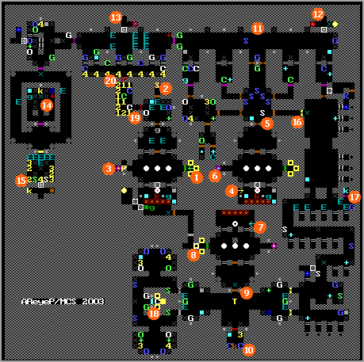 |  |
|---|---|

Enemies marked in blue appear in all difficulty levels. Enemies marked in green appear only in difficulty levels "I'm a Hero" & "Suicidal Tendencies". Enemies marked in white appear only in the difficulty level "Suicidal Tendencies" and "Tournament" mode.

## Level 28: The Mirror Rooms

This is the second secret level in the game, accessed from the secret lift found in level 8. Named after the two central rooms that are almost mirror images of one another, this level has the potential to be as confusing as the first secret level (Deja Vu 3).

**1.** You start here.

**2.** This room full of Artefacts of Displacement can be accessed by breaking one of the stone columns seperating it from the outer passage. All the Artefacts will transport you to point 6, except for this particular one, which will transport you to point 3. Now the tricky thing is that when you teleport to point 3, it won't look any damned different to if you teleport to point 6. Confusing? It's designed to be :)

**3.** Ahhh yes ... take the right Artefact of Displacement and you'll be here! You'll see a door in front of you - open it (and have that weapon ready to take on the horde of guards inside)!

**4.** The bronze key!

**5.** This particular Artefact of Displacement will take you back to point 6. All the others will just dump you at point 3 and you'll be getting nowhere fast.

**6.** Be careful, as once back here, you'll find there'll be a lot of guards that weren't here before making you wonder if you are indeed back in the same area or somewhere new! Once you've eliminated them, move forward to the storage room through the door in front of you.

**7.** The bronze key will allow you to open these doors.

**8.** The blood key! But, be warned!!! This is a death trap ... as soon as you go to grab the key, the doors in this room will open and you'll have not only a few SS on your heels, but an Ultraclone! Totally unfair? Well, if you're a good player you'll be OK ... but there has to be an easier way, right? And there is ...

**9.** It pays to explore your surroundings thoroughly and be aware of your environment before hastily going straight for your goal. Before you grabbed the key, you may have seen this Artefact of Invulnerability through the window to this storage room. Of course you'll need the blood key to open the doors to access this, but once you have that, and the Ultraclone and SS are on your heels, then this room would be the first place you should come to. Oh and watch for the annoying suicide clones in here - can't make it too damned easy you know!

**10.** And if you'd explored this area, you'll have found there's a handy Artefact of Fury here. If you grab the Invulnerability Artefact first, and then head straight for this, old Mr Ultraclone will be a piece of cake for you! Just watch he doesn't regenerate when the effects of the artefacts expire after 30 seconds ... making a run from this area before then is probably a good idea :)

**11.** Now that you have the blood key, you can use this little room as a thoroughfare from one "mirror room" to another, and avoid the confusion that may come from using the Artefacts of Displacement . There's a stealth rifle in here as a bonus reward also.

**12.** The blood key will allow you to access this door.

**13.** Deal with the guards in this corridor (and through the window at the end), and access the area behind this door. You're now about to enter an area that requires some logical thinking.

**14.** Fireballs shooting down corridors, and wall switches that move a pushwall from one point back to another. The concept is relatively simple, but it may not seem that way at first! You need to get to point 15, but in order to do so safely, you need to stop the fireballs that are travelling down the passage leading to that point. There's no switch around here to turn the fireballs off, so you'll have to throw one of the wall switches here to slide the pushwall across and block the fireballs off. Once you've done that, you can safely move to point 15.

**15.** Don't forget to check for pushwalls as you make your way to this area as there are some handy goodies to be had!

**16.** The gold key! And like with the blood key, a death trap awaits! The horde of SS that will descend on you as you go to grab the gold key will be a little tough to deal with all at once (and you'll use a lot of your ammo as well), so why not make your way back to the area at point 14, and throw one of the two wall switches to slide that pushwall back so that the fireballs travel down the passage to this area again? And then sit back and let them toast those pursuing SS for you :) Throw the other wall switch once you think the job is done so as to make it safe to return to where you found the gold key at point 16.

**17.** Curious to know what's in this area? Lots of goodies, and another bloody Ultraclone!!! Just follow the same routine as described in step 16 above, and you'll take care of this bugger the easy way :) Once that's done, there's LOTS of goodies to be found in here (including quite a few that can be found by repeatedly pushing back a pushwall down a corridor lined with rocket turrets :)

**18.** Next thing is to make your way to here. You'll have to proceed to the area at point 14 and follow the same routine as described in step 14 to block off the fireballs shooting down the passage leading to this area. Watch for the greeting party of SS up here also!

**19.** Finally, the elevator key! There's also a hidden room with switches to turn off the fireballs if you'd like, and a hidden Artefact of Displacement to take you back to point 3 to save you a long walk back there :)

**20.** The exit elevator - on to level 9!

**21.** A secret elevator in a secret level? Where could this go? It leads to Challenge level number 1, so if you've found this secret level you've just finished a challenge, you ain't seen nothin' yet! Do you dare to try?

**LEGEND**

| 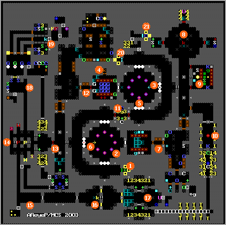 |  |
|---|---|

Enemies marked in blue appear in all difficulty levels. Enemies marked in green appear only in difficulty levels "I'm a Hero" & "Suicidal Tendencies". Enemies marked in white appear only in the difficulty level "Suicidal Tendencies" and "Tournament" mode.

## Level 29: E1L1 Reborn

This is the third secret level in the game, accessed from the secret lift found in level 10, and is named after the very first level in the original Wolfenstein 3D from id software (from which this design is based around). Who can forget that level? For many of us, it was our very first Wolfenstein experience! This version has had a number of sinister modifications though ...

**1.** You start here.

**2.** This secret pushwall is a good first port of call to top up with ammo - you'll need it for the pesky clones in the cells around here.

**3.** Next up is this pushwall to get the blood key in the cellroom here.

**4.** The blood key will allow you into this area. Don't miss the pushwall off this room that leads to a rocket launcher and some treasure goodies also.

**5.** The bronze key!

**6.** The bronze key grants access to this area.

**7.** This hidden MCS Mk 4 and ammo may come in handy soon, so grab it up!

**8.** There's a wall switch in this room - you'll need to throw it to continue through the level. What did it do you wonder? Don't ask questions! For, once you've thrown that switch, there'll be an Ultraclone on his way to visit you!!! He'll take a good minute or so to reach you, but you can't afford to delay too long! Read on for the best method with which to deal with this looming threat ...

**9.** This is where the Ultraclone comes from, and the switch you threw in the last step opened the remote pushwall here allowing the big guy out! He'll move from here upwards towards where you are, so you need to be ready for him!

**10.** These hidden Artefacts of Invulnerability and Fury are the key to beating the Ultraclone easily. Grab these after you've thrown the wall switch (as described in step 8), and then move down towards where you started the level from. You'll soon meet the Ultraclone on the way, and with these two Artefacts active, you'll be able to bring him down with one knife stab and not fear even being scratched yourself.

**11.** Once you've dealt with the Ultraclone, make your way immediately to here. Grab the gold key, and those Artefacts of Invulnerability and Fury as well, as there's every likelihood that the Ultraclone will be back on his feet and in hot pursuit! The extra Artefacts of Invulnerability and Fury hidden here will give you even more time in this super mode, and allow you to put a final end to the Ultraclone so that he won't be getting up again!

**12.** Finally, with the gold key in your possession, you'll be able to access this area.

**13.** Secret pushwalls in this area will not only reward you with treasure goodies, but this wall switch here will open the remote pushwall at point 14.

**14.** With the remote pushwall opened here after throwing the wall switch as described in the last step, you'll be able to access this stealth rifle as well as a few extra treasure goodies.

**15.** These two wall switches control the fireballs spewing out in the room from which this secret area is accessed.

**16.** The elevator key!

**17.** The exit elevator - on to level 11.

**18.** And true to the original level 1 of Episode 1 in the original Wolfenstein, here's a secret elevator! On to Super Secret level 1!!!

**LEGEND**

| 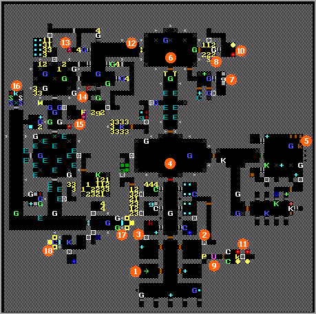 |  |
|---|---|

Enemies marked in blue appear in all difficulty levels. Enemies marked in green appear only in difficulty levels "I'm a Hero" & "Suicidal Tendencies". Enemies marked in white appear only in the difficulty level "Suicidal Tendencies" and "Tournament" mode.

## Level 30: The Panic Room

This is the fourth secret level in the game, accessed from the secret lift found in level 15, and is named after the movie "The Panic Room" where the idea for this level came from :)

**1.** You start here.

**2.** Now once you leave the elevator, you'll find a whole heap of Cybertroopers and Ultraclones waiting to greet you! You haven't got a snowball's hope in Hell of beating these guys, so it's time to panic! Thankfully, the "Panic Room" is right nearby :)

**3.** Run into here and throw the wall switch here straight away! The rempote pushwall at the entrance to this room will slide across, and lock you safely in here where the big guys can't get to you. Mind you if you delay in throwing the switch here you may end up with one of them inside the room here with you, and methinks you'll be starting this level again if that happens :) Once you're safely in here, use the secret pushwalls to exit here safely. And don't worry about all the boss guys - they're on the loose, but they can't stray too far from their lair just yet.

**4.** Make your way to here. All seems quiet enough in these hallways ... at least for now it does :)

**5.** The bronze key!!! But be careful geting into this room - all the Cybertroopers and Ultraclones are in that room behind the windows, and will be shooting at you if they can see you!

**6.** The bronze key opens this door.

**7.** Have you been wondering how you're going to get rid of all those Cybertroopers and Ultraclones? Well, here's the easy way!!! Throw this wallswitch, and then sit back, and enjoy! You can open the door if you wish to take a peek, and watch the fireballs toast the big boys :) This will eliminate most of them, but not all of them - there's still a bit more work to be done first!

**8.** Carefully navigate your way down this snaking passage being careful to avoid the Artefacts of Death placed in a straight line through here. Then, push the pushwall at the end, and then run back carefully up the snaking passage and wait ... the remaining Ultraclones and Cybertroopers will attempt to follow you, and the Artefacts of Death will be their undoing! Once they've been taken care of, move back down to check the coast is clear, and the lair that was infested with the big guys is yours! There's an Artefact of Regeneration at point 8 also which will bring you back to 100% health if you should be feeling a little sore and sorry :)

**9.** The gold key! And lots of treasure goodies! The big guys are all taken care of, and the spoils of victory are yours to enjoy!

**10.** Now that you have the gold key, you'll be able to open this door here. Be warned, all the commotion you've created with destroying all the Cybertroopers and Ultraclones will have the hallways you came through earlier swarming with guards, so things are about to get busy again!

**11.** The elevator key! Be careful of all the guards in the passage on the other side of the windows as they'll be taking plenty of potshots at you!

**12.** The exit lift - on to level 16. But there's more to be found for the adventurous player ...

**13.** The blood key. Now, you don't need the blood key to finish this level. But many goodies will be missed if you don't bother to collect this key. You may have noticed a lot of locked doors earlier on that require the blood key to be opened, and behind these doors lie treasure goodies galore! But the corridors and halls will be swarming with bad guys now, so you'll have to fight for the treasures!

**14.** Now this is a good first port of call to stop in at before you venture forth on your treasure hunt. An MCS Mk4, a backpack of ammo, and crates of MCS ammo. What more could a soldier of glory want?

**15.** Treasure storage area 1 is behind these locked doors. Just watch the clones laying in wait inside!

**16.** Treasure storage area 2.

**17.** Treasure storage area 3.

**18.** And what do you know? A secret elevator!!! Goodie goodie gumdrops! On to super secret level 2!!!

**LEGEND**

| 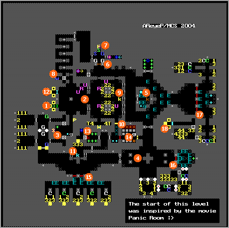 |  |
|---|---|

Enemies marked in blue appear in all difficulty levels. Enemies marked in green appear only in difficulty levels "I'm a Hero" & "Suicidal Tendencies". Enemies marked in white appear only in the difficulty level "Suicidal Tendencies" and "Tournament" mode.

## Level 31: Greed

This is the first super secret level in the game, accessed from the secret lift found in secret level 3 (level 29), and derives its name from the greedy clones (and you, the greedy player!) who'll be competing to grab up as much treasure as possible :)

**1.** You start here with only a knife!

**2.** From this area you'll be able to wander at a leisurely pace around the outer passageway looking in through the windows at all the juicy treasure goodies that await you!!!

**3.** Now, are you ready? Once you open one of the three doors here leading into the inner area of the level housing all the treasures, you'll see a number of suicide clones. Now these clones won't be wanting BJ to go stealing their goodies, so they'll all start racing off to grab up every treasure they can for themselves! The race is on!!! It'll only take a minute or so for all the goodies to be grabbed up, so don't dilly dally! The suicide clones will ignore you while there's treasure to be collected, unless you get too close to them that is! And being that you have only a knife and therefore can't shoot them from a safe distance, and that there's heaps of explosive barrels all over the place, combined with the fact there's no first aid to be found anywhere (other than a slow healing Artefact of Regeneration at the centre of the level), then you won't want to get too close to them!!! You'll just have to run in and grab up as many treasure goodies as you can. Make sure to go for the crowns first as they're worth 5000 points each!

**4.** The gold key here isn't needed, but may make your escape from the suicide clones a little easier should you be over near the three locked doors near point 2 when all the treasures have been collected.

**5.** When all the treasures have been collected, you'll hear a loud "gong" sound. Two things will happen at this point - the elevator key will appear on top of the Artefact of Regeneration here, and the suicide clones will come hunting for YOU! Time to grab the elevator key and get the hell outta here!!!

**6.** The exit elevator ... now, you can exit to level 11, or ... there's a pistol in the lift ... now maybe this would be good for paying back those troublesome suicide clones? There's only 4 rounds of ammo in the pistol though, so it's not exactly going to do too much. But it is a beginning ... care to have a bit more fun on this level?

**7.** A secret pushwall concealing a measly single clip of ammo. Not much, but enough to get a lot more!

**8.** Now to collect the bronze key here with only a knife would have required you to stab one of the explosive barrels surrounding it, and you'd be extremely lucky to survive the subsequent blast. But with the pistol and the extra rounds of ammo from the secret area mentioned in the previous step, you'll be able to shoot at these barrels from a safe distance. Blow 'em up, and the bronze key is yours! Just watch for those damned suicide clones whilst you're doing this!

**9.** The bronze key will open the locked door here, and you'd better have a few rounds of ammo left as the suicide clone in here will take a nice chunk of your health if you don't! Then slide back the pushwall here and the rocket launcher is yours (oh and another suicide clone too :)

**10.** The bronze key also opens this door, and behind the pushwall here a machine gun and 2 crates of ammo will be yours for the taking! Oh, and more bloody suicide clones too ... I guess goodies never come for free you know ... oh and don't forget the blood key in this area either!!! But be warned ... now that you have some firepower, you'll be needing it. The SS you just killed in here had time to alert their comrades on the other side of the level when they heard you bursting in, so you'll be needing that ammo before too long!

**11.** If you make it back here you'll find there's quite a few SS to deal with. Eliminate them and then there are two Artefacts of Life in this room that can be accessed with the blood key.

**12.** Another two Artefacts of Life! And now, it's time to go to the exit elevator at point 6 and depart this level (unless you want to go searching out stragglers first :)

**LEGEND**

| 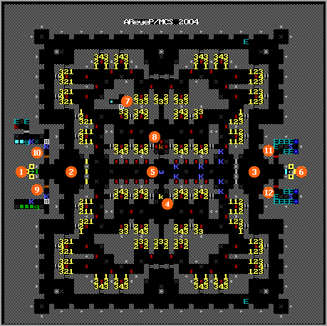 |  |
|---|---|

Enemies marked in blue appear in all difficulty levels. Enemies marked in green appear only in difficulty levels "I'm a Hero" & "Suicidal Tendencies". Enemies marked in white appear only in the difficulty level "Suicidal Tendencies" and "Tournament" mode.

## Level 32: Clone Wars

This is the second super secret level in the game, accessed from the secret lift found in secret level 4 (level 30). It could almost qualify as a "Challenge Level" in some parts, but is so easy in others that it was made a "Super Secret" level instead. Your mission? Take on over 60 Ultraclones with no more than a pistol and a few rounds of ammo!!! Oh and a couple of Superclones as well - can't make it too easy you know :) How in blazes do you do this? Read on ...

**1.** You start here with only a knife.

**2.** If you find the going too tough in this level, you can make a quick exit via this "emergency exit" elevator ... or you could call it a coward's exit if you like :)

**3.** A single pistol ... not much use at all considering the next area at point 4 has a heap of Ultraclones waiting for you!!! Fire one shot from your pistol and see what happens if you wish :) But, there's a wall switch here too ... go on, throw the switch! And peek out from behind a corner, as the Ultraclones won't be too happy with you for throwing this switch, and will try to get in a few shots at you as they feel the heat!!! Once all the groans and moans have subsided and all seems quiet, throw the switch again to turn the fireballs off - the coast should be clear by now.

**4.** Survey all the lovely carnage you wreaked on the big guys! Fire makes a terrible master, but a wonderful servant!

**5.** You did fire your pistol once at point 3 didn't you? If not, then the five Ultraclones in this area may not have had any reason to investigate the noise and may still be in here waiting for you! Use the wall switch at point 3 to toast 'em! And of course use the switch again to turn the fireballs off before you come in here to grab the bronze key, as you don't want to be toasted yourself! 13 Ultraclones down, and you hardly had to lift a finger to do it! Brains will always beat brawn :)

**6.** The bronze key will allow you to access this area. Now, if you proceed on from this point, you'll run into a room with 8 Ultraclones. You're not that stupid are you??? But you'll be able to see a room in front of you full of Artefacts of Death. And there's a pistol here just in case you wasted all the shots in the pistol provided earlier. Grab the pistol, then stand on top of the Artefact of Regeneration, and then fire one shot. The Ultraclones in the room nearby will be alerted and will come rushing into the room full of Death Artefacts. Listen to the pleasant groans as they fall, rise, and fall again as the Artefacts do their job!!! Once all is quiet, take a tentative look into the room of Death Artefacts, and check the coast is clear. Piece of cake!!!

**7.** Now just be careful in case any of the Ultraclones are still hanging around when you come into this area. If so, proceed back to the area at point 6 and lure them into the room of Death Artefacts. If all is indeed clear, then the Artefact of Invulnerability here will allow you to pass through the room full of Death Artefacts without being harmed. Don't waste this Artefact of Invulnerability either, as it's the only way through all those Death Artefacts!!!

**8.** Although it's not essential, if you don't drag your feet, the Artefact of Invulnerability from step 7 will still be active and will prevent you being hurt by any shots coming your way. You'll be able to see the gold key behind a barricade here, plus a rocket shooting Superclone, and 10 Ultraclones! But don't hang around here as there's nothing you can do to eliminate these guys from your present vantage point. So what to do now? Read on ...

**9.** Make your way to here straight away from point 8. Ahhhh ... now this is interesting!!! If you stand in view of the big baddies here, they'll want to shoot at you of course. But here's where the rocket shooting Superclone will come in handy! He'll stand in the background guarding the gold key, but in his excitement, he'll fire rockets at you, but they'll hit the Ultraclones and bring them down! There's two Artefacts of Regeneration here to restore your health should you get too badly shot up by the Ultraclones while you draw the fire of the Superclone. Persist, and before too long those Ultraclones won't be getting up again and the rockets of the Superclone will have made your task easy :) But, there's still the gold key to collect, and a mad Superclone to deal with. What to do now? Read on :)

**10.** Ahhhh yes!!! You'll no doubt have seen the Artefacts of Invulnerability and of Fury in here from where you were standing at point 9. Run into this room and grab them quickly!!! Go for the Artefact of Invulnerability first so as any rockets from the Superclone won't harm you, and then grab the Artefact of Fury. Now go up to that Superclone, stand toe to toe with him, look him in the eyes, and then with one stab of your knife, say "up yours mate!" The gold key is now yours for the taking!!! Now that wasn't too hard was it? What? You didn't think of the strategy required? I did say brains you know, not brawn :)

**11.** The gold key will allow you to access this room. You're half way home - only 29 Ultraclones, 1 Superclone and 2 rocket turrets left to go :)

**12.** This little room is just for fun - open the door and stand back, and then watch the Superclone fire his rockets at you ... how convenient for you he's surrounded by explosive barrels eh? Kaboom!!! Now that was one hell of a Suicide Clone!!! :) Oh and a room of treasures to collect as a reward for coming this far :)

**13.** You're about to enter an area that will require some careful strategy. If the Artefact of Invulnerability from step 10 is still active, it may help, but it's not necessary. When you open this door, you'll be in a passage with an inactive fireball shooting wall at one end, and a locked door requiring the blood key just around a corner up the other end. There's a wall switch located at point 18 that will activate the fireball device. The strategy you'll need to follow isn't obvious, but the aim here is to learn from your mistakes! So save your game now as you may no doubt need to reload! The following steps outline the best way to deal with this part of the level.

**14.** The switch in this room controls a remote pushwall up the far end of the passage just in front of the wall where the fireballs are produced.

**15.** There's another wall switch located in this room that also operates the same remote pushwall as the switch in the room at point 14, except this switch moves it in the opposite direction, and will slide the pushwall into the passage way blocking off the fireball producing wall. Throw this switch NOW so that the pushwall blocks off the fireball wall.

**16.** You'll notice a pistol in the passage just before this doorway. Before opening the door, throw the wall switch opposite (at point 18) to activate the fireball device. You won't see the fireballs as the pushwall is blocking them (assuming you threw the switch at point 15 first), but you'll need these fireballs very soon! Open the door, and fire one shot (or stick your head in the room if you want to be more adventurous)! The ten Ultraclones in the room will then be hot on your tail!!! Run to the room at point 14 now!!! Once there, throw the wall switch immediately, and the pushwall will slide back into the side of the passage. This will allow the fireballs to travel down the passage. By this time the Ultraclones will be making their way into the passage and they'll be sitting ducks! Let's just hope that you activated the switch early enough, as otherwise one of the big guys may just make it through to you, and if that happens, well, let's just say you'll be reloading that last save :) Keep an ear out for all the groans of dying Ultraclones to subside, and when you feel satisfied they won't be regenerating, dive across between fireball bursts to the room at point 15, and throw the wall switch there to block off the fireballs again with the pushwall. You can then make your way back to point 16, and check to see there aren't any Ultraclones hanging back waiting for you!

**17.** With all the Ultraclones taken care of, the blood key is yours!

**18.** The switch that controls the fireball wall device. Turn the fireballs off once you're certain all the Ultraclones are finished with. Now, if you access the secret area behind the pushwall in the room at point 15, there's another Ultraclone guarding some treasure items within. The best way to get rid of him is to throw the wall switch in area 14 (so as the remote pushwall isn't blocking the fireball wall), then lure him out, then run back down the passage and throw the switch to activate the fireballs so as to toast him! Once that's done, you can turn off the fireballs once again, and all the treasures he was guarding will be yours :) Then it's on through the locked door using the blood key, and on to the next area!

**19.** If you open the door here you'll greeted by another horde of Ultraclones! It's no use trying to lure them out of here to toast them with the fireballs in the passageway you've just come from, as they won't leave the area they're in! Another strategy is needed.

**20.** Here you'll see an Artefact of Displacement - this is going to make your task a lot easier! If you look through the barricades, you'll see a rocket turret on the other side. Down the other end of the same area there's another rocket turret, and the Ultraclones are in between and will be moving towards you. Stand here for a few seconds - the rockets from the rocket turret at the far end will be aimed at you, but will hit the Ultraclones instead! As the Ultraclones get closer to you and the damage they do you subsequently increases, jump into the Artefact of Displacement to go to point 21.

**21.** Repeat the same process as described in step 20. Jump into the Artefact of Displacement here to go back to point 20, and keep up this warping from one place to another to keep the Ultraclones at a safe distance. Before too long, the rocket turrets will have obliterated all the big guys and you'll be Ultraclone free again! Oh and don't forget to use the Artefacts of Regeneration at points 20 and 21 to restore your health when necessary.

**22.** You don't need to worry about destroying the rocket turrets, but the Artefacts of Invulnerability and Fury in this secret room will allow you to eliminate them with ease!

**23.** The final challenge for this level. Nine Ultraclones guard the elevator key you'll need to exit this level (unless you run back to the emergency elevator at the start of the level - you've come this far, you're not about to chicken out yet are you?) And inside their lair is also a machine gun and an MCS Mk4 plus crates of ammo so as you can rearm yourself for the next level. How to defeat them? Read on :)

**24.** Two Artefacts of Invulnerability, and two of Fury. Grab all of them straight away, and you'll have approximately one minute of total invincibility where you can bring down the Ultraclones guarding the elevator key with one stab! Grab the elevator key, and the weapons and ammo, and then you can keep stabbing the big guys while the Artefacts are still active should they regenerate. But it'd be wise to get out of this room before the time remaining for the power of the artefacts expires should there still be some life left in one of the Ultraclones!

**25.** Finally!!! The exit elevator!!! You've eliminated over 60 Ultraclones (not to mention a couple of Superclones and rocket turrets) with no more than a pistol and a few rounds of ammo in your possession!!! Go on, you have every right to brag! :)

**LEGEND**

| 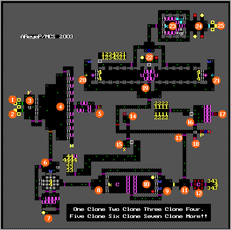 |  |
|---|---|

Enemies marked in blue appear in all difficulty levels. Enemies marked in green appear only in difficulty levels "I'm a Hero" & "Suicidal Tendencies". Enemies marked in white appear only in the difficulty level "Suicidal Tendencies" and "Tournament" mode.

## Level 33: Frosty

This secret level is accessed upon completion of Challenge level 3 (which is accessed from level 18). Disclaimer: Any resemblance to Frosty the Snowman is purely co-incidental, and no snowmen were hurt during the making of this level. And no, Santa Claus or Rudolf the red nosed reindeer declined to participate, as they didn't want to be associated with such wanton violence! :)

**1.** You start here.

**2.** You'd best head to this point first to grab a machine gun and stock up with some ammo, as you'll be needing them soon!

**3.** By now you should have seen your first snowmen! They're not out to bring Christmas cheer you know! And with that reanimation fluid used for bringing the clones to life, they're capable, just like the Ultraclones, of regenerating a number of times before they'll stay down for good! So grab these crates of ammo here and make sure you have enough to keep 'em down! And be warned - a number of the guards responsible for activating these snowmen with the reanimation fluid have holed up in various nooks and crannies around the level and will be taking potshots at you, so be doubly vigilant! The Artefact of Regeneration here will restore your health should things get a little rough as you play in the snow :)

**4.** Make your way to this little outpost and throw the wall switch here.

**5.** The wall switch you threw in step 4 opens a remote pushwall here, and inside this recess is another wall switch - throw it.

**6.** The wall switch you threw in step 5 opens a remote pushwall here, and inside the recess here you'll find an Artefact of Displacement - jump in! Oh and you have been collecting all the treasure goodies in the level haven't you? There's lots of nice black diamonds in the forest area you know ... 2500 points each ... that's the whole point of a secret level after all, to rack up a big score :)

**7.** The Artefact of Displacement from step 6 will teleport you to here, and the exit is right in front of you! But don't forget to check out what's in the tunnel area here first before exiting, as there's an MCS Mk4 to be collected as a small reward for completing this level.

**8.** This Artefact of Displacement here will take you back to point 1 so as you can explore the level at your leisure should you wish, and look for any goodies you may have missed.

**9.** The exit stairway - on to level 19!

**10.** Don't overlook this secret pushwall, as a handy rocket launcher and a few treasure trinkets are to be found here.

**11.** And a nice stealth rifle to be found in this secret area too - in fact you can proceed to level 19 with a full compliment of weapons should you search this level thoroughly.

**LEGEND**

| 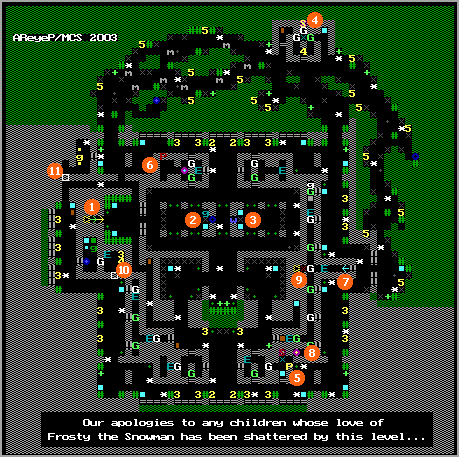 |  |
|---|---|

Enemies marked in blue appear in all difficulty levels. Enemies marked in green appear only in difficulty levels "I'm a Hero" & "Suicidal Tendencies". Enemies marked in white appear only in the difficulty level "Suicidal Tendencies" and "Tournament" mode.

## Level 34: 123 You're Dead

This Super Secret level is accessed from the secret elevator in level 23. In this level you'll die. In fact it's the only way to exit this level, unless you can survive for three minutes that is, at which time the level will end. You'll earn points for every second you stay alive ... it can be done if you're good enough, as others have done it ... sadly I'm not one of them and I made the damned level! :)

**1.** You start here. But don't stand around surveying your surroundings, because four Ultraclones have already spotted you and are on their way to pay you a visit!

**2.** You won't be getting out of this central room unless you grab the blood key here, so grab it straight away!

**3.** So long as you're quick enough, you'll have just enough time to grab the rocket launcher and rocket ammo here before the Ultraclones arrive.

**4.** The blood key will open this door here - quick! Those Ultraclones are probably breathing up your back right now! The bronze key is here too.

**5.** The bronze key will open this little passage and allow you to grab two first aid kits - how generous on a level where you're supposed to die!

**6.** The inner passage has it's own hazards ... rocket turrets, rocket firing Superclones, and explosive barrels all make for a lethal environment! Keep on the move as staying still will see you exit this level at an early stage! Remember, you only have to stay alive to earn points!

**7.** Rocket firing Superclones, rocket turrets and explosive barrels also line the outer passage ... is there any way to stay alive??? Just keep running as a moving target is harder to hit!

**8.** Ahhh ... the gold key! Grab it as it may come in handy!

**9.** Now here's a chance to buy some time ... two secret pushwalls access Artefacts of Displacement that could be the key to you surviving three minutes!

**10 & 11.** The Artefacts of Displacement will teleport you to these locations, temporarily away from where the enemies are tracking you down, and there's a couple of Artefacts of Life here to grab also!

**12.** An Artefact of Fury! With this you'll be able to bring down those Ultraclones and Superclones with one knife stab! Could you survive the three minutes after all? Others have ... maybe you may be able to do so too!

**LEGEND**

| 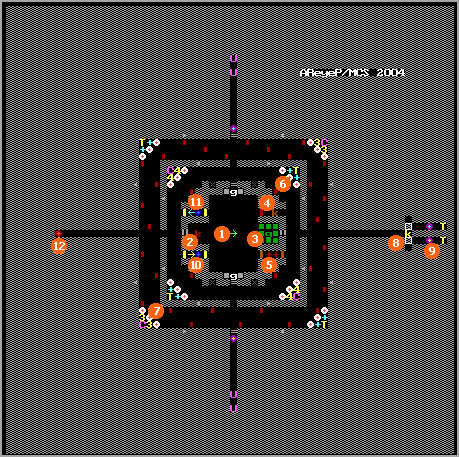 |  |
|---|---|

Enemies marked in blue appear in all difficulty levels. Enemies marked in green appear only in difficulty levels "I'm a Hero" & "Suicidal Tendencies". Enemies marked in white appear only in the difficulty level "Suicidal Tendencies" and "Tournament" mode.

## Level 35: Challenge Level 1

This is the first of four "Challenge Levels", and is accessed from Secret Level 2 (level 28, which is accessed from level 8).

A "Challenge Level" offers exactly that - a challenge! As such, each Challenge Level has a "coward's" emergency exit near the start so as you can at least exit the level should you give up in frustration. There's normally a penalty for such cowardice however, and seeing as you start a Challenge Level with only a knife or pistol, that penalty is to go to the next level with only these barest of essentials.

Certain tactics must be employed for the player to get through successfully. You'll no doubt be killed a number of times trying to figure out the best way to get through, but be assured that these levels have been designed so that it is indeed possible to get through. After all, making a level impossible isn't a challenge, and isn't any fun either. And should you succeed, then ample rewards await!!!

**1.** You start here.

**2.** If the going gets too tough for you, use this coward's elevator to go on to level 9. And hang your head in shame you yellow bellied easybeat!

**3.** Open this door and you'll be faced with four Superclones. They guard the blood key, which you need! It's quite obvious you ain't going to survive a shootout with your little pop gun against these guys, so what to do? Read on ...

**4.** This corridor can be accessed from the starting area, but fireballs stream down here from right to left. Using your right shift key combined with the movement keys (or your mouse if you are a mouse player), you can "run" slightly faster than the fireballs themselves. The trick here is to run into the corridor in between fireball bursts, and run with the fireballs down to the little alcove at point 5. You can do this after you've opened the door to area 3 (alerting the four Superclones to your presence), but it's best to do this before alerting those menaces.

**5.** Run with the fireballs down to this point, and then dive into this little alcove here (so that you stand in front of the door here). Be careful not to overshoot the alcove, as there's an Artefact of Death that'll see your heroic run end in ignominy! Once you're in this alcove, turn to face the door on the opposite side of the corridor. Run forward quickly to open it between fireball bursts, and then dive back into the alcove again as the door opens to avoid being struck by the fireballs. When the door has opened completely, dive across the corridor from the alcove again (once again timing it between fireball bursts) and through the open doorway.

**6.** Now that you're in here, you can throw the wall switch ... voila! You've just deactivated the fireballs! And watch for enemies sneaking up from behind who are out to investigate who's in the switch room :)

Now that you've deactivated the fireballs, it's time to go back and pay those Superclones at point 3 a visit. Open the door to their room, make sure all four of them see you, and then run off back down the corridor (point 4) to the switch room at point 6. You'll have to lure the Superclones into the corridor - once you see them in the distance coming down to fix you up, go into the switch room and throw the switch to reactivate the fireballs ... you've just fixed the Superclones up! Once you know you've toasted all four of them, deactivate the fireballs, then go back to the Superclones lair at point 3 and collect the blood key. That wasn't so hard was it?

**7.** Now that you have the blood key, you can access some handy ammo in this area to help you through the level (only one lousy clip and one lousy pistol? It is a challenge level after all!), and a couple of hidden portable first aid kits to help with any damage you've been dealt.

**8.** The blood key will open this door allowing you to proceed on through the rest of the level.

**9.** A tricky area :) Oh the explosive barrels are harmless enough, unless you shoot one of them! And the resultant explosion will cause a chain reaction that will set off the rest of the barrels ... it's highly doubtful you'll survive this! So, don't shoot them you think? Sounds easy, but there's only one problem - there's a suicide clone in other end of the room, and you have to go past him to get to the exit on the other side! If he sets himself off in your face, he'll set off all the barrels too, and you'll be history! Now, suicide clones won't open doors, and trying to get him away from these barrels by luring him out through all those doors at point 8 is going to be rather difficult! You can try to open a few of the doors, and then back up into the passage whilst the doors are open, and shoot the suicide clone when he tries to follow you, but this won't be easy as doors will be closing after you've opened just a few. But, there is an easier method ...

**10.** Ahhh yes!!! This hidden rocket launcher will make things a lot easier! Grab it, and then, while standing back in this secret recess, fire a rocket at one of the barrels in the room. You'll be far enough away from the subsequent explosions so as not to be hurt, and the explosions should also take care of the suicide clone too. Once this is done, you should be right to leave this room and proceed to the next challenge :)

**11.** A harmless enough looking corridor? It is for the moment at least ...

**12.** A switch ... I wonder what it does? It may be a good idea to blow up that explosive barrel nearby before you do throw the switch though ...

**13.** Well well well!!! You knew you'd be in trouble when you threw the switch didn't you? Five Superclones are now breathing down your neck launching a barrage of rockets in your direction ... lure them up the main passage and then use the narrow side passage here as a route to bypass them. Run down to the other end and blow up the barrel (point 11 - you'll cop a bit of damage from it though as you'll have to stand right next to it to destroy it) and then access their lair (point 14).

**14.** Run into the lair of the Superclones (don't dawdle as those 5 Superclones will be hot on your heels) and you'll find not only the bronze key, but an Artefact of Invulnerability and also an Artefact of Fury. Combined, these two artefacts make for an unbeatable combination. Grab them quickly and then go back out and face those 5 big thugs - 5 knife stabs later they're no longer a problem :) Oh, and there's a wall switch in this room that acts as a light switch for the level should you wish to brighten things up - this was a feature that was only used in this one level, more so as a novelty than anything else.

**15.** If the Artefact of Invulnerability from step 14 is still active, then this will help with this stage immensely. If it isn't, then things are going to be somewhat tougher! Once you grab the gold key here, a horde of SS will start pouring in to the other end of this passage (through the locked door that requires the gold key). You will be struggling to take them all on what with the limited ammo reserves you'll have, so you'll have to use the wall switch located here where the gold key is to activate the fireball producing wall at the other end of the passage to fry them! The only problem is that, if there's no SS guy there to cop the blast of fire, the fireballs will travel down the passage and fry you! There's 6 portable health kits in the passage to help you out for those occasions where you cop the odd fireball blast (after all, we're all human and our timing can't be perfect!) and for when the SS get in a few shots at you, but you're going to have to turn this switch on and off repeatedly to fry the SS one by one as to just leave the fireballs on will be certain suicide! Yes, it's a challenge to achieve this properly, but this is a challenge level, remember? :) That Artefact of Invulnerability (and couple with the Artefact of Fury) will prove invaluable for making this step easier if you're quick enough dispensing of those Superclones ... even only 10 seconds of invulnerability will come in very handy (grab the key, turn the switch on to activate the fireballs, run down through the fireballs and stab any SS that is in your way, and run back out into the big corridor where the Superclones were and let the fireballs do their thing. Once all is quiet, you'll just have to time your crossing of the passage to the locked door requiring the gold key and you're on your way :)

**16.** That's right, this is the passage where all those pesky SS came from. Take this passage to continue through the level.

**17.** As you enter this area, you'll see a lot of activity to your right. A horde of SS will be jumping into the Artefact of Displacement nearby and teleporting off to somewhere else. Stand back and take cover as if they see you they won't hesitate to fire at you. Where are they going to you may wonder? You'll find out soon enough, but first you'll have to navigate your way through the series of rooms leading from this point to make it to the Artefact of Displacement, and avoid the suicide clones lurking within! You'll notice the suicide clones won't leave the little rooms they're in, so there's no risk of them following you, but you'll have to time running through each room occupied by a suicide clone so as to avoid them "bumping into you" and risking the likelihood of them blowing themselves up! Thankfully there are a number of first aid kits scattered around to keep your health topped up.

**18.** Finally, some hidden ammo! You can go back and get the suicide clones if you wish, or you can stock up and prepare to jump into that Artefact of Displacement. Now where did those SS guys go? You're about to find out!

**19.** Hmmm ... still no SS to be seen ... they must have jumped into the other Artefact of Displacement here! And what's this behind you? A wall switch! Go on, throw it ... it'll open a pushwall next to you and there's a generous gift of an MCS Mk4 plus 3 crates of MCS ammo and a backpack! Do you have that sneaking feeling you're about to encounter a big firefight? Jump into the Artefact of Displacement ... it's time to find just where those SS did go!

**20.** Ever had that feeling someone's watching you? You will especially if they're shooting at you from behind! Go on - that Artefact of Invulnerability straight ahead of you is there to help you out! Run for it now as there's sixteen SS right behind you! So ... that's where they went :)

**21.** This Artefact of Invulnerability, combined with the MCS Mk4 and ammo you should now have, will allow you to bring all the SS down to size. Don't dawdle either, as there's more SS in the siderooms and you'll have 30 seconds of Invulnerability in which to get the job done the easy way.

**22.** This pushwall leads to some more treasure rewards, but also to more pushwalls that will lead you back to the rest of the level you've already completed should you want to explore it all at leisure.

**23.** And as a reward for completing a Challenge level, you get one of each weapon in the game, plus some nice ammo supplies to take with you to the next level :)

**24.** On to level 9 - job well done!!!

**LEGEND**

| 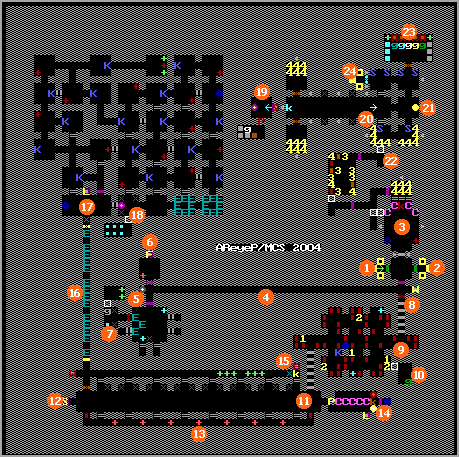 |  |
|---|---|

Enemies marked in blue appear in all difficulty levels. Enemies marked in green appear only in difficulty levels "I'm a Hero" & "Suicidal Tendencies". Enemies marked in white appear only in the difficulty level "Suicidal Tendencies" and "Tournament" mode.

## Level 36: Challenge Level 2

This is the second of four "Challenge Levels", and is accessed from level 12.

A "Challenge Level" offers exactly that - a challenge! As such, each Challenge Level has a "coward's" emergency exit near the start so as you can at least exit the level should you give up in frustration. There's normally a penalty for such cowardice however, and seeing as you start a Challenge Level with only a knife or pistol, that penalty is to go to the next level with only these barest of essentials.

Certain tactics must be employed for the player to get through successfully. You'll no doubt be killed a number of times trying to figure out the best way to get through, but be assured that these levels have been designed so that it is indeed possible to get through. After all, making a level impossible isn't a challenge, and isn't any fun either. And should you succeed, then ample rewards await!!!

**1.** You start here.

**2.** When you open the elevator door, you'll see four Cybertroopers behind a barrier in front of you - either close the door and wait for a little time (or run around a corner and take cover) as otherwise they'll make short work of you! There's an Artefact of Displacement in the enclosure they're in, so wait until all four of them have walked into it and have teleported out of this area. Once they have, the coast is clear. Of course you'll no doubt be wondering where they've gone to ... it's nice having such niggling little thoughts like this in the back of your mind isn't it? :) Oh and don't miss the secret pushwall behind the breakable stone column in this area, as there's a handy machine gun and some ammo to help you on your way.

**3.** If the going gets too tough for you, use this coward's elevator to go on to level 13. So much for being a man and not a mouse!

**4.** This area is not one you should explore at leisure. There are rocket turrets and Ultraclones trapped in by explosive barrels all through this area, and should you stand around for too long in their line of sight, they'll fire at you. The rockets from the turrets will detonate the barrels, and whilst the resultant explosions may cause damage to them as well as you, the main risk here is the Ultraclones - you don't want these guys on the loose! Even if the barrel explosions do kill them, remember, they can regenerate a number of times! So try to keep out of the line of sight of all turrets in this area, diving from one passage to the next as you explore.

**5.** The bronze key. Dive forward to grab it and then back off immediately so as the turrets in the line of sight of the key don't get a chance to fire off a shot at you (thus releasing the nearby Ultraclones).

**6.** The bronze key opens this door. There's a breakable stone column in front of you - shoot it from the doorway (you did get that pistol or hidden machine gun near the start of the level didn't you?)

**7.** The blood key. This room is a little safe haven in the middle of the level out of sight of all turrets.

**8.** There's a wall switch behind this locked door (requiring the blood key) - throw the switch.

**9.** Don't you hate having to search for whatever the switch you threw just did? Well, if you go back to the starting elevator, you'll see the rear wall of the lift has slid back to reveal this passage.

**10.** Ahhh ... an Artefact of Invulnerability! In fact two of them as there's another behind a breakable column here! Do NOT waste these on the rocket turrets and Ultraclones you saw in the previous area where you retrieved the bronze and blood keys from! Remember those four Cybertroopers you saw at the start of the level? You're going to need these artefacts for them! So grab them and run immediately to point 11.

**11.** An Artefact of Fury, and a second one behind a breakable column! Grab both of them and now run to point 12. Remember, you have less than a minute before the effect of all these artefacts will expire, so time is critical!

**12.** Go into the room where the Cybertroopers were, and jump into the Artefact of Displacement here. You're about to find out where those Cybertroopers went to!

**13.** You'll materialize at this point here. With any luck, the four Cybertroopers will be in the same area further in front of you. With the power of the Artefacts of Invulnerability and of Fury on your side, run up to the Cybertroopers, and bring them down with one stab! Remember, there's FOUR Cybertroopers to deal with, so if you only find three, check the room adjoining this passage to see if there's a straggler lurking in there! Once all four of them are down, you can rest easy.

**14.** The gold key!

**15.** Throw the wall switch here before exiting this area.

**16.** Now you can bypass this step and go straight to step 17 if you wish, but there's a lot of treasure goodies to be collected where all those rocket turrets and Ultraclones are penned up ... you don't want to miss these things do you? If not, then proceed to this point ... the wall switch you threw in the last step opened a remote pushwall here which opens to a set of four adjoining rooms - there are FOUR Artefacts of Invulnerability, and FOUR Artefacts of Fury to be grabbed up!!! That will give you almost two minutes of unequalled power! It's time to go out and give all those rocket turrets and Ultraclones a visit they'll never forget! Concentrate on the Ultraclones first, as they will require to be "killed" a number of times each before they finally stay down, and then worry about the rocket turrets afterwards. There are four Ultraclones to deal with, so make those two minutes count! And once you've removed all threats, there are plenty of valuable treasure goodies to be collected!

**17.** This locked door is opened with the gold key, and the room here contains the elevator key, plus a nice assortment of weapons for you to take on to the next level as a reward for completing this Challenge Level. Oh and there would be a couple of pesky clones in here too wouldn't there? You know, you should never get complacent!

**18.** The exit elevator - congratulations! On to level 13!

**19.** But ... before you do go on to the next level, would you like another little challenge? This area beyond this secret pushwall will provide you with some more scoring opportunities. If the Artefacts of Invulnerability and Fury you found at point 16 are still active (or if you kept one of each spare, you can go back and grab them now), then the first part of this area will be a lot easier!

**20.** This cache of ammo (plus hidden weapons in adjoining secret rooms) will assist you should you not have the benefits of the aforementioned artefacts.

**21.** You'll have to pass four Superclones to get to the Artefacts of Invulnerability and Fury located here. This won't be an easy task if you don't have such artefacts still active from earlier, but it can be done (remember you can always use standard weaponry to deal with these guys!) Grab the Artefacts and then deal out death!

**22.** The Artefacts of Invulnerability and of Fury here will allow you to easily remove the Cybertrooper pest here, but you'd better be quick as otherwise he'll block your way to them as he approaches you.

Hmmm ... there's a lot of Artefacts of Invulnerability and Fury in this level aren't there? So you have no excuse for failing!!!

**LEGEND**

| 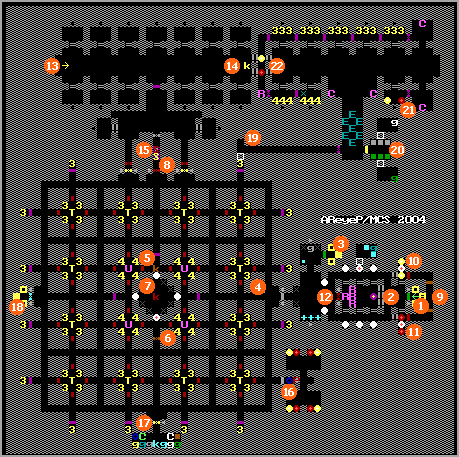 |  |
|---|---|

Enemies marked in blue appear in all difficulty levels. Enemies marked in green appear only in difficulty levels "I'm a Hero" & "Suicidal Tendencies". Enemies marked in white appear only in the difficulty level "Suicidal Tendencies" and "Tournament" mode.

## Level 37: Challenge Level 3

This Challenge level is accessed from level 18. Whilst there's a coward's exit at the start of the level, there's a special bonus reward for completing this level, and that's to be taken to the Super Secret snowman level!

A "Challenge Level" offers exactly that - a challenge! Certain tactics must be employed for the player to get through successfully. You'll no doubt be killed a number of times trying to figure out the best way to get through, but be assured that these levels have been designed so that it is indeed possible to get through. After all, making a level impossible isn't a challenge, and isn't any fun either. And should you succeed, then ample rewards await!!!

**1.** You start here.

**2.** A coward's stairway to take you to level 19. Run you frightened little rabbit!

**3.** Well, isn't this a nice gift so early in a Challenge Level? A pistol, a machine gun, an MCS Mk 3 and an MCS Mk4. In fact, every noise making weapon (other than the rocket launcher) in the game ... now, you could take these and then exit via the coward's exit, and start the next level with these weapons and a bonus for completing the Challenge Level, but that's no fun is it?

**4.** How easy can you get! Four guards patrolling around a central treasure room. And now, thanks to the weapons so generously provided in the previous room, you have guns with which to shoot them! Now ... you didn't really think those guns were provided as an act of generosity did you? Because they were really provided to make you fall into a trap! If you use one of those noise making weapons in this area, you'll alert a horde of clones in a seperate area, and they'll all come warping into the central treasure storage room here (point 8)! Considering the blood key is in that storage room also, and you'll need to go in there later with hardly any ammo, you've just made your task next to impossible! So, the trick of this whole area is to go in, and take on the 4 guards one at a time with your knife. The knife is a stealth weapon, and it won't alert any other enemies, so the treasure room with the blood key will stay clone free, and you'll make life for yourself a lot easier later on :)

**5.** The bronze key. You'll have to run down the corridor leading to here as the rocket turrets surrounded by explosive barrels will prove to be a hazardous combination - one rocket fired by any of those turrets at you will set off a chain reaction of explosions, taking the barrels, the turrets, and YOU with them. But when you open the door here to grab the bronze key, you'll find yourself faced with a Cybertrooper! You've got limited ammo ... there's no artefacts around to help you ... how in blazes do you deal with this situation?

**6.** Well ... timing will be critical in dealing with this situation! Use the passage here to run to point 7 and thus bypass the rocket turrets and barrels. Then, run out into the passage with the turrets/barrels at the opposite end so that you're looking down it towards the door that opened to the bronze key (and the Cybertrooper). The Cybertrooper should be on his way to greet you. You need to get him in the area between the barrels and turrets. But you'll need to act just before he does get into the right position otherwise you'll miss the crucial window of opportunity!

**7.** Once you think the Cybertrooper is a couple of seconds away from moving into the ideal position in between the turrets and barrels, open the door here and just look in ahead (don't go in as you'll be hurt) - one of the rocket turrets will see you through the window ahead and will fire at you. Subsequent result? There'll be a massive explosion where by all the barrels in the corridor will explode. This should take out all the turrets (but don't be too cocky - one may survive if you're unlucky) and it will take out the Cybertrooper should he be in between the barrels when this explosion occurs. End result? You should now be able to explore this whole area at your leisure and grab up the treasure goodies you find nearby. Oh and an Artefact of Life behind one of the turrets will restore your health to maximum as a reward for being such a cunning hero :)

**8.** Now ... stay quiet in this area still! One inadvertent gunshot will see all hell break loose! There's no enemies in here (unless you used one of your guns earlier) so just walk in, grab up the treasure goodies, and grab that blood key. Then depart here the way you came in and head for the next stage.

**9.** When you open the locked door here with the blood key, you'll be greeted with a face full of fireballs! How in blazes are you going to get down here??? Well, you're about to endure another test of timing. Your health should be at 100% at least with that Artefact of Life you picked up in step 7, and you'll need this as you're going to cop some fire damage for the first step needed here. OK ... here's the drill ... open the locked door, run into the passage and dive into one of the small alcoves in the side of the passage. You'll be safe from the fire here, and you'll see that there's a wall switch in each of the alcoves along here. These switches control a remote pushwall at the far end of the passage. If you throw the correct switch (it'll be one of the two in the alcoves opposite each other) then the pushwall will slide across the passage, momentarily blocking the fireballs travelling up the passage. So, throw a switch, and watch ... if you see a break in the fireballs, this is your chance! Run down to the next pair of alcoves down the passage and take cover as the fireballs will only be blocked off for a short moment as the pushwall blocks them during it's movement. Once the fireballs are travelling up the passage again, throw one of the switches in the new pair of alcoves you're in. One of the two will activate the pushwall again, once again blocking the fireballs momentarily. Use this moment to run down to the next set of alcoves. Continue doing this kind of thing until you reach point 10.

**10.** If you've thrown the switches in such a way so as the remote pushwall is now in front of this doorway here, then there'll be an alcove opposite this (point 11).

**11.** Dive into this alcove (you'll cop more fire damage no doubt as the pushwall will have to be out of your way when you try to access this alcove) and throw the switch here - it turns off those damned bloody fireballs!!! Finally!!! You have navigated a very tricky area and can be proud of yourself :) With the fireballs now deactivated, you can go back up the passage and throw one of the switches controlling the pushwall to move it back so that it no longer blocks the door at point 10.

**12.** Now for the next test ... this part is quite simple if you observe the items of gore lying on the floor ... should you cross over these areas you'll be seen by some clones in the area and next thing you'll be in a firefight you can't survive with clones pouring out all over. Stealth is the key here, and not being seen by any of the clones as you move upwards towards point 13. Zigzag your way upwards, and you'll only come to alcoves containing health items and clips of stealth rifle ammo until you get to the gold key.

**13.** The gold key! Plus a very handy stealth rifle!

**14 & 15.** Proceed down these passages and use your stealth rifle to eliminate the clones - don't worry about shooting them in the back either, as they'd gladly shoot you in the back if they had the chance! Once you've eliminated all the clones, you can collect the few treasure goodies in the area and move on to the next step.

**16.** The pushwall here leads to a treasure room you may have noticed earlier on in the level. Just watch for SS sneaking up from behind as you venture into the first part of this secret area.

**17.** When you come into this corridor, you'll see a whole heap of clones standing with their backs to you. These are the guys that would have teleported into the area at point 8 had you made a noise with a weapon there. But now you can pay them back for being such a potential nuisance! Stand in the alcove with the wall switch here, and throw the switch - this will activate a stream of fireballs that will travel down the passage and incinerate the clones one by one :) Once all the clones have been toasted, throw the switch again to turn the fireballs off, and then go down the corridor ... step around the Artefact of Displacement (it'll just take you to point 8 meaning you'll have to backtrack through the level again) and instead open the door at the far end - the treasure is all yours!

**18.** The gold key allows you to open this door. The end of the level is not too far away now.

**19.** As you proceed up this corridor, you'll see storage rooms full of treasure goodies. But the further up the corridor you go, the more enemies will start pouring in from your rear to stop you grabbing up all the goodies! The best bet here is to ignore all the treasure for now, and just go forwards through all the doors (they open automatically) and towards point 20.

**20.** By the time you reach this point, there'll be a horde of SS on your tail!!! Grab the crates of ammo here as you'll need them, and make your pursuers dance the "machine gun cha cha"!

**21.** When the SS threat has finally been removed (you may have to check those treasure rooms for stragglers), grab the elevator key here. Make sure to go back and grab all the treasure goodies, then it's on to the exit elevator.

**22.** Finally! One pesky clone in the lift to deal with, then as a reward for completing this Challenge Level, it's on to level 33 - the super secret Snowman level! Congratulations!

**LEGEND**

| 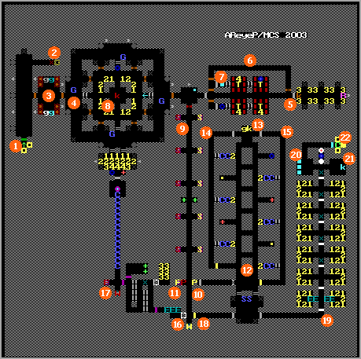 |  |
|---|---|

Enemies marked in blue appear in all difficulty levels. Enemies marked in green appear only in difficulty levels "I'm a Hero" & "Suicidal Tendencies". Enemies marked in white appear only in the difficulty level "Suicidal Tendencies" and "Tournament" mode.

## Level 38: Challenge Level 4

This is the last of four "Challenge Levels", and is accessed from level 21.

A "Challenge Level" offers exactly that - a challenge! As such, each Challenge Level has a "coward's" emergency exit near the start so as you can at least exit the level should you give up in frustration. There's normally a penalty for such cowardice however, and seeing as you start a Challenge Level with only a knife or pistol, that penalty is to go to the next level with only these barest of essentials.

Certain tactics must be employed for the player to get through successfully. You'll no doubt be killed a number of times trying to figure out the best way to get through, but be assured that these levels have been designed so that it is indeed possible to get through. After all, making a level impossible isn't a challenge, and isn't any fun either. And should you succeed, then ample rewards await!!!

**1.** You start here.

**2.** The coward's exit elevator. But before taking this easy way out, think to yourself ... isn't it much better to say "you came, you saw, and you kicked butt" than to say "you came, you saw a little, and you ran off"?

**3.** Two wall switches and a stream of fireballs ... you'll have to time it so as to run forward between fireball bursts to throw a switch and then dive backwards immediately so as to avoid being "slightly fried" :) One of the two switches (it's the one on your right as you face them actually) will slide a remote pushwall into position so that it blocks off the fireballs travelling down the passage.

**4.** As you race down to this point here, you'll be greeted by some SS ... you may have to run back and activate the other wall switch now so as to slide the pushwall back again and let the fireballs fry these guys! Or you can try using your knife ... the choice is yours. Once the SS have been dealt with, you'll see more fireballs travelling down this passage here (point 4). There's no way of turning them off, so you'll have to time it so as to run up the passage between fireball bursts towards point 5.

**5.** Having run to this point here, you'll be clear of the fireballs.

**6.** The blood key. Once you have it, head back to point 5 and throw the switch on your right (as you face the switches) to slide the remote pushwall into position so that it blocks the fireballs. Oh and be ready for more SS to come up looking for you - bloody pests!!!

**7.** The blood key opens this door and you can grab the bronze key. And MORE bloody SS will now rain on your parade ... where do these guys keep coming from? There's a secret pushwall here too that will open an area that will provide you with treasure goodies, plus a handy machine gun and crates of ammo. But exploring in this secret area will also mean you are seen by a Cybertrooper who will walk into an Artefact of Displacement, and warp into the area at point 3! So long as the fireballs are travelling down the passage towards point 3 then he shouldn't be much of a problem. But if you've blocked them off with the pushwall then you'd better be careful!

**8.** You'll have to race up the passage between fireball bursts to point 3 to make it to this location where you'll find the gold key.

**9.** Throw one of the switches at point 3 to block off the fireballs again, and then proceed to point 9 here. The gold key opens the locked door here and the elevator key is yours (and yep - more SS too :) Could it be the exit is not far away? Don't forget the secret area here which is a mirror image of the secret area accessed from point 7. Another Cybertrooper is in here also - deal with the same way as described in step 7.

**10.** Well I'll be ... the exit lift area already!

**11.** And as a reward for completing this Challenge Level, some nice juicy treasure items, and an Artefact of Life to restore you to full health!

**12.** The exit lift! On to level 22! But ... there's still a few extra goodies to be collected in this level if you feel up to the challenge ...

**13 & 14.** These two passages lead to some bonus treasure areas, plus there's a couple of secret pushwalls that open up to some extra ammo clips should you need them. You'll see some nice juicy treasure goodies through some windows further along too, but you can't access those from this area. More on those goodies in step 16.

**15.** Eliminate the officers in this area, and you'll be able to grab up a few treasure goodies in the adjoining side rooms.

**16.** Ahh yes ... the best treasure items are stored in this inner part ... but you'll have to dodge fireballs near point 4 to get into this area (there are a couple of Artefacts of Life in the passages leading into the inner treasure room should you be badly hurt by the fireballs). Open each of the doors leading into the inner area though, and you'll be greeted by a Cybertrooper! You'll have only your ammo and machine gun to deal with these guys, and there are two more Artefacts of Life in behind where they stand to help you out should you need any health assistance in your battles with these things. Good luck - the treasure rewards are worth the risk :)

**LEGEND**

| 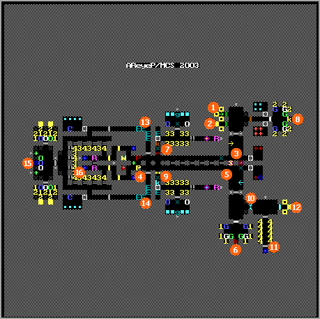 |  |
|---|---|

Enemies marked in blue appear in all difficulty levels. Enemies marked in green appear only in difficulty levels "I'm a Hero" & "Suicidal Tendencies". Enemies marked in white appear only in the difficulty level "Suicidal Tendencies" and "Tournament" mode.
