# Spear: End of Destiny: Game Manual

*From [areyep.com](https://www.areyep.com/eodmanual/Game_Manual.html), by AReyeP and MCS, reproduced here for players of the TC port. Text and pictures are theirs; the links to downloads go to their site.*

## To All Wolfenstein 3D Players

We made this "game manual" quite detailed for those that haven't played the original Wolfenstein 3D in a very long time, or are unfamiliar with playing it (if you're one of these people, then we recommend you visit [www.idsoftware.com](http://www.idsoftware.com) as soon as possible to find out how to get the original Wolfenstein 3D - it's a classic you know you need to have! Don't forget to order "Spear of Destiny", after all, that's the game this mod is based on. These games are cheap now - you have no excuse)!

If you're an experienced Wolfenstein 3D player, then many of the details in this game manual will of course be common knowledge to you. However, there are many new features in Spear "End of Destiny" that you will need to be aware of, so a quick read through will be beneficial.

A Sequel to a Sequel to a Sequel!

| 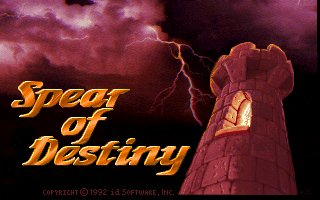 | 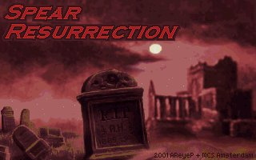 |
|---|---|

id software's "Spear of Destiny" was a sequel (some may argue it was a "prequel" due to the storyline's timeline) to Wolfenstein 3D. We (AReyeP & MCS) designed our earlier mod "Spear Resurrection" as a sequel to the original "Spear of Destiny". In turn, we've designed Spear "End of Destiny" as a sequel to "Spear Resurrection".

Although it's not necessary, you'd be advised to play the games in sequential order to fully appreciate the evolving storyline, as well as to appreciate the enhancements that have been made to both graphics and the original game engine by the Wolfenstein 3D modding community.

## Mission Briefing - The Story So Far...

"Two times captured, three times lost, Destiny's spear again in evil's grip. Only upon capture a third time shall its story come to conclusion.  
The task falls to the same as before. One against many to save all!  
The fires of Hell shall host the battle that preludes the End of Destiny..."

- Nostradamus: The Lost Quatrains

March 1946: With the war over for almost a year, a group of fanatical nazis headed by the imposing Baron von Schmitt had established a base of operations in an old castle located in the Spanish countryside. Having recaptured the Spear of Destiny from a British military storage facility, they'd hoped to use the artefact to resurrect Adolf Hitler and a number of other prominent nazis killed during the war, and, in doing so, bring about a rebirth of the Third Reich itself.

All had been going according to plan until the intervention of one B.J. Blazkowicz. After a gruelling battle, B.J. had managed to take on one and all to regain possession of the Spear, and after succeeding, had thrown the thing into the depths of the ocean off the Spanish coast to ensure it could never be found and fall into the wrong hands again.

But B.J. Blazkowicz had not been as thorough as he'd thought! Baron von Schmitt, though defeated in combat by Blazkowicz, had outsmarted the Allied one man army. He'd been cunning enough to have a small tracking device inserted into the shaft of the Spear. And the backup plan he had in place should things not go as originally planned was in motion.

The battle for the End of Destiny would soon begin...

Late March 1946: A tall dark figure, silhouetted by the setting sun, stood looking over the remains of the once imposing Spanish castle. The flames had died down, but thick smoke still belched forth from the crumbling ruins that, until just the day before, had been host to Baron von Schmitt and his loyal followers. Intent on using the "Spear of Destiny" to resurrect Adolf Hitler and the Third Reich, their dream had been shattered by none other than their Allied nemesis, B. J. Blazkowicz.

The lone figure stepped forward and moved slowly amongst the broken stone formations that once formed the foundations of the western side of the castle. As he turned around, closely examining the destruction before him, the sunlight brushed across his face momentarily. It was the face of Heinrich Haufmann. He'd hoped it would never come to this, but things had not gone as planned, and his time to take action had arrived.

His visit to the site was to ensure there was no obvious evidence of the activities that had taken place here. Normally, local authorities would have been swarming over the site investigating the cause of the blaze. But a little stolen nazi gold directed at a few corrupt officials did wonders for keeping the authorities away for a day or so.

As he explored further into the ruins, Herr Haufmann encountered smouldering corpses littered among the charred ruins. Obviously, he would have to dig a little deeper into the reserves of nazi wealth than he'd anticipated to have all this covered up. Thankfully, there would still be enough wealth left in reserve to fund the new operation. Turning to leave, he stopped momentarily. He'd heard something! A groan?

Turning toward where the sound had originated, he saw an arm reaching out from a nearby pile of rubble! A survivor! Running over to help the unfortunate soul, he quickly cleared the debris from around the face of the person. The smell of charred flesh almost made him recoil! So badly burnt was the face that he could hardly recognise it. But, it was somehow vaguely familiar. Only when the person spoke did Herr Haufmann realise just who it was...

The voice was that of Baron von Schmitt!

"Herr Baron!" gasped Haufmann. "You're alive!!!"

Baron von Schmitt's eyes stared up at Haufmann.

"Haufmann!" gasped von Schmitt. "We... failed...!"

Heinrich Haufmann could see that the Baron was close to death. That he'd survived this long was testament to the man's physical strength. Haufmann replied...

"Herr Baron, we have not failed. That is why you had a backup plan. And I have set that plan in motion! I swear to you, I will finish this matter. I know the Spear's location, and my men are retrieving it as we speak. The Reich will be reborn!"

Baron von Schmitt somehow managed a tortured smile in response to Haufmann's promise. Struggling to speak, he raised his free arm and clutched Haufmann's collar.

"Haufmann," spoke von Schmitt. "You know what to do. Good luck!"

Haufmann cradled the Baron's head in his hands.

"Herr Baron, I will see to it that the Allied dog that did this pays with his life!"

The Baron smiled his last smile, and, pausing momentarily to cough up blood, gazed at Haufmann and said, "Tell the dog that if he dares to interfere again, I'll be waiting for him in the fires of Hell! And that... is my... dying promise!!!"

With that, Baron von Schmitt drew his final breath.

Haufmann rose to his feet. So close had they been to success! As he looked down at the Baron's corpse, he determined to make certain the same fate did not await himself. After a brief pause, he hauled the Baron's corpse out from the ruins and over into the edge of the adjoining forest. He felt that the least he could do before departing was to give the Baron a reasonable burial.

Far out, riding the ocean waves in the light of dusk, a fishing trawler made its way steadily back towards the Spanish coast. The German divers on board were happy with their evening's work. The tracking device had made their task easy...

January 1947: It had been almost a year since you, B.J. Blazkowicz, had captured the Spear of Destiny from the grasps of Baron von Schmitt and his henchmen. Time had healed the wounds you'd suffered in that battle, but the memories would scar your mind forever. Twice you'd rescued the Spear from the clutches of evil. And each time you'd encountered the forces of an ungodly "otherworld". You'd survived, but only by the skin of your teeth. Lady Luck had been generous to you!

Having gradually grown accustomed to the leisurely pursuits of peacetime, you'd strived to put the past behind you. You'd done your bit for King and country. The time had come for you to finally enjoy life - let others worry about the future for once. But, on opening an envelope you'd just received in the mail, you wondered if heroes would ever be allowed to rest!

The letter inside the envelope was from an old British agent colleague of yours. Requesting you travel to Spain as soon as possible to meet with him, you wondered what in blazes he wanted. This fellow never seemed to be a bearer of good news, having been responsible for alerting you to the location of the Spear after it had fallen into the clutches of Baron von Schmitt. Hopefully this time he was just wanting to meet to chat about the "good old days"...

And so your journey began

Spain. You hadn't returned here since your battle last year to recapture the Spear of Destiny. Returning here brought back memories you'd tried to suppress. It was a beautiful country, no doubt, but that same countryside had been home to an old Spanish castle that you'd prefer to forget. That castle lay in ruins now, so you shook off those thoughts as your train pulled into the station where your colleague had arranged to meet you.

A few hours later, after some friendly banter and a hearty meal, your colleague made the reason for your visit clear. Although a large number of nazis had fled to Spain from Germany at the end of the war, not all of them had been recruited by Baron von Schmitt to help in his plans. Many of them had instead been instructed to just mingle with the general population, finding work and supporting themselves, until such time that their services were required.

Initially, according to your colleague, Baron von Schmitt had planned to bring these "sleepers" back into service once his original plans of resurrecting Hitler and other prominent nazis had been successfully carried out. But, should the plan fail, which it had, then these "sleepers" would be called upon to assist with a backup plan. Your colleague had only learnt of this arrangement just recently...

Anxious to determine if anything was taking place that may indicate renewed nazi activities, his investigations had uncovered some documents signed by a character named "Heinrich Haufmann". Subsequent digging uncovered further documents dating back to almost a year ago. Of particular interest was the date marked on the documents - late March of 1946, just after you had recaptured the Spear of Destiny from Baron von Schmitt's clutches.

These documents referred to the failure of "the intended plan", and subsequent activation of a "Plan B". It appeared that instructions had been issued by Haufmann ordering all "loyalists" to report immediately to a particular location in a remote regional area of the Spanish countryside. Fortunately, your colleague had recently been able to pinpoint the exact location of this new "base of operations" for the nazis.

The site was a substantial mansion situated on a large estate. Bought by the Germans before the war had even started, this estate was originally intended for use as a holiday retreat for high ranking members of the German hierarchy. As the war's end drew close, bribes of stolen nazi gold were made to corrupt Spanish officials to ensure the property remained under nazi control, and the site was used as a stopover point for nazis fleeing the crumbling Reich.

"And so you see, B.J.," your colleague concluded, "when Baron von Schmitt's original plan to resurrect the Reich failed, Heinrich Haufmann put this fallback plan into action. All non active loyalists were ordered to report at the rural location in order to help with the new plan. All this happened just under a year ago, so they've had plenty of time to get things in motion." Your friend paused, then added "It's a pity I hadn't discovered this earlier..."

But, you didn't see a huge problem.

"I wouldn't worry too much," you said. "Easily dealt with. I can't see that they'd be able to achieve a great deal. Last time, they had the Spear of Destiny in their possession. That provided more than just a psychological advantage, let me assure you!"

Your colleague frowned. "I'm afraid I have some bad news, B.J. From what I discovered from a source last week, they DO have the Spear..."

A sense of disbelief engulfed you. Surely they couldn't have the Spear of Destiny! You'd disposed of it yourself; it was at the bottom of the ocean, and finding it would have been harder than finding a needle in a dozen haystacks!

But, after your colleague informed you of his suspicion that Baron von Schmitt had apparently inserted some kind of tracking device in the shaft of the Spear, you felt like kicking yourself.

How could you have been so stupid?!! You should have destroyed the Spear, not hidden the thing! It seemed that, despite your having defeated Baron von Schmitt in battle, he'd been one step ahead of you all along. And now, because of your oversight, you found yourself in the same situation as just over a year ago.

The Allies, as before, wouldn't be interested in helping. They were now too preoccupied with their former Soviet "comrades". Besides, they'd never considered the stories surrounding the Spear of Destiny to be any more than superstitious nonsense.

Once again, it would be up to you, B.J. Blazkowicz, to set things right.

Looking your colleague in the eye with a steely gaze, you commented "Looks like B.J. Blazkowicz has a job to do..."

Your colleague nodded in agreement. "I'll take you to the outskirts of the mansion's estate" he said. "From there, you'll be on your own. Remember, the estate is huge, and no doubt well guarded. But I have faith you'll find a way in."

And so you found yourself at the edge of the property now acting as home to the nazis activities. Light snow fell gently to the icy ground as you felt a chill embrace your body. But you knew the chill you felt was not due to the cold...

This would be the third time you'd embarked on a mission to capture the Spear of Destiny from the nazis. You'd faced the Angel of Death. You'd faced Hitler's ghost. And now you feared you'd face Hell itself.

Gritting your teeth, you unsheathe your knife, and make your way slowly along the estate's perimeter looking for an easy access point.

Destiny awaited...

## Playing The Game - Menu

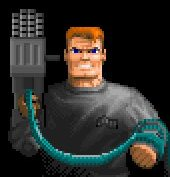

1. [What's New?](#whats-new)
2. [System Requirements](#system-requirements)
3. [Installation](#installation)
4. [Running the Game](#running-the-game)
5. [Getting Started](#getting-started)
6. [New Game](#new-game)
7. [The Function Keys](#the-function-keys)
8. [Playing the Game](#playing-the-game)
9. [Your Current Status](#your-current-status)
10. [Scoring](#scoring)
11. [Weapons & Ammunition](#weapons--ammunition)
12. [Health/First Aid](#healthfirst-aid)
13. [Keys](#keys)
14. [Treasure](#treasure)
15. [Artefacts](#artefacts)
16. [Interactive Objects](#interactive-objects)
17. [Secret Areas](#secret-areas)
18. [Secret Levels](#secret-levels)
19. [Regular Enemies](#regular-enemies)
20. [Boss Enemies](#boss-enemies)
21. [Enemy Deaths](#enemy-deaths)
22. [Hints and Strategies](#hints-and-strategies)

### What's New?

Our mod "Spear Resurrection" introduced a number of features not seen in the original Wolfenstein 3D or Spear of Destiny. MCS has since released coding tutorials (available from our site [www.areyep.com](https://www.areyep.com/../index.htm)) for many of those new features he implemented in Spear Resurrection.

In addition to the features coded into Spear Resurrection, MCS has coded even more features into Spear "End of Destiny". Some are obvious, such as the outdoor & shading effects made available through coding tutorials released to the general community by another keen Wolf 3D fan ("Ripper"), and the use of "wall switches", new weapons etc. But there are numerous other coding changes introduced by MCS, some subtle, others not so subtle, that will dramatically affect the gameplay in Spear "End of Destiny". We could list those changes here, but to do so would detract from the element of surprise we hope Wolf 3D fans will experience while playing many of the game’s levels.

Many of the new features are revealed in this manual. Many though are not. Some affect gameplay, others are for "looks" only. Some may be unique to a particular secret level. Some you will notice as you play, but others you may not. Whatever, hopefully you’ll experience some Wolfenstein 3D nostalgia as everything old is made new again!

### System Requirements

We’re talking 1992 technology folks – the mysterious days of DOS, when men were men, women were women, and computer games didn’t need something designed by NASA to run on! So unless your computer is more than 10 years old, or is not IBM compatible (such as a Macintosh), then it should be quite capable of running Spear "End of Destiny" just fine. However, due to advancements in hardware and operating systems (such as Microsoft Windows XP), there may be certain steps you’ll have to take in order for the game to run or to hear sounds/music in the game properly. The "Troubleshooting" section in this manual covers most of what you should know.

### Installation

Using a compression utility such as Winzip or LZArc, simply extract the contents of the game zip archive to the folder you wish the game to be run from.

### Running the Game

Run the file "spear.exe" in order to start the game. See the "Troubleshooting" section in this manual should you have any problems running the game.

### Getting Started

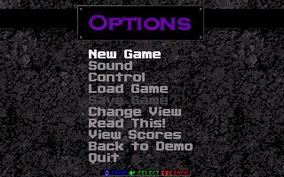

After the title sequence, you’ll be presented with the Options Menu. Use the arrow buttons to highlight the desired option, then press the Enter button to activate that option. The Esc key always backs out. You can also use the first letter of a menu item to go straight to that item, or you can navigate the menus with the mouse, joystick or gamepad.

### New Game

When starting a new game, you'll be able to select from one of five different difficulty levels. These levels are:

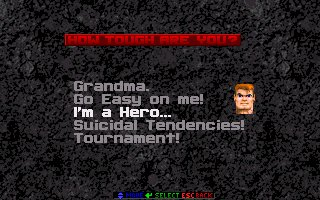

Grandma: The easiest skill level that's suitable for beginners. This skill level provides little challenge at all. If you complete the game on this level then you really haven't got much to brag about!

Go Easy on me: Like "Grandma", but with tougher enemies. In addition, enemies and other hazards cause more damage. This is the skill level a serious beginner should contemplate!

I'm a Hero: This is more like it! More enemies than the previous skill level. For gamers who want a reasonable challenge without things getting too tough.

Suicidal Tendencies: Now you're talking! The most enemies. For serious gamers.

Tournament! A special challenge! We noticed a lot of Wolfenstein 3D players save their game heaps of times during each level. When they’re killed, they just reload their last saved game. So we wanted to provide a little more of a challenge to that kind of player. This difficulty level is similar to "Suicidal Tendencies", but with limited game saves. In this skill level, your limited number of lives, as indicated on the game status bar under where it says "BJ's", are replaced by a limited number of saves. So, although you have unlimited lives, you can't save your game every 20 seconds! You'll get an extra savegame at the start of each new level, plus you may find the odd "Artefact of Preservation" (fancy name for "savegame artefact") whilst exploring in the game itself. Consider yourself challenged!

### The Function Keys

Pressing the Esc key in-game will take you to the Options menu, however the "F" keys will take you directly to certain options:

F1 – Help: Takes you to the game’s "Read This" section which contains the storyline and the basics of gameplay.

F2 - Save game (F8 for Quick save): There are ten Save Game slots. To save a game, move to an empty slot (or one you don’t mind writing over), type in a name and press the Enter key. This option will not be available unless you are playing a game.

F3 - Load game (F9 for Quick load): Load a previously saved game.

F4 - Sound menu: Select the type of sound you want the game to use. To activate or deactivate a particular sound type, highlight the desired selection and press the Enter key.

F5 – Change view: Pressing F5 allows you to increase or decrease your in-game view area. Use the arrow keys to resize the view window to your desired size, then press the Enter key to accept it. Alternatively, pressing the "plus" key (+) in-game will automatically increase the view size, whilst pressing the "minus" key (-) will decrease the view size. In Spear "End of Destiny", the game’s view area can be increased to take up your whole screen. In this mode your status bar (normally displayed at the bottom of the screen) will not be visible, however, you can view the status bar at any time by pressing the Tab key whilst playing the game in this mode, or alternatively press the F11 key to toggle the status bar display on or off.

NOTE: Like many games of its day, the original Wolfenstein 3D game engine required a certain amount of "conventional" memory to run optimally. It doesn’t matter if your system has a gigabyte of RAM – if you don’t have enough of this memory free, the game will attempt to compensate for this by automatically reducing the viewing area of the game. Depending on how much conventional memory your system has free, the game may or may not accept the larger view size, or may automatically reset itself to a smaller view size after you save or load a game. See the "Troubleshooting" section in this manual for more information on this topic.

F6 - Controls menu: Select the kind of input you’d like to use to play the game (keyboard, mouse, joystick or Gravis PC gamepad).

F7 - End game: This will end your game without saving it and return you to the Options menu. A prompt will appear asking you to confirm your decision.

F10 - Exit game: Quits the game completely and returns you to your operating system. A prompt will appear asking you to confirm your decision.

F11 - Toggle Status Bar: If playing in full screen mode, this toggles the status bar on or off.

F12 - Turn in-game messages on/off: During the game you will receive messages displayed across the top of the screen displaying information relevant to actions you have just taken or are required to take. By default this feature is activated, however, if these messages annoy you, just press F12 to turn them off. Pressing F12 again will turn them back on.

NOTE: If you wish to turn off floor/ceiling textures for any reason (perhaps you have an old 286 or 386 computer that suffers slow framerates, or perhaps you'd just like to turn them off for some kind of weird nostalgic Wolfenstein 3D feel!), then pressing Backspace-T will toggle floor/ceiling textures on or off. Likewise, shading can be toggled on/off by pressing Backspace-S.

### Playing the Game

Use the arrow keys to move. Use the Alt key together with the left/right arrow keys to strafe sideways. Use the right Shift key together with the arrow keys to run (move faster than normal).

NOTE: Learning to strafe and run are extremely important when fighting some of the tougher enemies!

Use the Ctrl key to use your knife or fire your weapon. If you are using a machine gun or MCS weapon, you can hold down the Ctrl key for rapid continuous fire.

Use the Space key to open doors, activate elevators and to activate secret "pushwalls" (described in more detail later). Each level contains at least one exit elevator or stairway. Activating an elevator takes you to the next level. If a level ends with a stairway leading up or down to the next level, all you need to do is walk up to the stairway to finish the current level and proceed to the next.

Some items, such as treasure, weapons and ammo, can be picked up by the player. To pick up an item simply walk over it. If you have the maximum amount of a particular type of ammo, then you won’t be able to pick up any more of it. Likewise, walking over a first aid kit or roast dinner won’t "use" that item if you are already at 100% health.

With a mouse or joystick, button 1 acts as the Ctrl (shoot) key, and button 2 acts as the Alt (strafe) key. Gamepads have a 4th button which acts as the Shift (run) key.

### Your Current Status

At the bottom of the play screen is a status bar which provides information you’ll need to know while playing the game (if you are playing in full screen mode you’ll need to press the Tab key to view the status bar).

Your status bar displays the number of the level you are currently playing, your current score, the number of "B.J’s" (lives, or savegames if you are on "Tournament" mode) you have remaining, your visual representation, your current health, the amount of ammo you have for the currently selected weapon, the keys you currently possess, and an image of your currently selected weapon.

### Scoring

Dispatching your enemies and picking up treasures earn you points. In addition, when you finish a level, a bonus screen will tally your performance. Secret areas found, ratio of kills and percentage of treasure found will be calculated. Each 100% ratio earns you an extra 10000 points. Also, if you beat the par times for completing a level, you’ll receive extra bonus points.

Scoring is important! Dependent on the difficulty level you are playing, extra lives (up to a maximum of 9) are granted for every 40000, 60000, 75000 or 100000 points earned (in "Tournament" mode, you receive an extra savegame for every 100000 points).

### Weapons & Ammunition

You start the game with only a knife, so you'll need to find weapons and ammunition to survive. There are 7 weapon types in Spear "End of Destiny":

Knife: The knife isn't just there as a fallback weapon for when you run out of ammunition. It can be used as a "silent" weapon when you want to dispatch an enemy without alerting others nearby. Mind you, against certain enemies (such as Suicide Clones), the knife is virtually useless!

If you have no weapons except a knife, and can't find another weapon, then it's possible to get a pistol by killing a guard, or a machine gun by killing an SS.

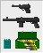

Pistol: Standard firearm issued to nazi guards and officers. Good against single enemies such as your average guard, but not ideal in situations where you’re outnumbered. Uses standard calibre ammunition.

Machine gun: The standard weapon issued to SS. A good all purpose weapon capable of dispatching small groups of enemies. Not recommended for use when dealing with large groups of enemies, or against tougher enemies (such as "boss" enemies). Uses standard calibre ammunition.

Ammunition for both the pistol and machine gun comes in clips of 8 (4 if clip is dropped by enemy) and crates of 25, and is quite common due to its being used in weapons used by guards, officers, SS etc. You are able to carry a maximum of 100 rounds of this ammunition at any time (200 if you find a backpack).

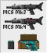

MCS (Multi Cannon Shredder) Mk3 & MCS Mk4: The MCS Mk3 is a 3 barrelled prototype weapon that packs a similar punch to a chaingun - ideal for large enemy groups. The MCSS Mk4 is a rare 4 barrelled version of the Mk3. It uses ammunition at an almost frightening rate, but is often the weapon of choice when the odds are stacked against you.

Both the MCS Mk3 & Mk4 use a larger calibre ammunition than your standard pistol or machine gun. Coming in clips of 8 and crates of 25, this type of ammunition isn’t quite as common but can still be found in reasonable quantities. You are able to carry a maximum of 100 rounds of this ammunition at any time (200 if you find a backpack).

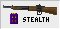

Stealth Rifle: An experimental rifle that was designed to be used for special assassination tasks. Not many of these weapons were manufactured, and those that were are generally kept well hidden by the nazis from prying eyes. Like the pistol, the stealth rifle is not a rapid fire weapon, but this is more than compensated for by the fact that it can kill most enemies with only one shot. Its other primary advantage is the fact that it is fitted with a built in silencer that means dispatching an enemy will not alert other enemies nearby. For this reason it is an excellent alternative to the noisy MCS weapons when facing regular enemies. However, against heavily armoured opponents (such as rocket turrets or "boss" enemies), the stealth rifle has very little effect.

Being that it is an experimental weapon, ammunition for the stealth rifle is in very limited supply. Coming in clips of only 4, it is not advisable to waste this ammunition when a machine gun or MCS weapon could do the job just as effectively. You are able to carry a maximum of 18 rounds of this ammunition at any time (36 if you find a backpack).

NOTE: The accuracy of the above weapons diminishes with the range of the shot. Aim to the left or right of your enemy if your bullets are missing your target.

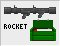

Rocket Launcher: Undoubtedly the most powerful weapon you will encounter is the rocket launcher. It is capable of turning your average enemy inside out and killing others nearby with the resultant splash damage. However, this weapon, whilst being ideal against tougher enemies, is not without its drawbacks. It’s slow rate of fire means you can find yourself vulnerable while waiting for it to reload. Add to this that extreme caution must be used when firing this weapon, as the splash damage from a rocket exploding nearby will hurt you as well as your intended target!

Rockets required by the rocket launcher are not to be found in an abundant supply, so don't waste them on a single pesky guard unless you have no other choice! Coming in crates of 2, you are able to carry a maximum of 10 rockets at any time (20 if you find a backpack).

Weapon Selection: Once you have more than one weapon, the keyboard buttons 1-7 choose the weapons. 1 selects the knife, 2 the pistol, 3 the machine gun, 4 the MCS Mk3, 5 the MCS Mk4, 6 the stealth rifle, and 7 the rocket launcher. Needless to say, you cannot select a weapon you don’t possess. If you run out of ammo for a particular weapon, you will have to manually select another weapon. If you run out of ammo for all available weapons, you can only use your knife. As mentioned previously, pressing the Ctrl key fires your selected weapon.

The weapon you have selected will be displayed on the far right side of your status bar as you play the game. The amount of ammo for the selected weapon will be displayed on the status bar also.

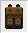

Backpacks: On occasion you may find an ammunition backpack. As well as containing a small assortment of ammunition, a backpack will enable you to carry twice the amount of ammunition you'd normally be able to carry for each weapon.

### Health/First Aid

There are numerous items that can boost (or reduce) your health in Spear "End of Destiny":

Small Medkit: Adds 5% to your health (up to a maximum of 100%).

Steak Dinner: Adds 10% to your health (up to a maximum of 100%).

Berry Bush: Found in outdoor areas. Those with red berries add 10% to your health (up to a maximum of 100%). Those with slightly brownish berries take 16% off your health. They look similar so be careful (didn’t your mother warn you about the dangers of eating things in the wild)?

Large Medkit: Adds 25% to your health (up to a maximum of 100%).

Portable Medkit: Like a large medkit, these add 25% to your health (up to a maximum of 100%). However, unlike the large medkit, these portable kits can be picked up and kept until needed. You can only carry up to two of these at a time. It’s always a good idea to have a couple of portable medkits on hand should you get caught in a tough situation with no other sources of first aid nearby. To use a portable medkit, you must first select it (just as you would select a weapon) by pressing the keyboard button 9. Once selected, press the Ctrl key to use one portable medkit and feel a lot better. But be careful, for while restoring health this way, you won’t have a weapon in hand and will be quite vulnerable to attack!

NOTE: There are also some special artefacts that affect your health – see more on these below. It is also important to note that when you pick up a first aid item (or treasure item) that the screen will momentarily flash with a yellow tinge (if the screen flashes this way when you haven't picked up such an item, then it means your enemies somewhere are collecting these goodies)!

### Keys

To progress through each level, you will need to find various keys located within the level in order to open certain locked doors.

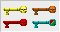

There are 4 key types - the gold key, the bronze key, the blood key, and the elevator key. Locked doors have locks which match the colour of the key required to open them.

NOTE: Necessary keys are never hidden in secret areas. However, keys required to access a secret area may be hidden.

### Treasure

To provide funding for rebuilding the Reich, the nazis took plenty of stolen treasure with them when they fled Germany. Deprive them of their ill gotten wealth (and line your own pockets in the process)! Most treasure items are secured in secret areas, so you will have to search to find it. Treasures you will find are:

Cross: Worth 100 points.

Chalice: Worth 500 points.

Chest: Worth 1000 points.

Black Diamond: Worth 2500 points.

Crown: Worth 5000 points.

### Artefacts

Whilst the Spear is being used by the nazis for evil purposes, it is important to note that the Spear itself is not necessarily an evil artefact. If the Spear is being used primarily for an evil cause, it attempts to counter this by creating artefacts that are designed to assist the forces of good. In such a situation, many of these artefacts can only be seen and used by those who oppose the evil for which the Spear is being used.

There are 7 "Artefacts of the Spear" which can be found in Spear "End of Destiny":

Artefact of Life: Raises your health to 125%, or in increments of 25 if you are already at 125% health (up to a maximum of 200%). Also worth 10000 points!

Artefact of Invulnerability: Grants you complete invulnerability for 30 seconds. If you have the "messages" feature (F12) turned on, a timer displayed in the top right hand corner of the screen will countdown the seconds remaining.

Artefact of Displacement: Teleports you to another location within a level. Can also be used by some enemies.

Artefact of Death: Kills anyone who moves over it, including you!

Artefact of Fury: Temporarily turns you into a knife wielding maniac capable of killing any enemy with one knife thrust. Lasts for 30 seconds. If you have the "messages" feature (F12) turned on, a timer displayed in the top right hand corner of the screen will countdown the seconds remaining.

Artefact of Regeneration: Slowly restores your health to 100% in increments of 2. You must stand on top of this artefact for it to work.

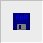

Artefact of Preservation ("Tournament" mode only): Gives you an extra opportunity to save your game.

### Interactive Objects

Other than doors, elevators, weapons and other trinkets as described above, there are a number of items you can directly interact with in Spear "End of Destiny". These items may affect the strategies you implement.

Barrels: Some barrels contain flammable vapours that can trigger an explosion if the barrel is damaged. The explosion will hurt nearby enemies, and you too if you're too close! Some exploded barrels will leave behind a toxic green sludge that will harm you if stepped on.

Toxic pools: Toxic waste chemicals stored in many barrels have sometimes been spilt on to the ground by their clumsy nazi handlers. These chemicals form a green sludge puddle on the ground - avoid stepping on them as they detract from your health.

Stone Columns: Some stone columns in the estate are rather crumbly, and can be destroyed to allow access to other areas. If you're low on ammo, it may be wise to use your knife to weaken the column instead of wasting valuable ammo (definitely not recommended for barrels though)! Bear in mind that not all stone columns are destructible.

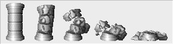

NOTE: Destroying a stone column will not cause any harm to you or your enemies.

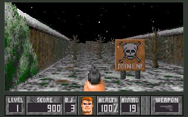

Landmines: The nazis have planted landmines in several outdoor areas. Stepping on one can cause considerable injury, and, as they are difficult to see, caution must be taken when taking a stroll through certain forest areas. Although they are a hazard, they can be used to advantage in certain situations as they will kill enemies who inadvertently step on one. In most situations, areas planted with landmines are marked with warning signs. Who said the enemy wasn't considerate?

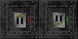

Wall switches: As an added security measure, Heinrich Haufmann has had a number of security devices installed throughout the estate that are remotely controlled by wall switches. These switches do one of two things:

1. Open a secret "pushwall" that cannot otherwise be opened. Once such a pushwall has been opened, it cannot be closed by the same switch that opened it unless another separate switch has been installed to do so. These remote pushwalls are generally used to conceal secret areas located somewhere in the current level, or to conceal some form of dangerous trap.

2. Activate/deactivate a special wall unit that shoots dangerous fireballs.

NOTE: Throwing a wall switch is often necessary to proceed through a level, but sometimes the consequences can be deadly! You’ve been warned!

### Secret Areas

There are a number of secret areas hidden in each level. Sometimes the entrance to such an area may appear obvious, but often it is not! Finding such areas can be time consuming, but it may be well worth the while, after all, you can't expect your enemies to just leave all the goodies lying around in the open for you! Most of the time you don't have to find these areas to complete a level, but it can certainly help you complete your mission if you do (or at least make you richer than what you are considering that most treasure items are hidden).

Unlike the original Wolfenstein 3D games, merely finding and activating a secret pushwall does not constitute having "found a secret". In Spear "End of Destiny", you may not even need to activate a secret pushwall in order to access a secret area. Other times, you may be required to activate more than one. When you have entered the secret area, a message will be displayed across the top of the screen advising you of the fact (the "messages" feature, accessed by pressing the F12 key, must be switched on for this feature to work).

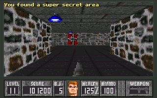

Some levels may have a "super secret" area that is especially difficult to find. These areas generally contain something special, such as a wealth of treasure, or perhaps access to some other kind of special area such as a secret level. As with normal secret areas, you’ll be informed via an on screen message if you find such an area.

As with the original Wolfenstein 3D games, essential items (such as keys necessary to progress through a level) are never hidden in secret areas. However, if you do happen to find a key in a hidden area, it may be worthwhile trying to find the bonus area it opens!

And of course, as all "Wolfers" would know, the best way to search for secret pushwalls is to run along a wall at a 45 degree angle whilst keeping the space bar depressed. Just make sure the area you’re searching in is free of enemies before you start!

### Secret Levels

In addition to the 25 regular levels, there are 12 secret levels to be found in Spear "End of Destiny". In many cases these levels can be difficult to find, but should you find one, be warned, they are generally more difficult than standard levels. However, this is compensated for by the fact they are generally loaded with treasure and opportunities to boost your score dramatically!

There are 3 categories of secret level in the game:

Normal: These secret levels are similar to normal levels in the game, but are generally more challenging.

Super: These hard to find super secret levels stand out from other levels in the game in that they have some crazy unique theme (a little like the "Pacman" level in the original Wolfenstein 3D). Expect something different!

Challenge: If you think the other levels in the game are tough, then you’re in for a shock! Challenge levels contain our nastiest traps and require you to think out a certain strategy for you to succeed. These levels are far from impossible to get through, but you’ll need to take risks, and learn from your mistakes!

NOTE: You’ll start each challenge level with only a knife. There’s an exit from the level right near where you start from in case you find the going too tough, but the penalty for such cowardice is that you’ll start the next level with only your knife! Special rewards await you near the end of a Challenge level, including powerful weapons & ammo, or perhaps even another secret level!

A number of secret levels can only be accessed from within another secret level. If you can find all 12 levels without cheating then you’ve made Sherlock Holmes look like an amateur!

### Regular Enemies

There are 6 regular enemies you will encounter in the game. Most will drop ammo clips when killed. And remember, shoot to kill, as wounded enemies (except clones) can use health items thus robbing you of the opportunity to heal yourself!

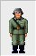

Guards: Wearing the traditional green uniform of the Werhmacht, these guys are easy enough to dispatch individually, but are potentially dangerous in groups.

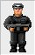

SS: Dressed in traditional black, equipped with machine guns and wearing bullet proof vests, the elite SS make tough opponents, and are extremely dangerous in groups.

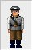

Officers: Very agile and accurate opponents. Although equipped only with a pistol, officers wear bullet proof vests that make them almost as tough to bring down as an SS.

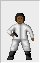

Clones: With the war being over, the nazis found themselves without a steady supply of dead bodies required to create the mutants that they’d used during those years. Using the same twisted technology of the maniacal Dr. Schabbs that was used to create mutants, the nazis have been able to use waste human organic material to clone slave peasants as a cheap mindless workforce. These disgusting abominations are armed with a pistol and don’t hesitate to kill anything they consider a threat. Kill 'em, and they revert back to their waste form! Yuk!

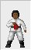

Suicide Clones: These special clones will just die to kill you! Instead of being armed with a pistol, these clones have an explosive charge strapped to their waist which they’ll attempt to detonate as soon as they get next to you. Be warned, the explosion will set off any other explosive devices nearby including certain barrels and other suicide clones making for one hell of a deadly bang!

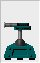

Rocket Turrets: Once they lock onto any threat detected, these dangerous stationary turrets will continuously fire rockets in your face until you’re a red stain on the floor. The light steel plating protecting them means they’ll take a little more to destroy than your other regular enemies.

### Boss Enemies

In addition to the regular enemies described above, there are some big bad bosses you’ll encounter as you explore through the estate.

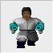

Superclones: These disgusting monstrosities are twice the size of a standard clone, but are many times stronger. They are a fast and dangerous enemy that guard various key areas within the estate. Once the pride of nazi clone creation, the production of Superclones was ceased by Heinrich Haufmann in order to give preference to the production of the newer "Ultraclones". Originally equipped with an MCS Mk3, the Superclones that remain have been rearmed with twin rocket launchers in an attempt to make them a deadlier foe.

Ultraclones: The nazis were determined to perfect the work of the twisted Dr. Schabbs, and this abomination is the end result! The Ultraclone may look similar to earlier versions of the Superclone, but don’t be fooled - it is an enhanced version of the Superclone. Other than being equipped with an MCS Mk3, the main difference between this new clone variant and the older Superclone is a form of experimental "re-animation" technology that was used in it's creation. In other words, if you kill one of these, it may stay dead, but it may not! Capable of regenerating themselves from "death" a number of times, it goes without saying that you need to exercise extreme caution around these horrors! You will soon learn to fear even their corpses as their lifeless grotesque faces stare up at you!

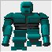

Cybertroopers: The overwhelming stench created by having so many clones in the estate resulted in Heinrich Haufmann requesting research be made into producing a super cybernetic trooper that could eventually replace the clones. Armed with twin traditional chainguns, these prototypes have so far proved quite effective, however they haven’t quite yet matched the deadly capability of the Ultraclones (looks like Heinrich will have to live with the smell for a while longer). Still, this doesn’t mean you can afford to take these Cybertroopers lightly.

Otto von Thugg: Thugg by name, thug by nature. This character is Heinrich Haufmann's number one henchman. With a taste for violence and a thirst for blood, his rocket launcher and classic chaingun have satisfied his lust nicely over the years. So sadistic is he that, as a form of "entertainment", he even had his own catacomb like dungeon constructed in the estate for the sole purpose of hunting down and exterminating poor Spanish peasant slaves. He's heard the stories of courage and bravery displayed by B.J. Blazkowicz, and would like to add the final chapter to the Blazkowicz biography. Needless to say, he's not planning on a happy ending for you!

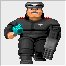

Heinrich Haufmann: Having taken over the nazis operations after the demise of Baron von Schmitt, Herr Haufmann is determined to make certain that things go according to plan this time around. He only packs a rocket launcher and an MCS Mk3, but unlike some bosses, he’s not prepared to take you on alone. Even if you do get the better of him, he has no reason to fear death, after all, he believes Baron von Schmitt's dying promise. It had something to do with meeting you in the fires of Hell

The Spear of Destiny: Although not a boss enemy, the Spear of Destiny deserves being listed in here alongside them. Having captured the Spear of Destiny from the nazis twice before, you need no introduction to this mysterious artefact. Taking possession of it will be the "easy" part. But you know only too well there will be a price to pay if you are to truly secure it. What does the Spear have in store for you this time? Perhaps your old foe Baron von Schmitt had known the answer to that...

### Enemy Deaths

An enemy death = points for B.J.! Whether you use a weapon or lure your foe into a trap - it doesn't matter how or what strategy you use to dispatch an enemy - you will always receive the allocated amount of points when an enemy dies. So, feel free to lure your enemies into a minefield. Or towards an Artefact of Death. Or kill them with exploding barrels. And relax in the knowledge that by doing these things you score points the easy way! So, if you see your score climbing mysteriously during gameplay, you’ll have the satisfaction of knowing that somewhere, some poor sod who’s out to get you has walked on a mine or stumbled into some other deadly hazard!

And the points earned for each enemy dispatched? You earn:

200 points for a guard  
200 points for a suicide clone  
400 points for an officer  
500 points for an SS  
500 points for a regular clone  
800 points for a rocket turret  
1000 - 10000 points for "boss" enemies (the tougher they are, the more they're worth).

### Hints and Strategies

If you are going to survive in Spear "End of Destiny", then you’re going to have to learn that filling every room with lead isn’t always the key to success!

Get them to come to you!  
If there is only one entrance, try to lure the guards to come out to you. This will make it easy to pick them off one by one. However, don’t expect this tactic to always work. Some guards are smart enough to use the same strategy and will wait for you to come in to them!

Get close where possible  
Shooting an enemy at close range will do them more damage than if you try picking them off from a distance. In other words, running straight up to an enemy and blasting them point blank will sometimes be a more effective tactic than hiding behind a corner firing pot shots at them. Just make sure the area you’re running into isn’t full of other enemies! Of course, if you have the stealth rifle, then maybe a few pot shots here and there wouldn’t go astray!

Every level has hidden stuff  
If you explore carefully, you’ll find extra health, ammo and other goodies everywhere! Sometimes it’s better to take your time searching for secret areas than trying to get to the level exit "dead on time"

Necessary items aren’t hidden  
As mentioned previously regarding keys, items you need to get to the end of a level aren’t hidden. Likewise, elevators (except those leading to secret levels) and exit stairways can be reached through the normal passages of a level without having to search all over the place for secret areas.

Conserve your ammo  
Some areas may have generous amounts of ammo lying around, but at other times you may find yourself desperately scrounging for any clip you can find. So think twice before wasting your ammo blowing up barrels or smashing stone columns - those few bullets wasted may save youur life! If you’re low on ammo, spend your time looking for hidden areas that may contain much needed munitions. After all, it’s no good bravely fighting off the hordes with a knife when there may be an MCS Mk4 hidden behind the wall next to you!

Great balls o’ fire  
Those walls that shoot fire may look impassable, but if your timing is right, you can walk through between individual firebursts without being hit. If your timing is poor then you’ll feel the pain. Sometimes, to get to your destination, you may have no other choice than to take the risk. A little practice and you’ll be weaving in and out of fireballs with the grace of a ballet dancer. But merely treating these fire hazards as something to avoid is a waste of potential. Why not use these hazards to your advantage? While some of your enemies will carefully avoid falling into their own traps, others aren’t always the smartest and will be so obsessed with pursuing you they’ll run blindly into the streams of fire. Lure them towards their own traps, then sit back and relax as your enemies march to their doom without you wasting so much as a single bullet!

"Friendly" fire  
Those rocket shooting turrets can be a pain in the butt. But those rockets can be a pain in the butt for your enemies also, as turrets are programmed to shoot at any perceived threat irregardless of whether there’s an obstacle in the way. Give the enemy guards a taste of their own medicine and lure them in between you and a rocket turret, and watch those rockets give your pursuers a literal pain in the butt! Just make sure you know how to strafe sideways left and right, as the odd rocket that gets through will be headed your way (or you can stand behind a solid object such as a fence. The turrets will still fire at you, but will harmlessly explode on the object instead of you).

NOTE: The same strategy can be used with Superclones or any other enemy that fires rockets. Enemies skilled in the art of using such weapons know how to avoid being harmed by "friendly fire", so don’t expect Superclones or rocket turrets to damage each other.

But that room was empty!  
Many areas are subject to roaming enemy patrols, and if guards are being attacked in a certain area then reinforcements could be sent in to investigate. So never assume that just because you’ve cleared an area of enemies that it will stay that way. A number of your enemies may be used to seeing death and thus may be stupid enough to dismiss a dead comrade’s body as being due to a faulty suicide clone or some other mishap and therefore do nothing. But some enemies patrolling through areas you’ve already visited will notice the carnage you’ve wreaked on their buddies and will come looking for you, no matter where you are! In short, learn to watch your back if you wish to stay alive.

Finding secret areas  
Don’t feel you have to find every secret in every level! Certainly, if you’re low on ammo or health, then it would pay to search those areas you haven’t already in case you’ve missed a hidden stash of ammo or first aid. But some secret areas are very difficult to find and may require a certain strategy to reach them. Don’t let yourself get bogged down looking for every single secret. On the other hand, difficult to find areas can yield huge rewards, so persistence can pay off!

What did that switch just do?  
Most of the time the consequences of throwing a switch on a wall will be immediately evident. But sometimes it won’t! If you throw a wall switch and nothing seems to happen, then perhaps it’s because the action triggered takes place elsewhere in the level. Who knows, maybe it’s the first step on your way to finding a Super Secret area?

Brains not brawn  
One of the most important keys to survival is to study your environment as you explore. Brute force may win most battles, but sometimes you may come across situations that require a little thought, some careful planning, or a certain strategy in order to get through unscathed. If your regular tactics are failing to get you through a certain area, then try something else. The solution to your problem may be as simple as using a switch or an artefact somewhere nearby!

Artefacts can be the key to success!  
Certain artefacts can give you the edge against the enemy hordes. But there are two artefacts that, when combined, make you temporarily unstoppable! Should you ever have the opportunity to grab both an Artefact of Invulnerability and an Artefact of Fury simultaneously, then you will be able to kill any enemy in the game with one knife stab whilst being completely invulnerable! Whenever you find these two artefacts together, don't waste them! Waste not, and ye shall want not!

NOTE: Should you grab both an Artefact of Fury and an Artefact of Invulnerability together, then the time remaining indicator displayed in the top right corner of the screen applies to the last of the two artefacts you grabbed.

Find the going too tough?  
You can always cheat by pressing the HAC keys simultaneously at any time during gameplay to give yourself full health and add a nice boost to your ammo supplies (but you'll lose the added carrying capacity of a backpack if you have one). However, should you take this cowardly option, your score will be reset to zero, and will remain at zero for the remainder of your game. The lesson here is that cheaters never prosper! In other words, if you're chasing a high score, don't cheat! Loading a previously saved game (one saved before you applied the cheat), or starting a new game, will restore your scoring ability.

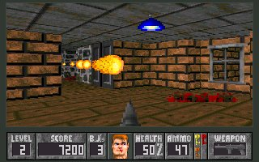

## Troubleshooting

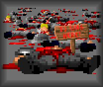

1. General

2. VDMSound/Dosbox

3. Brightness

4. Memory

5. Game Crashes

6. Sound Problems

7. Known Bugs

8. Disclaimer

### General

Spear "End of Destiny" is a DOS based program that uses the same game engine technology as the original Wolfenstein 3D. It should be able to run on any IBM compatible system, but depending on your system configuration there may be certain steps you have to take in order to run the game properly. Many of the problems associated with running the game are as a result of certain requirements needed by the game not being met due to newer operating systems and hardware and/or the way some people have their system configured.

Windows 2000/XP do not support sound in old DOS based games as well as Windows 95/98/Me. Likewise, soundcard hardware released in recent years often isn’t totally compatible with older soundcard standards that existed when Wolfenstein 3D was first released in 1992. If you use Windows 2000/XP then you will most likely find you have no music or sound at all, and as such we recommend you use either the utility "VDMSound" or "Dosbox" (see next section) to easily solve this problem. If you use Windows 95/98/Me and experience sound problems in the game (such as music sounding "offkey", or no music or sound at all), then the problem is most likely related to your soundcard settings (see the "Sound Problems" section).

Other problems you may experience with running the game are often memory related. In the old pre Windows days of DOS, gamers were quite adept at tweaking their systems to maximise their system memory in order to meet the demands of many games of the day. Unfortunately, with the advent of Windows 95 and beyond, this has become somewhat of a lost art, and should you experience problems with running the game we've suggested some steps you can take to resolve this in the "Memory" section further below. Although the troubleshooting advice offered in the sections below is based on a system running either Windows 95/98, much of the information offered is relevant to other operating systems also. Good luck, and have fun!

### VDMSound/Dosbox

If you use Windows 2000/XP, then a handy little utility program called "VDMSound" (freely available off the internet) is often all you'll need to solve any sound problems you may experience with the game. As mentioned above, Windows 2000/XP do not offer old DOS based games the same level of sound support that earlier versions of Windows offered. VDMSound is a program that emulates soundcard settings that were common in 1992 and as such should help you to hear sound and music in the game the way it was meant to be heard. A quick search of the web should enable you to easily find this utility program (make sure you get the latest version. The version of VDMSound we tested was version 2.0.1, and only runs on systems using Windows NT/2000/XP, so if you use Windows 95/98/Me then you may have no choice but to either use "Dosbox", or follow the suggestions outlined in the "Sound Problems" section further below). Should you use VDMSound then you MUST disable both "DPMI support (DOSX)" and the "CLI/POPF workaround" options (both of which are enabled by default). Failure to do so may result in wrong colours being displayed in game, and will likely lead to the game crashing with an "out of memory" error message. These options can be found by right clicking on the VDMSound shortcut you create for the game, then clicking the "Advanced" button, and selecting the "Compatibility" tab (if you're not sure about this kind of thing, then ask a friend who knows a little about computers).

Alternatively you can try using the DOS emulator "Dosbox". Like VDMSound, this utility is freely available off the internet, and should help you overcome any sound related problems you're likely to experience with the game. Please note that Spear "End of Destiny" will not work with earlier versions of Dosbox - you'll need version 0.61 or later (note also that you'll probably need at least a Pentium 3 or equivalent in order to achieve decent framerates using Dosbox).

NOTE: Problems often occur simply because people fail to read the documentation that comes with a program. Should you decide to use either of these two utilities, please thoroughly read the documentation that comes with them! If you still experience problems running, or attempting to run, either of these programs, please contact their creators.

### Brightness

Many early DOS games didn't offer the option to adjust their brightness levels. Wolfenstein 3D was one of these, and being that Spear "End of Destiny" uses the Wolfenstein 3D source code as a base, it too lacks such an option. In the early days of DOS gaming, gamers mostly just adjusted their monitor's brightness and/or contrast settings if a game appeared too light or dark. If Spear "End of Destiny" appears too dark, we suggest you do likewise.

Unfortunately, many monitors lose their ability to display at their maximum brightness over time, with some getting so dark you can suffer eyestrain continuing to use them! With most games these days offering gamma and brightness adjustment, and Windows software that can enable you to adjust the gamma levels of your display, you may not even notice any such deterioration. If your monitor is affected this way however, then Spear "End of Destiny" may appear quite dark even with your monitor set to maximum brightness.

Some levels in the game have darker shading than others. The first level in the game is one of these "dark" levels being that it set outdoors during night. However you should still be able to see distant walls and objects quite clearly in this level (although they will of course appear darker). If not, and adjusting your monitor to maximum brightness settings doesn't help, then you can turn the game's shading feature off by holding down the "Backspace" key and pressing the "S" key. Not all levels are this dark though, so when the next level starts, use the Backspace-S combination again to turn shading back on to check if the shading for the new level is acceptable or not. You can turn shading off or on at any time during the game should the need arise.

Alternatively you could always buy a new monitor (for an old DOS game? "Like - yeah!" :)

### Memory

It doesn’t matter if your system has 1 gigabyte of RAM, the most important thing as far as the game is concerned is how much "conventional" memory your system has. If Spear "End of Destiny" won't run on your system, it could be due to your system having insufficient conventional memory available. You require at least 560 kb of such memory in order for Spear "End of Destiny" to run reliably. If you have less than 560 kb, you may experience problems such as the game refusing to run with the maximum view size, or even "dumping out" altogether. The more conventional memory you have free, the better. If you have less than 560kb of conventional memory free, there are ways of freeing up more (as decribed below).

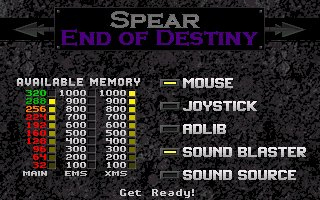

Although the game will also use available "expanded" (EMS) and/or "extended" (XMS) memory, the conventional memory is the most critical. If the game doesn’t start at all, it may be that you have less than 560kb conventional memory free. If the game starts up, you'll see 3 memory indicators under the title "Available Memory". The one on the far left listed as "Main" is the most important. If the yellow indicators are only as high as the red 224 (or lower), then you may need to free up more conventional memory for reliable performance.

The following is straight from Microsoft Windows 98’s help database:

To determine whether Windows 98 is configured to provide enough conventional memory for a DOS based program:

1. Right-click the program's icon or shortcut, and then click Properties.

2. Click the Memory tab.

3. In the Conventional memory area, if a specific value is selected in Total or in Initial environment, verify that the value is high enough. If the value is high enough but the problem persists, in Total and in Initial environment, select Auto instead of a specific value.

4. Click OK.

If following this advice doesn’t help get the game running, then further steps as detailed below may be required.

To find out how much conventional memory your system has, open a DOS command prompt window, and type:

mem

then press the Enter key. At the bottom of the readout, you should see a line that says:

Largest executable program size 608K (623,008 bytes)

NOTE: Typing mem/c instead of mem will report exactly what programs are running in the background and how much conventional memory each program is using.

The 608K indicates you have 608kb of conventional memory free. Anything higher than 560 should give you reliable game performance. If you have less than 560kb free, the game may still run, but we can’t guarantee anything!

If you have insufficient conventional memory free, you will have to stop some of those programs running in the background from starting when you start your computer. To do this, open your config.sys file (located in your C drive’s root directory – open it from within "Notepad" or some similar text editor) and, if they're not already there, try inserting the following lines at the top:

DEVICE=C:\WINDOWS\HIMEM.SYS  
DOS=HIGH  
DOS=UMB  
DEVICEHIGH=C:\WINDOWS\EMM386.EXE AUTO RAM

Or alternatively try:

DEVICE=C:\WINDOWS\HIMEM.SYS  
DOS=HIGH  
DOS=UMB  
DEVICEHIGH=C:\WINDOWS\EMM386.EXE AUTO NOEMS

The first option enables "expanded" memory on your system. If the first option still fails to provide enough conventional memory after you restart your system, try the second option. The second option disables expanded memory but should provide more free conventional memory. It's quite possible your config.sys file has other "DEVICE=" lines. In addition to inserting the lines above, try changing those to "DEVICEHIGH=" and it's possible these "devices" may be loaded into upper memory areas thus freeing up conventional memory. Of course you'll need to restart your computer again for these new settings to take effect.

Or, if you're certain you don't need particular device drivers loaded from your config.sys, just put the letters "rem" in front of the line you don't need eg:

rem DEVICE=C:\ATACR\ATAPIMGR.SYS

The "rem" will stop that particular driver loading and hogging precious conventional memory. Of course, if you later find you really do need to have that particular line loaded, you can just remove the "rem" and restart your computer.

If all this is too confusing, we’ve included a sample "config.sys" file in with the game files. Copy this file to the root directory of your C drive (don’t forget to back up your existing config.sys file first!) and then restart your computer. If you're lucky it may help.

Another file that may need attention is the "autoexec.bat" file (located in your C drive’s root directory). This file automatically runs certain programs each time you start your computer, such as virus checking programs etc. It could be that these programs are hogging precious conventional memory you need for Spear "End of Destiny" to run. Open the autoexec.bat file from within a text editor such as Notepad, and use the "rem" command in the same way as described above to prevent certain programs loading the next time you start your computer. You can just remove the "rem" commands and restart your computer again should you find a program you absolutely need is not running.

If you have no luck with any of the above, try moving the config.sys and the autoexec.bat files to another location temporarily, then restart your computer. This may or may not free up the conventional memory you require to run the game. Don’t forget to move the files back to their original location afterwards.

Remember that any changes you make to the config.sys and/or autoexec.bat files won’t take effect until after you’ve restarted your computer. After restarting, go to the DOS command prompt once again, type

mem

and press the Enter key. If your "Largest executable program size" is now above 560kb, then you should be able to run Spear "End of Destiny" with few problems.

If you’re still having problems, then we suggest you get a computer savvy friend who knows a little about this kind of thing to help.

### Game Crashes

If for some reason your system decides it doesn't like something the game is doing, then the game will most likely just "dump out" with an error message. This won't harm your system, but it will mean that you'll lose whatever progress you'd made in the game after your last save.

If you've got a standard type of computer with an adequate amount of conventional memory (see above), you shouldn't experience any crashes at all, but there is one possible exception

If you play the game for extended periods making lots of saves and reloads as you play, the game may "dump out" with an error message. This same kind of thing used to happen with the original Wolfenstein 3D games. It could be due to a "memory leak" of some sort - whatever, it was a part of the original Wolfenstein 3D that we couldn’t rectify. Having said that, you’re unlikely to encounter the problem unless you play for hours on end and you save/reload a lot.

If it does happen, well, it's no major problem. Just restart the game, load from your last save, and away you go again!

### Sound Problems

In order to hear sound and/or music in the game, your computer will require an Adlib or Soundblaster compatible sound card. When you start the game, it should automatically detect the presence of such a soundcard. If it doesn't, there are a few things that may be the cause. The most common causes will hopefully be solved by checking the following:

1. If you're not getting any sound at all, or the music in the game sounds "off key", then one possible cause is due to your soundcard's "interrupt" setting. To check this, from Windows 95 or 98, click "Start", "Settings", "Control Panel", then double click on the "System" icon. Click the "Device Manager" tab, and you should see a list of various hardware components installed in your computer. Look for "Sound, video and game controllers". To the left of this there should be a + sign; click on this to open the sub tree. You should see your soundcard listed in there. Click on it, and then click on the "Properties" button. Now, click the "Resources" tab, and you will see a number of settings assigned to your soundcard.

If the "Interrupt Request" setting is higher than 7, then that's most likely your problem. You'll need to change this, as the old Wolfenstein 3D engine didn't recognize soundcard interrupt values of greater than 7. To do so, deselect the "use automatic settings" option, then highlight the "Interrupt Request" option and click on "Change Setting" (you may have to change the Basic Configuration Setting if Windows won't allow you to change it). Now, click on the arrows until you find a number lower than 8 that isn't being used by any other system component (Windows will list what components are using each interrupt). If there's one lower than 8 that's free, select it! If there's not, you'll have to assign something else that's using one of these lower interrupts a higher figure so as to free up the lower one for your soundcard.

Some soundcards will not allow you to change their "Interrupt Request" setting. In this case, you could try "VDMSound" or "Dosbox" (as described earlier), or just play the game without music if the other "in-game" sound effects work OK. You could always play the game with PC speaker support, but all you’ll hear are strange bleeps and bloops as you play (which may be a real nostalgia trip for some computer game buffs but certainly not for us)!

Please bear in mind that the above procedure is from within Windows 95 or 98. The procedure to follow from Windows Me/2000/XP may be slightly different to this. And if all this hardware setting stuff is a little confusing, well, you'd be best to get a friend who knows a little about computers (or a computer technician) to help out rather than attempt to fiddle around with things yourself!

2. Another possible cause of sound problems may be found in your autoexec.bat file. Although you may still get in-game sound without the following, it's certainly worth trying this if step 1 above doesn't seem to be your problem.

In your autoexec.bat file, you may have a SET BLASTER line that looks like this:

SET BLASTER=A220 I5 D1 H5 P330 T6

or

SET BLASTER=A220 I5 D1 T4

This tells your computer to set your Soundblaster (or compatible) so that DOS based programs will be able to detect it. Without trying to get too technical, the "A" points to the hex IO address, The "I" indicates the interrupt request, the "D" the low DMA, the "H" the high DMA, the "P" the MPU-401 UART address, and the "T" the soundcard type (refer to your soundcard manual).

Generally, A220 , D1, H5 and P330 are pretty much standard for most soundblaster type cards. Often, the number 5 is a common setting for the "I" value, but other figures can be used. You'll have to ensure the "I" setting matches that listed for the soundcard's interrupt request as explained in step 1.

Don't forget, you’ll need to restart your computer in order for altered settings to take effect.

NOTE: If your autoexec.bat file doesn’t have such a line in it, try inserting a "set blaster" line into it that reflects your current soundcard settings and restart your computer. This may not work, but it’s worth a try.

3. If you've accounted for the possible problems as per steps 1 and 2 above, and are still having no luck, then look for a file named "config.eod" in the folder where you installed Spear "End of Destiny" to. This file contains information pertaining to your soundcard. It's possible it may have incorrect settings in it. Delete it, and then try running the game (the game will create a new copy of the file with updated information in it).

4. Although unlikely, if the sound engine should "lock up" for some reason during the game, try pressing the keys "BAT" simultaneously to reset it.

If none of the above help with sound problems, and you haven’t tried "VDMSound" or "Dosbox", then we can only suggest you ask someone who may understand your particular computer setup.

We (AReyeP & MCS) have run the game on a number of different systems, each with different setups and different soundcard types. Problems we have encountered with sound on various computer configurations include the following:

1. If you have a Soundblaster AWE64 soundcard, you may sometimes find in-game sound effects "drop out" eg: you may not hear a door open, or your weapon firing on some occasions. The other systems have different soundcards (one has a Crystal 3D Soundblaster clone, another a Soundblaster 16 clone built on to the motherboard, another a genuine Soundblaster 16, and yet another a very early model Soundblaster card), and none of these systems experienced these "drop outs". Could just be an issue with the AWE series of Soundblaster soundcards.

2. On the system with the "on board" Soundblaster 16 clone, the soundcard’s "Interrupt Request" (IRQ) value is 10 (this setting cannot be changed on this particular soundcard). The in-game sound effects work, but the in-game music sounds "off key". If you experience this problem, follow the steps as outlined above, or just go to the "Options" menu in the game, select the "Sound" option, and in the "Music" section select the "None" option. Better a game with no music than crappy sounding stuff!

### Known Bugs

We wish we could say there were no bugs! But there are a few which, thankfully, are very rare. Hopefully you shouldn't even encounter these at all whilst playing the game (unless you deliberately go looking for them)!

1. One bug we are aware of was present in the original Wolfenstein 3D game also. After playing for extended periods and saving/loading games on a frequent basis, you may find some wall tiles display the incorrect textures. If this happens, it most likely will occur on a large complex level. We could have made the levels smaller and less challenging to avoid the likelihood of this ever happening, but we didn't wish to sacrifice features in levels just so as to try to avoid a bug that is very rare anyway.

If you do find that some wall graphics look decidedly out of place whilst playing, then save your game, quit the game altogether, and restart the game. After loading the game you just saved, all should be OK.

2. Rocket Launcher: If you fire a rocket whilst standing in an open doorway, or whilst standing in front of an open doorway, you may not see the rocket you've just fired. Likewise, if you fire a rocket and then "chase" it, it'll appear to "disappear".

3. On very rare occasions when you stand face to face with an enemy who's in the middle of a doorway, the enemy may appear to "disappear" (or be "invisible"). If this happens, just back up a fraction and the enemy will become visible again.

4. On rare occasions when opening a doorway and encountering an enemy directly on the other side, the enemy may appear to "jump" a space as they move towards you through the doorway. Thankfully though, as stated, this is a rare occurrence.

5. Occasionally, if you run into an "Artefact of Displacement" while firing your weapon, the weapon will still appear to be firing (even though it isn't) when you arrive at the teleport destination. This will be reset when you next fire the weapon (or select another weapon).

6. "Gliding" guards! This problem occurred from time to time in the original Wolfenstein 3D also. Patrolling guards may sometimes appear to be "gliding" as they move instead of displaying the normal walking animation. This behaviour ceases once the guard becomes alerted to your presence. If this fault really annoys you, then we suggest you play a little Michael Jackson music in the background to make the behaviour seem quite normal :)

### Disclaimer

AReyeP and MCS take no responsibility for problems encountered as a result of running Spear "End of Destiny", or as a result of following or attempting to follow suggested courses of action as per the above "Trouble Shooting" section.

## A Big Thanks To id Software

Firstly, the creators of this Wolfenstein 3D mod (AReyeP and MCS Amsterdam) would like to thank id Software ([www.idsoftware.com](http://www.idsoftware.com)) for making the original "Wolfenstein 3D" and its sequel "Spear of Destiny". The guys at id made 3D gaming what it is today, as the Wolfenstein games were a breakthrough as far as today's 3D computer gaming is concerned. Wolfenstein was just the beginning. Afterwards, the team at id went on to make classic 3D games such as "Doom", "Quake" etc.

When John Carmack (head programmer at id software) made the source code for the earlier Wolfenstein games freely available to the public a few years back, it enabled Wolfenstein fans to alter the game in ways they had never been able to. And although Spear "End of Destiny" (and it's prequel "Spear Resurrection") were both made by 2 Wolfenstein 3D fans, they used this source code and the original game material as a base. As such, neither mod would exist if it weren't for the original Wolfenstein games and John Carmack’s generosity. Don't let it be said that id software don't look after their fans!

If you want the original Wolfenstein 3D (believe me, it's a classic that is well worth the small amount it would cost these days), then pay a visit to [www.idsoftware.com](http://www.idsoftware.com) (where you'll also find information on how to obtain the sequel to Wolfenstein 3D "Spear of Destiny"). Don't forget to check out the other great games they make!

Thank You!

AreyeP and MCS would like to thank the following members of the Wolfenstein 3D modding community for their direct or indirect contributions:

Greg "BrotherTank" Foley: Testing the game and reporting back to us on recommended improvements. In addition, the feature Greg contributed to our earlier mod "Spear Resurrection" (allowing us to use extra wall textures) has been used again in Spear "End of Destiny". Greg also contributed other ideas towards "End of Destiny" during its development.

Norberto Ariel "Arielus" Castañares: Testing the game and reporting back to us on recommended improvements.

Brian "Schabbs" Lowe: Testing the game and reporting back to us on recommended improvements.

(Actually, our three game testers named above deserve an extra big thanks, as they did an absolutely fantastic job! Their thoroughness, observations and suggestions resulted in a number of improvements to the game - thanks guys!)

Chris "Chokster" Chokan: Helping with conversion of some midi music tracks to Wolfenstein 3D game format.

Paul "The Master" Drude: Contributing design ideas towards this game manual’s layout.

"Ripper" of Chaos software: For making coding tutorials on night time sky effect, weather effects, non rotating sprites, shading routines, full screen view and "removing the scalers" freely available to the general community.

"Darkone": For his music and palette tools, and for making his floor/ceiling & animated texture tutorials freely available to the general community.

The Wolfenstein 3D community: For keeping this classic game alive, and for their never ending patience and understanding while we spent over 2 years slowly working on this mod and repeatedly deferring the release date. To those of you who said we'd never finish it - nyahh!!

To our families: For their tolerance of us spending so much time on things Wolfenstein related.

Finally...

A note from MCS Amsterdam:  
Should you ever find out how to enter "debug" mode, then you should be aware that certain rather "useless" cheats have been removed in order to save some precious memory. Instead, we added some more useful cheats for your convenience.

Available keys:

Tab-B (Knife Fury mode)  
Kill any enemy with one knife stab.

Tab-C (Count Objects)  
Displays the amount of static objects, doors and enemies used in the current level.

Tab-D (Display Ratio)  
Displays the ratio of kills, secrets, and treasures so far.

Tab-E (End level)  
Ends current level and displays intermission screen.

Tab-G (God mode)  
Invulnerability mode. No enemy, object or artefact can harm you.

Tab-H (Hurt yourself)  
Takes 16% off your health (you can use this if you get stuck and nothing else helps).

Tab-I (Item cheat)  
Adds health, points, weapons and ammo to your current total.

Tab-K (Item cheat)  
Adds all 4 keys to your inventory.

Tab-M (Memory info)  
Displays current memory usage.

Tab-N (No Clipping Mode)  
Used to walk through walls, static objects and enemies.

Tab-Q (Quit)  
Exit to DOS immediately, without saving current game.

Tab-S (Reveal Secrets)  
Highlights all secret pushwalls in the current level by replacing them with a bright texture.

Tab-V (View Position)  
Displays the current MapEdit coordinates of the player and the direction he's facing.

Tab-W (Warp to Level)  
Go directly to the level of your choice (1 up to 23).

Tools used by MCS Amsterdam:

UltraEdit v.7.10 and 8.00 (the ultimate editor, [www.ultraedit.com](http://www.ultraedit.com))

Norton Text Search for DOS v.7.0 (text search)

Audio File Manager v.1.0 by DarkOne (music and Adlib sound replacement)

Jpal2bin v.1.0 by DarkOne (palette conversion)

FloEdit v.1.0 by Florian Stohr (graphics and digitized sound replacement)

Paint Shop Pro v.5.03 by Jasc Software (graphic modifications)

CoolEdit2000 v.1.01 by Syntrillium Software (sound modifications)

EatMem v.1.0 -author unknown- (memory management)

LZEXE v.0.91 by Fabrice Bellard (EXE compression)

Borland C++ v.3.1 (source compilation)

VThief 0.07 by Andrew Aksyonoff (screenshots)

MapEdit 8.4 by David Huntoon, Bryan Baker & Warren Buss (level design)

A note from AReyeP:

A special thanks to the people who run the websites "Graphtallica" ([www.graphtallica.com](http://www.graphtallica.com)); "Texture Universe" ([www.planetunreal.com/TextureUniverse](http://www.planetunreal.com/TextureUniverse)); and "3D Cafe" ([www.3dcafe.com](http://www.3dcafe.com)). These sites post a number of freely available textures that are fantastic. A number of these textures were used as a "base" in some of the textures created for Spear "End of Destiny". To the people that run these sites - a big thankyou - you are appreciated!

Thanks also the classic game "Ultima Underworld II" by Looking Glass for inspiration and some textures that were used. If Wolfenstein 3D was groundbreaking, then the Ultima Underworld games were revolutionary!

Tools used by AReyeP:

Paint Shop Pro ver 6.00 by Jasc Software (graphic creation & modification)

FloEdit v.1.0 by Florian Stohr (graphics and digitized sound replacement)

Mapedit 8.4 by David Huntoon, Bryan Baker & Warren Buss (level design)

Midi Orchestrator Plus ver 2.11.24 by Voyetra Technologies (midi editing)

Wlfaud Wolf 3D audio editor ver 1.1 by Bill Neisius

Goldwave ver 4.25 Copyright 2001 Goldwave Inc (*.wav editing)

Audio File Manager v.1.0 by DarkOne (for music replacement)

IMFCreator v. 1.0.4 by Adam Biser

Cool Page v. 2.72 by 3Dize (creation of html game manual)

Wolf 3D and Spear of Destiny (of course) by id software (who else)?!!!

And one last thing: should you ever encounter the term "betagraphiken saugen" anywhere in the game, it's just an "in house" joke between myself and MCS. Let's just say it was one of my poor attempts at German referring to some of my earlier "beta graphics" :)

Take care all :)  
AReyeP & MCS Amsterdam  
(November 2004)
