# Spear: End of Destiny

AReyeP and MCS's sequel to *Spear Resurrection*: 26 levels plus 12
secret ones, snowbound estates, mines, fire walls, rockets and a new
arsenal. The TC uses the v1.12 editor's version.

**[Manual](MANUAL.md)** · **[Hint book](HINTS.md)** (spoilers) ·
[areyep.com page](https://www.areyep.com/RIPandMCS-EoD-Main.html) · [back to the TC](../../../README.md)

## In the TC

<table>
<tr><td width="50%">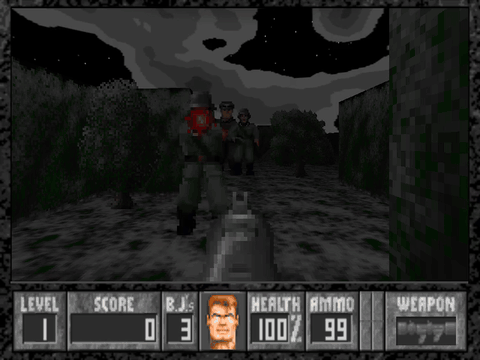 Estate Entry: rocket launcher against the guards</td><td width="50%">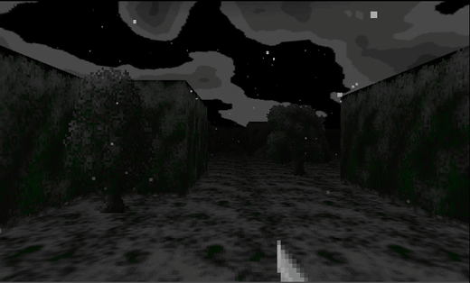 Snow and drifting clouds over Estate Entry</td></tr>
<tr><td width="50%">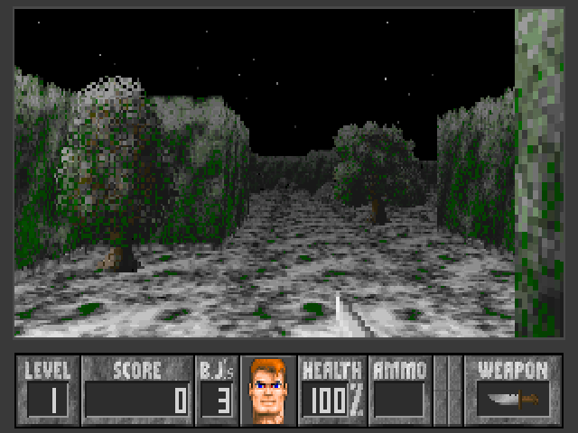 Estate Entry, DOS original</td><td width="50%">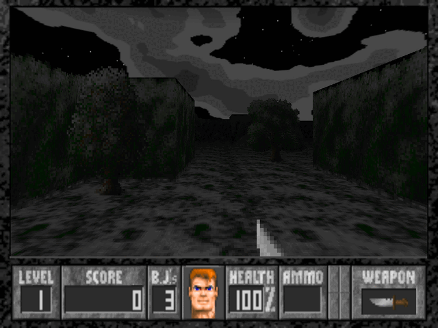 Estate Entry, in the TC</td></tr>
</table>

*The sections below are from [areyep.com](https://www.areyep.com/RIPandMCS-EoD-Main.html), by AReyeP and MCS, reproduced for players of the TC port. Text and pictures are theirs.*

## About the game

Wolfenstein 3D had a sequel in the form of "Spear of Destiny".  
"Spear Resurrection" was our answer to a sequel to this classic game by iD Software.

**Now there's a sequel to "Spear Resurrection"- Spear "End of Destiny"!!!**

Was the "Spear of Destiny" lost for all time?  
Had B.J. Blazkowicz saved the world last time, or just delayed the inevitable? Were the nazis again engaged in secret activities?  
Who is "Heinrich Haufmann"?  
What awaits the hero who should recapture the Spear this time?

All these questions, plus more, will be answered, but only if you have the guts and determination it takes to take on the role of B.J. Blazkowicz in his toughest mission yet! If you thought B.J. had things tough in "Spear Resurrection", then you don't even know the meaning of the word tough!

But before you embark on this critical mission, you'd be best to plan your course of action! Click [here](MANUAL.md) for the game storyline and manual - and if you should decide that you have the right stuff required to take on the role of B.J. Blazkowicz in this new battle to save the world, then maybe, just maybe, you're ready to take on "Spear End of Destiny"!

**What is "Spear End of Destiny"?**

"Spear Resurrection" was created in 2001 by 2 Wolfenstein 3D fans - namely "MCS Amsterdam", and myself (AReyeP - pronounced as R.I.P).

In the early part of 2002, the two of us decided an add on for Spear Resurrection was in order. Before too long, we had new ideas and a growing list of new features that we planned to use for this add on. It soon became evident to us that we were going to be making more than an "add on". And so the concept for a full blown sequel to Spear Resurrection was born, and "Spear End of Destiny" was its chosen name. Featuring a total of 26 levels, plus an additional 12 secret levels of varying difficulty, Spear End of Destiny will challenge you in ways the original Wolfenstein 3D games didn't whilst still retaining the original spirit of those earlier games. Dust off your weapons and get yourself psyched - a new challenge awaits!

MCS and myself have spent 3 years working on this sequel. We've had our quiet times where little was done, and our bursts of activity where progress raced ahead. It's been a gradual process, a leisurely one where we took our time and never rushed. With all the new features introduced by MCS, there was huge potential for all kinds of unexpected bugs, so we asked 3 dedicated Wolf 3D fans who are influential members of the Wolf modding scene to test the game for us. The end result is a mod that has been exhaustively tested to make sure that the final game is as professional as possible in both gameplay and presentation, and on a par with the original Wolfenstein 3D games by iD software.

MCS and I feel "Spear End of Destiny" will be a very worthwhile addition to any Wolf fans collection.

## Screenshots from areyep.com

Perhaps the best way to show the visual enhancements in Spear "End of Destiny" is to compare a number of screenshots from it up against our earlier mod "Spear Resurrection". Of course screenshots can only show what the game looks like - bear in mind thereare many new features that MCS has put into "End of Destiny" that screenshots could never show, but make a vast difference to the overall gameplay.

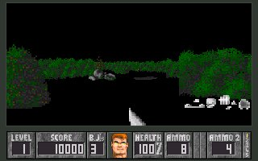

A typical "outdoors" scene from "Spear  
Resurrection" on the right ...

Compare to the three typical outdoor  
scenes from Spear "End of Destiny" shown  
below, and the difference is noticable ...

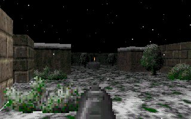

| 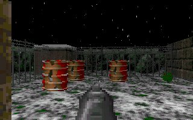 | 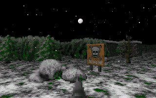 |
|---|---|

Below left: a scene from the "mine tunnels" in Spear Resurrection ...  
Below right: a scene from the "mine tunnels" in Spear "End of Destiny" ...

| 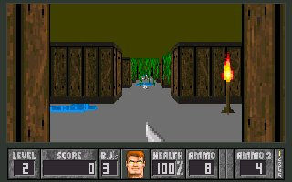 | 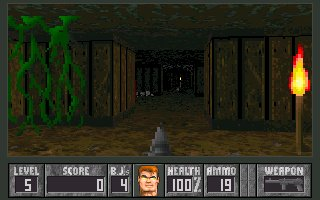 |
|---|---|

Below left: a scene from Spear Resurrection ...  
Below right: an equivalent scene from Spear "End of Destiny" ...

| 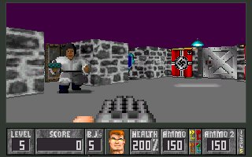 | 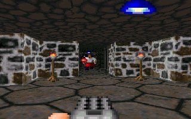 |
|---|---|

Below left: a prison scene from Spear Resurrection ...  
Below right: a prison scene from Spear "End of Destiny" ...

| 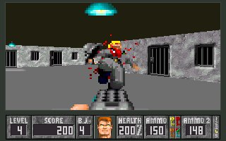 | 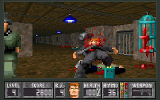 |
|---|---|

Below: some more general screenshots from Spear "End of Destiny" ...

| 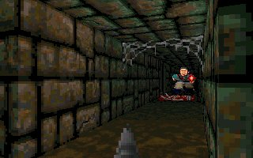 | 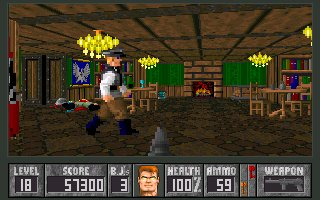 |
|---|---|

| 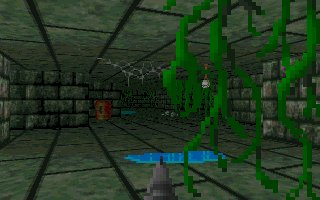 | 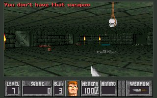 |
|---|---|

| 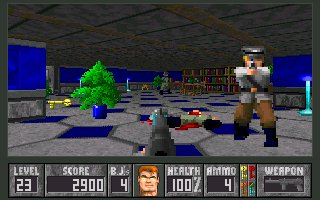 | 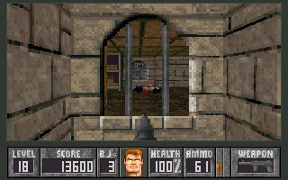 |
|---|---|

| 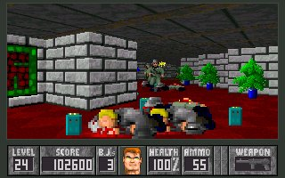 | 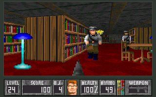 |
|---|---|
