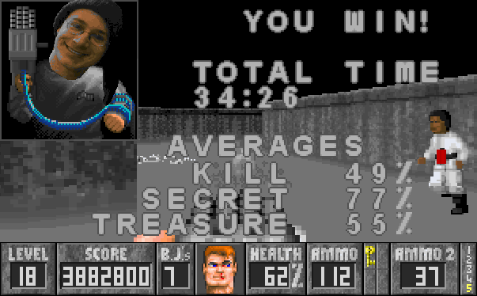

# Spear Resurrection: Hall of Fame

*From [areyep.com](https://www.areyep.com/RIPandMCS-Spearres-HallofFame.html), by AReyeP and MCS. The contest below ran on their site when the game came out (2001); it isn't open through this repo.*

Like to get YOUR name into the Hall of Fame? Then download Spear Resurrection, and read on!

All you have to do is play Spear Resurrection through on one of the two hardest skill levels without cheating! By cheating, we mean using the MLI keys (or their equivalent), or playing the game in "debugmode". Also, any attempt to edit the maps/savegame files etc will be detected by MCS' coding, and this kind of thing will be determined to be a cheat. But, you can save and reload games as often as you wish.

See if you can crack it for a high score and make it to number one on the Hall of Fame list! Beating par times will definitely help crack the 3 million barrier!

As soon as you reach the Spear of Destiny (ie: the moment you actually see the spear, just before you actually "capture" it), you'll have to save your game and send the savegame file to us. [...] MCS and I will check the saved game to verify cheats haven't been used. Your name and score will be listed in the Spear Resurrection "Hall of Fame", with the highest score taking number one position. And don't be afraid if your score isn't the highest - if you completed the game without cheating, you're a worthy entrant into the Hall of Fame!!!
