# Spear Resurrection: Hint Book

*From [areyep.com](https://www.areyep.com/RIPandMCS-Spearres-HintManual.html), by AReyeP and MCS, reproduced here for players of the TC port. Text and pictures are theirs; the links to downloads go to their site.*

> **Spoilers.** Every level's map, secrets and route are below.

To activate cheats in the game, just follow the following directions:

Type CAH (hold the 3 keys down simultaneously) in the game to get full ammo/keys etc, but zero score (like MLI in the original Wolf).

To enter "debugmode" in Spear Resurrection, just run the game by typing the following at the DOS prompt: spear -pinorules  
Or alternatively, just set a shortcut from Windows adding the -pinorules parameter to the spear.exe file.

Once in debugmode, just type the following key combos in game to activate the cheat described (eg: holding down the Tab and G keys simultaneously will put you in God mode):

Tab-C (Count Objects)  
Displays the amount of static objects, doors and enemies used in the current level.

Tab-D (Display Ratio)  
Displays the ratio of kills, secrets, and treasures so far.

Tab-E (End level)  
Ends current level and displays intermission screen.

Tab-G (God mode)  
Invulnerability mode. No enemy, object or artefact can harm you.

Tab-H (Hurt yourself)  
Takes 16% off your health (you can use this if you get stuck and nothing else helps).

Tab-I (Item cheat)  
Adds health, points, weapons and ammo to your current total.

Tab-M (Memory info)  
Displays current memory usage.

Tab-N (No Clipping Mode)  
Used to walk through walls, static objects and enemies.

Tab-Q (Quit)  
Exit to DOS immediately, without saving current game.

Tab-V (View Position)  
Displays the current MapEdit coordinates of the player and the direction he's facing.

Tab-W (Warp to Level)  
Go directly to the level of your choice (1 up to 23).

**Levels:** [1](#level-1) · [2](#level-2) · [3](#level-3) · [4](#level-4) · [5](#level-5) · [6](#level-6) · [7](#level-7) · [8](#level-8) · [9](#level-9) · [10](#level-10) · [11](#level-11) · [12](#level-12) · [13](#level-13) · [14](#level-14) · [15](#level-15) · [16](#level-16) · [17](#level-17) · [18](#level-18) · [19](#level-19) · [20](#level-20) · [21](#level-21) · [22](#level-22) · [23](#level-23)

## Level 1: The Black Forest

This forest has been booby trapped by the nazis with landmines, and is guarded by a number of guards and "Suicide Clones". The landmines are hard to see, but if you look carefully, you'll see a grey line marking the ground where they've been buried. The best way to survive this level is to use stealth, and to remain alert! For those willing to take the time to explore, plenty of rare black diamonds (worth 2500 points each) can be found in this level.

1: BJ starts here.

2: Need a pistol? The guard just around the corner will be happy to give you his, provided you kill him first that is.  
The best way to do that is to let him see you, then hide around the corner as he runs into that landmine blocking his path! Voila! The pistol is yours!  
NOTE: Areas after this point are littered with landmines. They're hard to see, and can be planted amongst vegetation making it even harder. Watch your step, and hope the enemy don't watch theirs! And watch for Suicide Clones - they're silent, but deadly!

3: Detour to this area to find a secret enclosure built into the hillside. There are some handy ammo clips and a few black diamonds from the mines hidden within.

4: Follow the red dotted line for a quick exit - handy for beating par times, or for just making a quick exit from this forest of misery! Or, you may prefer to explore other areas in search of rare black diamonds.

5: 10,000 points worth of treasure in this secret area - may be worth your while.

6: Don't shoot the guard here - let him set off a mine which will save you ammo, and clear a path for you to access those treasure items he was guarding.

7: On to level 2!

Enemies marked in blue appear in all difficulty levels. Enemies marked in green appear only in difficulty levels "I'm a Hero" & "Suicidal Tendencies". Enemies marked in white appear only in the difficulty level "Suicidal Tendencies". Locked doors appear in the colour of the key required to open them, whilst unlocked doors are coloured grey (or green if it's an unlocked elevator door).

**LEGEND**

| 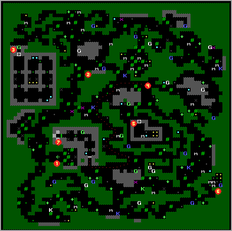 | 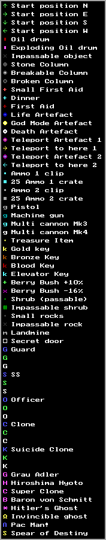 |
|---|---|

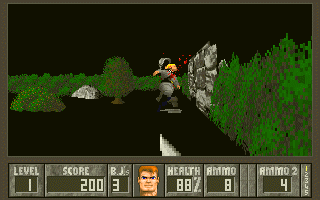

## Level 2: Subterranean mines

These mines are being used by the nazis to extract rare black diamonds to help fund the rebuilding of their "New Reich". Other treasure items are also being kept in storage in this underground den.

1: BJ starts here.

2: This secret area should be your first stop - a very handy machine gun can be found here. But don't waste time getting here - guards patrol the area and you'll be spotted before you get the machine gun if you take too long!

3: Needless to say, this secret area should be your next stop. The first aid kits here give you a place to run to should your health drop too low.

4: This secret pushwall opens up to some nice stores of treasure, plus there's some health and ammo to restore anything you lose dispatching the clones in the area.

5: Make your way through the mines to the bronze key located in this room.

6: Use the secret pushwalls to access this Artefact of Life should your battle scars be getting the better of you!

7: Once you have the bronze key, you'll have to backtrack your way through the mines to this area. You'll need the blood key here to proceed towards the last part of the level.

8: The gold key is located behind a breakable column - just make sure you take care of the clones in the area first.

9: Although you can access this room via the breakable column, the best strategy is to get the gold key first, then open the locked door with the explosive barrel just behind it. Stand back and shoot the barrel, and you should clear this room of most of its enemies, allowing you to pick up the elevator key without a fight!

10: On to level 3!

Enemies marked in blue appear in all difficulty levels. Enemies marked in green appear only in difficulty levels "I'm a Hero" & "Suicidal Tendencies". Enemies marked in white appear only in the difficulty level "Suicidal Tendencies". Locked doors appear in the colour of the key required to open them, whilst unlocked doors are coloured grey (or green if it's an unlocked elevator door).

**LEGEND**

| 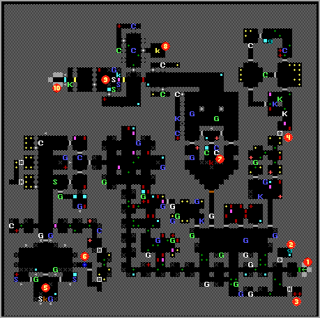 |  |
|---|---|

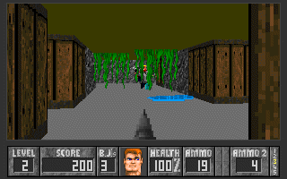

## Level 3: Catacombs

These passages run underneath the main castle complex. Once a part of the castle itself many hundreds of years ago, the area was subject to flooding in the wet season, and was abandoned by its Spanish occupants of the era. Stone columns were erected in many areas to add support to the roof areas to avoid the risk of cave ins.

The nazis, not wanting the castle breached from underneath by the likes of you, flooded the catacombs with clones. Mazelike in structure, these catacombs will be one of your greatest challenges!

1: BJ starts here.

2: Break the column to access this reserve of 1st aid - you'll need it.

3: This room should be your next stop. This mini munitions depot provides you with plenty of ammo for your pistol/machine gun, plus plenty of the rarer type of ammo used in the MCS weapons. Yes, there's a machine gun hidden near the start of the level, but your first MCS weapon (an MCS Mk3) is hidden here!

4: Your first foray into the catacombs should be to get the elevator key located in this small opening behind a breakable column. Having got this far, you'll have had a small taste of what to expect in the rest of this level! Don't forget to grab the ammo and treasure hidden nearby.

5: Make your way to this area where you can access an anbandoned mine area that leads to the blood key.

6: The blood key!

7: After getting the blood key, backtrack through the abandoned mines and make your way to this room where the bronze key is kept. After securing the bronze key, you'll have to head back to where you started this level.

8: Once back at this point, break through the stone column, and make your way through to point 9. Expect some heavy resistance along the way from cowardly clones hiding behind columns.

9: Now you have a choice. Head north and secure the gold key needed to access the elevator room at the end of this level, or head south, and access the caved in secret area that leads to the elevator to the first secret level! Or, perhaps you'd like to do both in order to collect that Artefact of Life located up near the gold key!

10: Elevator to the first secret level.

11: Should you decide to give the secret level a miss, head back to here, and break through the stone column to make your way through to the elevator room.

12: On to level 4!

Enemies marked in blue appear in all difficulty levels. Enemies marked in green appear only in difficulty levels "I'm a Hero" & "Suicidal Tendencies". Enemies marked in white appear only in the difficulty level "Suicidal Tendencies". Locked doors appear in the colour of the key required to open them, whilst unlocked doors are coloured grey (or green if it's an unlocked elevator door).

**LEGEND**

| 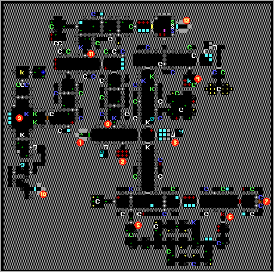 |  |
|---|---|

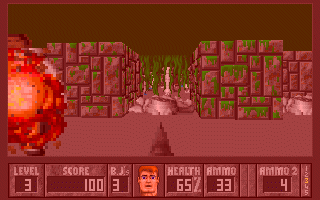

## Level 4: Castle Entrance

This lower castle level leads to the main castle entrance to the north, which is very heavily guarded. But, they're not expecting you to attack from inside, so the element of surprise is on your side.

1: BJ starts here.

2: There's no key to the locked door out of this area, but these breakable columns will allow you to bypass the door. Or, if you want to have a bit of fun and "break out" in a more spectacular fashion, stand back and shoot one of those red barrels! Don't forget to get that hidden machine gun once you're out.

3: Fight your way into this prison torture room for an MCS Mk3 that's not even hidden!

4: Now make your way here to the Prison Kommandant's office where the bronze key is being kept. This whole prison area is heavily guarded; you may wish to use the few explosive barrels in the area to your advantage. And remember - the greedy Kommandant is likely to have a stash of hidden treasure somewhere in his office, just as most greedy Kommandants have!  
5 & 6: There are 2 ways you can access the office areas at the bottom of this level; via the doorways at area 5, or 6. Area 6 would be the best option if your health is low after your romp through the prison area, as there's an Artefact of Life hidden behind a pushwall in this room. The office areas at the bottom of this level are worth exploring, as they provide some handy ammo and first aid items, as well as the odd treasure. Once your "exploration" is complete, make your way to area 7.

7: The blood key!

8: For those of you not wishing to hurry, there's a nice little treasure trove hidden off the "Mens Room" here that requires the blood key to access (and don't ask where the Ladies Room is)!!!

9: Make your way to this room where the purple coloured Artefact of Displacement (fancy name for "teleporter" :) is located. Load up on ammo, and jump into the Artefact of Displacement.

10: You'll be warped into this room, where you'll find yourself in a room full of clones! Fortunately, none of them are expecting you to just "drop in" like this, so while their backs are turned, tiptoe quietly towards the gold key, grab it, then quietly move down to the Artefact of Displacement in the same room to exit this area and warp back to the room where you came from. If you'd like to have a little fun and draw their attention to how slack they were not detecting your presence, fire a shot just before you warp out! Mind you, be prepared for them to come looking for you, as their sense of humour is sadly lacking!

11: Of course, if you like to do things the easy way, you'll grab this Artefact of Invulnerability before warping in to get the gold key, and go in with all guns blazing! In fact, you don't even need the gold key if you do it this way!

12: Be careful when you enter this room, as one shot will draw out all the SS at once. Grab the elevator key and you're out of here.

13: If you're not out to beat par times, don't forget to grab the treasure here.

14: On to level 5!

Enemies marked in blue appear in all difficulty levels. Enemies marked in green appear only in difficulty levels "I'm a Hero" & "Suicidal Tendencies". Enemies marked in white appear only in the difficulty level "Suicidal Tendencies". Locked doors appear in the colour of the key required to open them, whilst unlocked doors are coloured grey (or green if it's an unlocked elevator door).

**LEGEND**

| 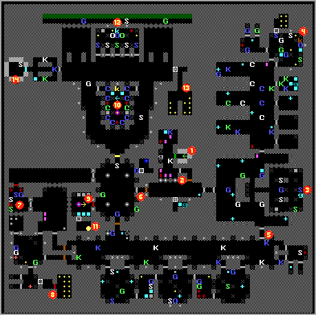 |  |
|---|---|

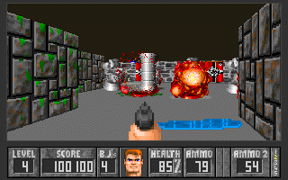

## Level 5: Superclone

If you wish to make your way to the middle levels of the castle, you have no choice but to defeat the Superclone in this level.

1: BJ starts here.

2: The small rooms just to the north and the south of this point offer a decent supply of ammo and health should you be starting this level with only a pistol, or with poor health.

3: Stock up on some MCS ammo here.

4: A visit to this room will dramatically improve your chances of success! Not only is there an MCS Mk3 in here, but a large reserve of MCS ammo plus first aid in the form of roast dinners. The best way to eliminate the enemies here is to make use of the explosive barrels. Set off one, and the rest will detonate taking out any enemies nearby.

5: Talk about making things easy! The Artefact of Invulnerability hidden here will cost you, as to get it, you'll have to detonate that barrel in the way, and the only way to do this is to stand right next to it. It'll hurt, and it may even hurt more if the barrel leaves behind a toxic sludge residue. But, once you've cleared the way, you can leave this artefact for later when you're taking on the Superclone himself!

6: Make your way here to get the blood key. Don't forget the Artefact of Life hidden nearby!

7: Once you have the blood key, it's back to here you must go in order to grab the bronze key. But be warned! As soon as you access the area the bronze key is in, you'll be seen by the Superclone - time to run for that Artefact of Invulnerability! If, for some reason, you've already used that artefact, you'll have to be careful how you deal with the Superclone, as there are a number of entrances leading to his lair he may emerge from. The best bet is to eliminate the clones guarding him first if you can, and then deal with him one on one.

8: Don't forget to grab all the treasure in the Superclone's lair. Plus the secret area off his lair has some handy first aid and ammo.

9: Once you've killed the Superclone and have taken his gold key, head to this point. Be warned, once you fire a shot in the room behind the locked door, you'll also alert the clones residing in the exit elevator located on the other side of the level, who'll come looking for you!

10: Grab the elevator key (and the hidden treasure nearby), and make your way to the exit elevator. Don't forget to watch for those clones...

11: On to level 6!

Enemies marked in blue appear in all difficulty levels. Enemies marked in green appear only in difficulty levels "I'm a Hero" & "Suicidal Tendencies". Enemies marked in white appear only in the difficulty level "Suicidal Tendencies". Locked doors appear in the colour of the key required to open them, whilst unlocked doors are coloured grey (or green if it's an unlocked elevator door).

**LEGEND**

| 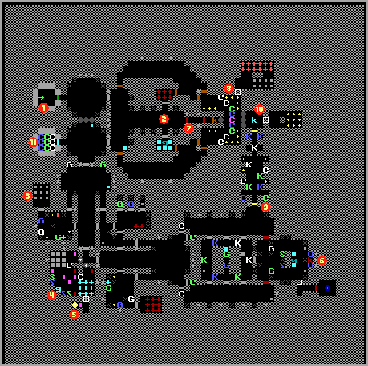 |  |
|---|---|

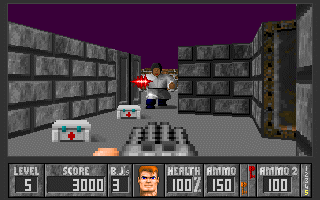

## Level 6: Grand Halls

The wide open hallways in this part of the castle have been used by the nazis in an attempt to create a grand "nazified" entrance to the upper castle levels. It won't look so grand though once you've littered the halls with bodies!

1: BJ starts here.

2: Stock up on goodies here.

3: Once you open this door and fire a shot, the guys hiding behind the locked bronze door will be alerted and will sneak up behind you. Be prepared!

4: Unless you sneak through the bronze door while it's open, break one of the stone columns here to proceed further.

5: Once in this hallway, be prepared to do some running and shooting, unless you'd prefer to stand in an alcove and wait for them to come to you, that is.

6: This secret area leads to some very nice things indeed, including your very first MCS Mk4! True firepower! But, you may want to save these goodies for the last part of the level.

7: Grab the bronze key hidden in the toilet block here.

8: Shoot the guards here, and then stand back and pick off the other guards as they come running out from the toilet block to see what all the noise is about.

9: You can wait until you have the blood key to access this area, or, you can access it beforehand by breaking some stone columns. Either way, there's an MCS Mk3, a machine gun, ammo and plenty of treasure to be collected from this area.

10: Here's the blood key. But, this area can be a deathtrap if you're not careful. Use the explosive barrels in this room to your advantage to help eliminate the enemy, and then the blood key is yours for the taking.

11: Use the blood key to access this area. Guards patrol the hall and adjoining rooms here, so beware of enemies coming out from the rooms adjoining this hallway. Eliminate all opposition before proceeding to 12.

12: The Artefact of Displacement here will take you to the gold key. But be warned! A large number of SS wait just behind those doors nearby - as soon as you warp in to grab the gold key, they'll see you!

13: Now's the time to be quick! Grab the gold key and use the Artefact of Displacement in this area to warp back to area 12 (before you do though, don't forget the hidden Artefact of Life here - you'll probably need it). Once you've warped back to area 12, the SS will come running after you - now may be a good time to run back and grab that Artefact of Invulnerability in the secret area at area 6, or, if you've already used it, prepare for a firefight!

14: Once you've taken care of all the SS, enter this area and break some columns to grab all the treasure in this storage room of ill gotten wealth.

15: Enter second elevator from the left, and on to level 7!

Enemies marked in blue appear in all difficulty levels. Enemies marked in green appear only in difficulty levels "I'm a Hero" & "Suicidal Tendencies". Enemies marked in white appear only in the difficulty level "Suicidal Tendencies". Locked doors appear in the colour of the key required to open them, whilst unlocked doors are coloured grey (or green if it's an unlocked elevator door).

**LEGEND**

| 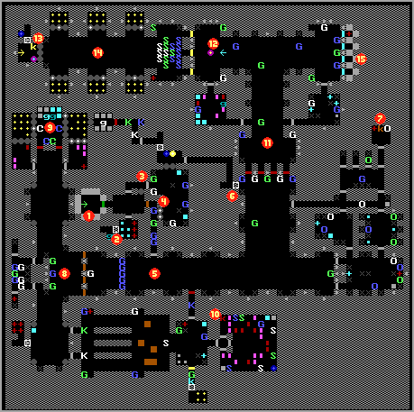 |  |
|---|---|

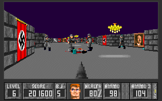

## Level 7: "X" Centric!

This level is named after the X shaped room that much of the action in this level centres around. This lower part of the castle was used mainly for housing Spanish peasants in prison cells, and for general storage.

1: BJ starts here.

2: The Artefact of Death in the doorway means you'll have to break one of the stone columns to access this room. But, before you do, alert the SS guarding this room to your presence. They'll come rushing through the door to deal with you. Just hide around a corner and let the Artefact of Death take care of them!

3: Be warned, after shooting the suicide clones in this room, the guards in the adjoining room will sneak up behind you if you're not careful. Break the column leading to their room, and grab the goodies in there. Don't forget the hidden machine gun.

4: Make your way through the prison area to this torture room where the blood key is kept.

5: With the blood key in your possession, head to this area. Be careful once in here - SS patrol many of the adjoining areas including this hallway! If you don't want to alert enemies in nearby areas, stealth and timing may be your best option here.

6: This secret pushwall in the toilet block leads to a very handy Artefact of Invulnerability - grab this just before running into area 7 to make life a lot easier.

7: This area can be difficult what with clones firing at you from different sides, and with other enemies likely to come running out from nearby corridors. If you haven't got the Artefact of Invulnerability from area 6, then the best bet here is to quickly follow either the red or green dotted lines to area 8 to grab the bronze key, picking off enemies as they come. There's a secret door off the corridor marked with the red dotted line that leads to 4 Artefacts of Life - anyone for 200% health?!!!

8: The bronze key is well guarded by a mix of enemies. Eliminate them and grab the key, which will allow you access through all the locked doors in this area.

9: After grabbing the bronze key, make your way down to the corridor at the bottom of the map, and then work your way towards the Artefact of Displacement found here in a storage room.

10: After jumping into the Artefact of Displacement from area 9, you'll find yourself stuck in a small metallic room. Don't worry - just push the wall in front of you and you're free again (not that the clones in this area will approve...)

11: Grab the gold key here.

12: Jump into the Artefact of Displacement here - not far to go now!

13: After warping from area 12, you'll find yourself stuck in another small metallic room! Just push the wall in front to escape, and yes, deal with the disapproving clones before you blindly rush in to grab the elevator key here...

14: On to level 8!

Enemies marked in blue appear in all difficulty levels. Enemies marked in green appear only in difficulty levels "I'm a Hero" & "Suicidal Tendencies". Enemies marked in white appear only in the difficulty level "Suicidal Tendencies". Locked doors appear in the colour of the key required to open them, whilst unlocked doors are coloured grey (or green if it's an unlocked elevator door).

**LEGEND**

| 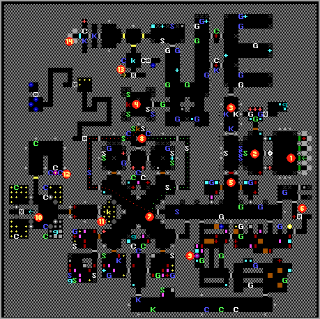 |  |
|---|---|

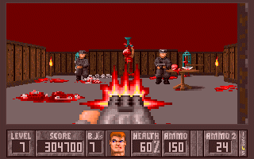

## Level 8: Easy Does It!

Rushing blindly into some of the winding corridors in this lower castle level will prove fatal. You'll probably need every health item you can find on this level.

1: BJ starts here.

2: Navigate the corridor (and explore the office areas along the way for useful ammo/health items) to get the bronze key here. Don't forget to grab the MCS Mk3 and the MCS ammo hidden off the small room nearby.

3: Be careful not to step on green toxic puddles in this room, and watch out for the enemies patrolling outside.

4: From here to point 5 is a bit like running the gauntlet. You can either strafe sideways down this area and pick off the clones one by one, or you can try running as fast as hell and gamble that the clones watching from the parallel corridor aren't quick enough to react. Watch out though for the suicide clone waiting around the corner near the end! The hidden Artefact of Life off this area may be of great assistance.

5: Caution still needs to be exercised at the end of the gauntlet with a room guarded by suicide clones awaiting.

6: The blood key!

7: With the blood key, access this area. It may be wise to stand back and let the enemy come to you, although you'll still probably have to go in to clean up the stragglers. And although you may be able to see the gold key hidden behind a column in the central room, you won't be able to get to it just yet!

8: Work your way down to this point, where you'll have to proceed to the Artefact of Displacement at point 9.

9: Jump into the Artefact of Displacement to take you back north where the gold key is kept.

10: Eliminate the clones in this area and grab the gold key before taking the Artefact of Displacement back to point 9.

11: With the gold key in your keeping, make your way west to this point. Cowardly guards hide behind explosive barrels here taking pot shots at you as you pass - if you want to risk the pain of shooting one of the barrels to access their hideout, it may be well worth it, as apart from some handy reserves of first aid and ammo, this area is the only way to access the Artefact of Life, MCS Mk4 and Artefact of Invulnerability hidden at point 12.

12: You know you want these hidden goodies!

13: The Elevator key! Plus some nice treasure also! But you'll have to fight for it...

14: Once you have the elevator key, backtrack through the level to the exit elevator here. On to level 9!

Enemies marked in blue appear in all difficulty levels. Enemies marked in green appear only in difficulty levels "I'm a Hero" & "Suicidal Tendencies". Enemies marked in white appear only in the difficulty level "Suicidal Tendencies". Locked doors appear in the colour of the key required to open them, whilst unlocked doors are coloured grey (or green if it's an unlocked elevator door).

**LEGEND**

| 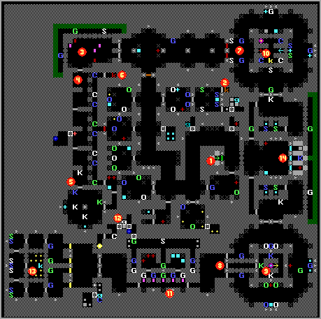 |  |
|---|---|

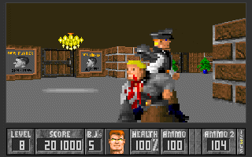

## Level 9: Deja Vu 2

Ever had the feeling you've been somewhere before? Maybe not everything is as it seems. Two large identical areas at the start of this level are designed to catch the unwary intruder off guard (using a similar idea to the original "Deja Vu" level found in AReyeP's "Wolfendoom").

1: BJ starts here.

2: A thorough exploration of the area once you start this level will reveal that the only way out is to jump into the Artefact of Dislacement located here.

3: What? I could swear I've been here before! Deja Vu! But, although it may appear you've been warped back to where you started, you'll soon find otherwise!

4: This is where you discover you're not where you thought you were! Silence the enemy and grab the blood key, and then access those secret areas with ammo and first aid - you'll need 'em as other enemies from areas 5 and 6 may soon be arriving to find out what all the noise is about.

5: Rush over to this area to heal any wounds - be careful as there will most likely still be a number of officers and guards hanging around.

6: Some nice treasure awaits you here. But the real goodies lie in a hidden area off the eastern side of this room - 4 Artefacts of Life and valuable treasures (all guarded by a liberal dose of suicide clones of course)!

7: Work your way south to this point. The Artefact of Death in the corridor near here may come in handy after grabbing the bronze key.

8: The bronze key! You can hang around and exchange fire, or run back to 7 and into the corridor, hoping some of the enemy will fall foul of the Death Artefact.

9: The bronze key will get you into this room. And although you don't have the gold key required to open those doors at the western side of this room, you can bypass them by taking the side corridors and breaking your way through a column.

10: This area can be a real deathtrap! Up to 6 SS patrol the corridors to the north and south of this room, and if you happen to enter this area at the wrong time, they'll all open the doors together to greet you!

11: You don't need the gold key to finish this level, but if you want to save time exploring this area, then the gold key is located here behind a breakable column.

12: You will need the elevator key though, and it's located here behind a breakable column with a clone watching over it.

13: This Artefact of Invulnerabilty may make things easier, especially if you plan to explore the secret area at 14. Don't forget the Artefact of Life in the similar room to the south if your health is low.

14: The secret area here leads to a Displacement Artefact that takes you to an MCS Mk4, an Artefact of Life, plus another hidden area with treasure, all lovingly guarded by clones of course. Should you explore this area, the only way out is via an Artefact of Displacement that will warp you back to the area at 3.

15: On to level 10!

Enemies marked in blue appear in all difficulty levels. Enemies marked in green appear only in difficulty levels "I'm a Hero" & "Suicidal Tendencies". Enemies marked in white appear only in the difficulty level "Suicidal Tendencies". Locked doors appear in the colour of the key required to open them, whilst unlocked doors are coloured grey (or green if it's an unlocked elevator door).

**LEGEND**

| 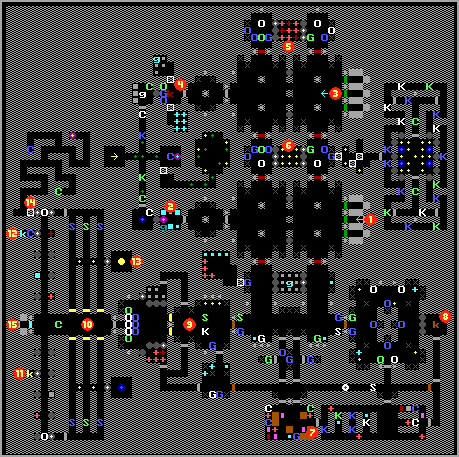 |  |
|---|---|

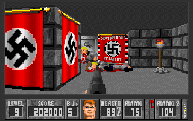

## Level 10: Hiroshima

Hiroshima Hyoto holds the gold key you'll need to exit this level! As you'll soon discover, this level has a distinctive Japanese flavour that'll have you Turning Japanese!

1: BJ starts here.

2: The suicide clones outside can't harm you in here, but you do have to get out sometime! And the only way to do that is to stand back and shoot one of those barrels (and hope there's no green toxic sludge residue left behind) and then dispose of those suicidal menaces.

3: This secret area leads to a very handy Artefact of Invulnerability. Use it now, or save it for Hiroshima (if it lasts long enough for you to run to him that is)!

4: Your first port of call is to this room to get the bronze key (unless you visit the nearby toilet block first where some enemies are engaging in some rather questionable behaviour). Shooting the officers in the room with the bronze key will alert the other officers in the adjoining rooms; however, these guys won't be able to get to you just yet...

5: As you come through the locked door here using the bronze key, the officers you may have alerted in those adjoining rooms will most likely come pouring into the corridor towards you. Some may no doubt remain behind in the rooms, so be careful.

6: This room has the blood key. Just be careful when entering the room as static SS guard the area.

7: The area beyond the columns here has a distinctive Japanese look! You're ready to enter Hiroshima Hyoto's lair! The Artefact of Displacement here will warp you to the other side of the columns, but once you're there, there's no coming back until after you've eliminated Hyoto and taken the gold key from him.

8: Once at this point, you have entered Hyoto's Inner Sanctum. The clones in this area are more likely to be a greater threat than Hyoto himself, as it's extremely difficult trying to dodge Hyoto's firepower when you have pesky clones running around behind you. The best bet is to pick off those clones you can before coming into Hyoto's line of sight. So long as you don't cross the green dotted lines marked in the map, you shouldn't alert Hyoto to your presence (nah - he won't hear your guns, he's partially deaf y'know)! Grab the goodies in those secret areas in the corners (yes, there's an MCS Mk4 hidden there too you know), and pick off those clones you can before letting Hyoto see you!

9: Well, well, well! What's this secret passage hidden behind a torch? It just happens to be the way to the Ultra Secret level! In case you didn't know, the torches in the game no longer block a player's movement if you shoot them for long enough. This isn't exactly a "feature", but we decided that we wanted to make the Ultra Secret level ultra hidden! Oh, and in case you're thinking you can bypass Hyoto by taking this route, think again - the gold key is required to access the elevator to the secret level, and yep, Hyoto has it...

10: Hiroshima Hyoto's lair. A good strategy perhaps would be to run around the corridors outside of this inner room, and pick off the clones in the area whilst Hyoto is trying to catch up with you. Once the clones are gone, you can concentrate on Hyoto himself. Remember - although the health items are plentiful, Hyoto will pick them up as well if he walks over them, making himself even harder to kill. Keep this in mind and try not to lure him into areas full of first aid kits. There's a handy Artefact of Life in the central area also, so you have no excuse for being killed!

11: Once you've eliminated Hyoto and taken his gold key, raid his storages of stolen wealth, and then open the door to this Artefact of Displacement. Jump in to take you back to area 7.

12: Enter this Japanese restaurant (remove your shoes beforehand please) and interrupt the clones dining there. Grab the elevator key!

13: This old area was subject to a cave in some time ago and was subsequently sealed off. But the treasure items and the Artefact of Life hidden inside may make it well worth your visit.

14: On to level 11! Or alternatively, proceed to area 15 and on to the Ultra Secret level!

Enemies marked in blue appear in all difficulty levels. Enemies marked in green appear only in difficulty levels "I'm a Hero" & "Suicidal Tendencies". Enemies marked in white appear only in the difficulty level "Suicidal Tendencies". Locked doors appear in the colour of the key required to open them, whilst unlocked doors are coloured grey (or green if it's an unlocked elevator door).

**LEGEND**

| 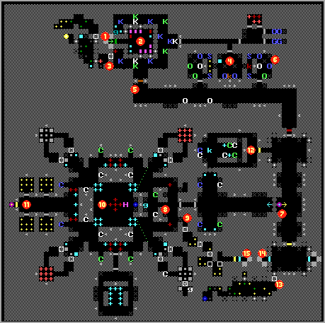 |  |
|---|---|

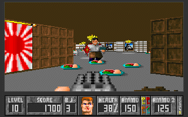

## Level 11: Mayhem Central

A whole range of challenges await you in this middle castle level. You'll even have to warp back outdoors at one point in order to proceed onwards. This level is featured in one of the game demos, and watching the demo may help you prepare a suitable strategy to start with.

1: BJ starts here.

2: This is the area the level is named after - mayhem central. This central area can become quite a hive of activity in the opening stages. Patrolling enemies come through this area on a regular basis, and while you're dispatching one, another could quite likely enter the area meaning that your shots will alert other enemies in adjoining areas. Be alert and stay alive!

3: As patrolling enemies enter the central area from this adjoining corridor, this is the best place to visit next, as it's quite possible there are some stragglers still active in this area.

4: You can skip this area for now and go to area 5 straight away if you wish, or you may prefer to clear this corridor first and grab the ammo and the first aid hidden behind the pushwall.

5: Grab the blood key here. Be careful, shooting the guard here will alert enemies in the other nearby rooms. It may be best to grab the key and wait for them to come to you. Don't forget the hidden MCS Mk3 and stash of ammo off this room - you'll see an Artefact of Life in this secret area also, but you won't be able to get that until later...

6: The blood key will allow you to access this area, known as "The Maze of Death". Carefully navigate your way through the maze avoiding the Artefacts of Death (and eliminate those few SS in the maze), and then open one of the doors at the other end. SS galore! Now's not the time to stand around waiting! Hope you remembered the path you took through the maze, because you'd be best to run back to the other end and wait in safety whilst you can sit back and chuckle as you hear the SS' screams of death as the Artefacts of Death take their toll! But don't be too complacent - an Artefact of Death will only kill a limited number of times before it disappears, and it may be possible for one or two SS to make it through!

7: After all the SS have been taken care of, make your way back through the maze to grab the bronze key here, and make your way to area 8.

8: Being that this part of the castle is built on a hillside, the area here has been subject to occasional flooding and has fallen into a state of disrepair. Jump into the Artefact of Displacement here to enter the forest nearby!

9: After warping into the forest at this point, make your way carefully to the Artefact of Displacement at area 10, watching for clones and landmines (and the odd black diamond too!) as you go.

10: Needless to say, jump into this Artefact of Displacement.

11: You'll be warped to this point, where the gold key is just sitting waiting for you. And there's plenty of MCS ammo, plus an MCS Mk3 and a hidden MCS Mk4 just waiting to be picked up. What's the catch? Well, fire a shot, or break one of the columns to exit this room, and all hell will break loose! Thankfully there's an Artefact of Invulnerability that makes things far too easy!

12: Whilst the Artefact of Invulnerabilty lasts, run through this corridor shooting everything that moves. If you're quick enough, you'll clear this area without receiving a scratch.

13: This secret area leads to that Artefact of Life you may have seen earlier. Watch for the clone hiding behind that pushwall though!

14: A secret area too good to pass up - 3 Artefacts of Life! Too easy!

15: With the gold key in your keeping, it's time to make your way to the exit elevator here. On to level 12!

Enemies marked in blue appear in all difficulty levels. Enemies marked in green appear only in difficulty levels "I'm a Hero" & "Suicidal Tendencies". Enemies marked in white appear only in the difficulty level "Suicidal Tendencies". Locked doors appear in the colour of the key required to open them, whilst unlocked doors are coloured grey (or green if it's an unlocked elevator door).

**LEGEND**

| 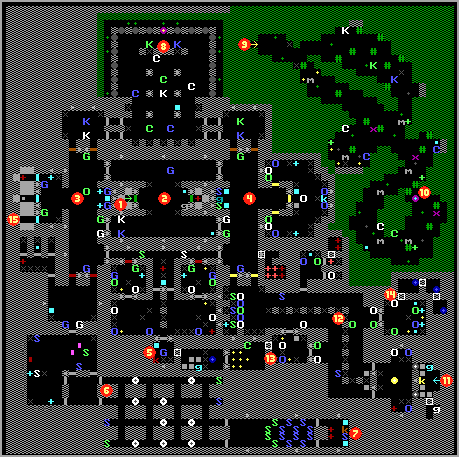 |  |
|---|---|

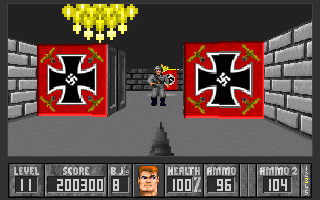

## Level 12: Admin Blues

This would have to be the "bluest" level in the game! Now you're starting to work your way into the upper areas of the castle where the elite nazis reside. This level is a large office complex where officers plan and devise policies for the running of the new reich they hope to build.

1: BJ starts here.

2: If you start this level with only a pistol, then this is the first room to visit. You'll be able to restock your ammo supplies, plus grab a handy machine gun whilst you're at it. Be careful - guards patrol the hallways from adjoining office areas, so silence and stealth may prove effective.

3: This little storage room is the next port of call - an MCS Mk3 plus plenty of MCS ammo, plus some first aid kits! BJ never had it so good!

4: Now for the bronze key! It can be found off the toilet block here to the north of the starting elevator.

5: Of course you'll need the bronze key to access the blood key stored here. And refreshen yourself with that Artefact of Life hidden in this room!

6: If you're after hidden goodies, then this is the place to go. Just watch out for the hidden baddies! And if you keep exploring, you'll find not only an Artefact of Invulnerabilty to help your explorations, but 3 juicy Artefacts of Life, some nice treasure, plus an Artefact of Displacement that takes you to an ultra secret area!

7: This "ultra secret area" is easier than it looks. To defeat the Superclone and his clone buddies, just use the secret pushwall to sneak in and grab the Artefact of Invulnerability. Then, open the door to the Superclone and fill him (and his buddies) with lead. The treasure and MCS Mk4 are all yours! Oh, and the Artefact of Displacement that warps you out of this area takes you straight to a toilet in case you wet your pants whilst taking on these nasty baddies...

8: Once you have the blood key, you can access the gold key here.

9: Use the gold key to access the corridor to the exit elevator.

10: Now for the tough part! You may wish to save one of the Artefacts of Invulnerability for this. Getting to the elevator key here will be difficult, as a number of SS lurk in the corridors leading to this room, and it's quite likely you will be attacked from behind whilst you attempt to make your way here. Eliminate the SS, and the key is yours!

11: On to level 13!

Enemies marked in blue appear in all difficulty levels. Enemies marked in green appear only in difficulty levels "I'm a Hero" & "Suicidal Tendencies". Enemies marked in white appear only in the difficulty level "Suicidal Tendencies". Locked doors appear in the colour of the key required to open them, whilst unlocked doors are coloured grey (or green if it's an unlocked elevator door).

**LEGEND**

| 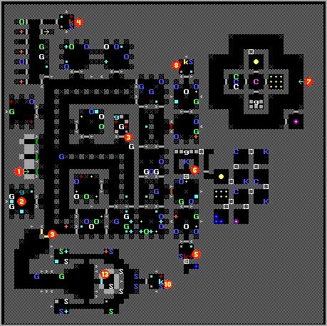 |  |
|---|---|

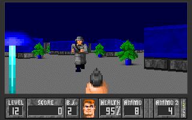

## Level 13: The Great Escape!

Egad! Captured by the nazis and thrown into a prison cell! And with all your weapons taken away from you! Things don't look good. But since when does BJ give up? Time to make a great escape from this prison compound!

1: BJ starts here. Yes, it's a prison cell, and you have only a knife. And, if you're on the hardest skill level, two SS are standing outside on guard. Seeing all you have is a knife, you have two options. The first is to open your cell door, and run forward ever so slightly so as to alert the SS to your presence. Then, dive back inside your cell just around the corner of the doorway, and the SS should come in one at a time, allowing you to eliminate one with a knife without the other being able to shoot at you. Try to eliminate both SS with your knife if possible so as not to draw the attention of guards patrolling the area. Once you've killed the SS, you should have a machine gun, and a few rounds of ammo - use 'em wisely! The second choice is to open your cell door, and run like hell to point 2!

2: This secret area is a must visit, as ammo is scarce once you make your "breakout". A pistol, plus some clips of ammo, should give you the bare essentials needed to prepare for the areas to come.

3: The bronze key needed to break out of the prison complex is well guarded by a number of SS. Let 'em come out to you instead of rushing in like a fool!

4: This prison cell is worth a visit, as an Artefact of Life is hidden here. Just blow up the barrel, and provided you can take the damage from a possible residue of toxic sludge, the Artefact is yours.

5: With the bronze key, and your health looking good, now's the time to get out of the prison complex. There are a number of ways to exit, but each way takes you into a winding corridor that surrounds the prison complex. In addition to the static guards posted in various places, other guards and SS patrol these corridors in a clockwise direction, so be alert, and don't get hurt! There are many little hidden areas around the corridors - look for them to grab some handy goodies!

6: If you should discover this Artefact of Displacement, save it for later. Using it before accessing the storage compound at 7 will alert enemies making things a little more difficult...

7: Head to this area, which is the main entrance to a large storage compound. Be warned though that should you fire a shot once you open these doors that SS may try to sneak up on you via those locked doors just behind you. Clear the storage area of enemies; there's an Artefact of Death that may be of assistance.

8: Grab the blood key here!

9: Oh yes!!! A room full of wonderful things! But how to get it? The pushwall acessing this area is blocked by a stupid clone on static guard duties! The solution? Simple! You'll have to go to the Artefact of Displacement at 6 to warp in to the other side of this room. Once there, the clone will see you - don't shoot him straight away though. Let him come running towards you so that he no longer blocks the pushwall, then shoot him! Jump back into the Artefact of Displacement that will take you back to area 6, then make your way back to the storage compound. You should now be able to move the pushwall, and the goodies are yours! Don't forget the MCS Mk4 hidden inside.

10: With the blood key, access this room to grab the gold key. There's also a hidden area just off this room with lots of treasure (plus a few clones).

11: Access this door with the gold key - leave the other locked door at 14 til after you have the elevator key.

12: Grab the elevator key here.

13: A very handy Artefact of Invulnerability. Use this for the next area...

14: Shoot the guard in the back, and get ready for 2 Superclones to come running towards you! Hope you have that Artefact of Invulnerabilty - if not, maybe that Artefact of Death nearby may be of use...

15: This secret area leads to the Secret Castle level, which is perhaps one of the hardest levels in the game. Avoid if you're not into dying!

16: On to level 14!

Enemies marked in blue appear in all difficulty levels. Enemies marked in green appear only in difficulty levels "I'm a Hero" & "Suicidal Tendencies". Enemies marked in white appear only in the difficulty level "Suicidal Tendencies". Locked doors appear in the colour of the key required to open them, whilst unlocked doors are coloured grey (or green if it's an unlocked elevator door).

**LEGEND**

| 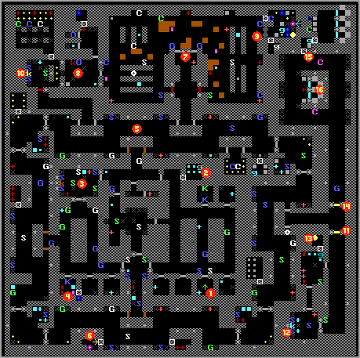 |  |
|---|---|

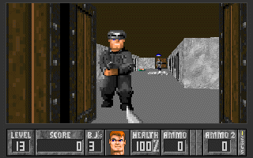

## Level 14: Forest Gump

This part of the castle is built on the side of a heavily forested hill. You'll need to explore the forest to find the key needed to proceed further.

1: BJ starts here.

2: Once you exit the elevator, don't muck around exploring - enemies to the south will see you and will be on their way! And as if that isn't enough, there's more trouble looming, as a squad of SS on patrol in the north are slowly making their way to this area. Run for the hidden health and ammo to help your cause.

3: Work your way down to here where the blood key is stored. And don't forget to expect those SS to the north when you make your way back!

4: What's this? A hidden area with locked doors requiring a bronze key! Grab the Artefact of Life, and come back to this area later if you wish.

5: Using the blood key, access this area. Of course, you could just sit and wait for the SS to open these doors for you if you don't want to bother getting the blood key...

6: Jump into this Artefact of Displacement to warp into the nearby forest.

7: Your forest excursion starts here. There's some nice black diamonds to be found, as well as some landmines to be avoided!

8: The gold key!

9: Once you have the gold key, make your way through the winding forest pathways to the Artefact of Displacement here.

10: You'll be warped back to this point, except now you'll be able to open those locked doors behind you (unless you forgot to grab the gold key, that is. Back to the forest if you did).

11: Heaps of SS guard the elevator key! No time to waste - break the stone column here, and grab the Artefact of Invulnerability. Fry the SS, and the key is yours!

12: The elevator key. There's a handy Artefact of Life hidden just behind it.

13: Ahah! A hidden bronze key! If you wish, make your way back to the hidden area at 4, and when you find yourself facing a Superclone, just remember there's an Artefact of Invulnerability in the treasure room he's guarding.

14: On to level 15!

Enemies marked in blue appear in all difficulty levels. Enemies marked in green appear only in difficulty levels "I'm a Hero" & "Suicidal Tendencies". Enemies marked in white appear only in the difficulty level "Suicidal Tendencies". Locked doors appear in the colour of the key required to open them, whilst unlocked doors are coloured grey (or green if it's an unlocked elevator door).

**LEGEND**

| 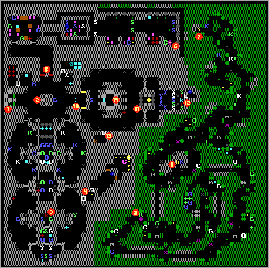 |  |
|---|---|

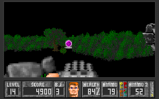

## Level 15: Grau Adler

Now you're making your way into the upper castle reaches. And the first level of these heavily fortified areas is guarded by the Grau Adler - Hitler's most trusted double agent during the war years. He won't appreciate your intrusion into his inner sanctum! There are many strategies you can use to complete this level. Proper examination of the level map will help you formulate your own, whilst the points listed below will give you some ideas.

1: BJ starts here.

2: Make your way up this widening corridor to enter Grau's domain. If you're starting with only a pistol, there's a machine gun and some ammo hidden off the corridor that may come in handy.

3: Once inside, search this corridor area for secret pushwalls. You'll soon discover a hidden MCS Mk3, and plenty of stores of ammo and health.  
4 & 5: These areas aren't essential to visit. But a blood key and bronze key can be found at these locations, which will allow access to the storage areas at 6 & 7. Just be warned - each of these keys is guarded by a number of enemies including a Superclone! But, the Artefacts of Invulnerability hidden in these areas may be well worth it!  
6 & 7: If you do decide to go for either the bronze or blood keys, these rooms will become accessible. The bronze key will grant you access to a wealth of ammo, plus the only MCS Mk4 in the level, whilst the blood key will grant access to a feast of first aid items.

8: Time to meet Grau Adler! If you've played your cards right, you may be able to grab one of those Artefacts of Invulnerability hidden near the bronze and blood keys just before you open this door. Grau's inner sanctum has many exits which are secured with locked doors requiring the gold key, so if you decide to run, be aware he may come out from anywhere! Not only that, but officers in other nearby rooms may be alerted to your presence once you start your fire fight with Grau. The ammo and first aid in Grau's inner sanctum are tempting, but don't get cornered in there! And remember - Grau Adler will use any first aid item he runs over, so don't try to lure him into areas where first aid abounds.

9: A wonderful treasure trove. But you won't be able to access it just yet...

10: Once you've eliminated Grau Adler, grab his gold key, and make your way to this area.

11: Eliminate the officers, and grab the elevator key. There's a hidden alcove in this area which has an Artefact of Displacement - this will warp you to the treasure trove at 9. Grab the treasure, and warp back to here!

12: Just before you exit this level, you may wish to explore this little area.

13: And if you do decide to explore this little area, then you'll get a blast out of this! A tip: opening that door and shooting at the Superclone will cause a chain reaction explosion of barrels, which will quite likely kill you. You'd be best to stand back and shoot at those barrels before opening the door, and let the Superclone feel the heat as they explode! Go in afterwards and grab the goodies!

14: On to level 16!

Enemies marked in blue appear in all difficulty levels. Enemies marked in green appear only in difficulty levels "I'm a Hero" & "Suicidal Tendencies". Enemies marked in white appear only in the difficulty level "Suicidal Tendencies". Locked doors appear in the colour of the key required to open them, whilst unlocked doors are coloured grey (or green if it's an unlocked elevator door).

**LEGEND**

| 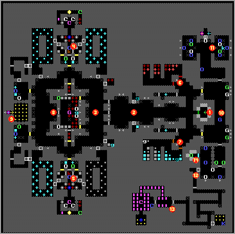 |  |
|---|---|

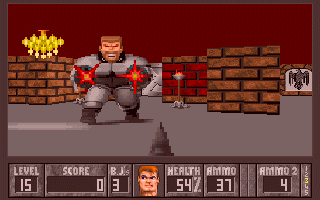

## Level 16: The Torture Room

This level is built around a central torture room where hideous cloning experiments have been carried out. But you'll have to explore the outer castle corridors first to find the key needed to access this area.

1: BJ starts here.

2: Grab the hidden machine gun just outside the elevator should you need it, then head clockwise around the level eliminating opposition as you go. Be warned - a squad of SS patrol these outer corridors in a clockwise direction. If you have to backtrack along these halls at some time, you may run into them!

3: The column here will have to be broken in order to access the locked doors requiring the gold key. But you'll need to proceed further along the corridors first as the gold key ain't in this area!

4: This secret pushwall leads to an Artefact of Invulnerability. You may wish to save this for when you access the central hub of this level. There's other little secrets hidden off the corridor areas also; look thoroughly enough and you'll find a hidden MCS Mk3 hidden not far to the north of this area.

5: There's a hidden bronze key here. You don't really need this key at all, but it may save time should you decide to use the locked doors nearby saving you from backtracking through the halls (and perhaps running into those SS)!

6: The gold key!

7: Now make your way back to the locked doors here. Jump into the Artefact of Displacement, and you'll find yourself in the inner hub of this level. You may wish to run back and grab that Artefact of Invulnerability before you do this.

8: Make your way to area 10 with caution, and beware of clones!

9: Should you need to teleport back to the outer corridors, use this Artefact of Displacement.

10: The breakable column here will enable you to access the inner torture chamber. But once that column is broken, the 2 Superclones inside will be able to get out - you may wish to try eliminating them before breaking this column - the choice is yours. But there's an easy way - see 11.

11: Ahh yes! A hidden Artefact of Invulnerability! Grab this, and teach those Superclones not to mess with BJ!

12: The elevator key!

13: Before you exit this level the conventional way, you may be interested to know there's a hidden blood key here which will allow you to access a rather unusual secret level. Just watch out for that clone guarding it!

14: This series of secret pushwalls leads to a hidden toilet block of all things! But that's nothing compared to where that secret elevator off the toilet block will lead you to - the Secret Dunny Level!

15: On to the Secret Dunny Level!

16: On to level 17!

Enemies marked in blue appear in all difficulty levels. Enemies marked in green appear only in difficulty levels "I'm a Hero" & "Suicidal Tendencies". Enemies marked in white appear only in the difficulty level "Suicidal Tendencies". Locked doors appear in the colour of the key required to open them, whilst unlocked doors are coloured grey (or green if it's an unlocked elevator door).

**LEGEND**

| 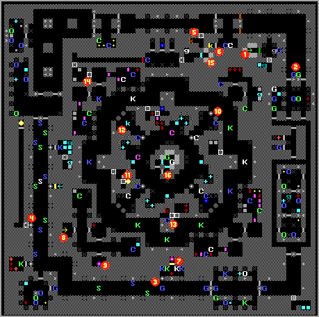 |  |
|---|---|

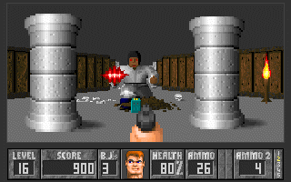

## Level 17: Not Far Now...

No - it's not far now at all until you meet Baron von Schmitt. But first, you'll have to tackle this upper castle level that was designed by the Baron himself to protect the upper castle area where the Spear is housed. And if you can do this, you've earned the right to challenge the Baron. By the way, this level has 3 MCS Mk3's, 1 MCS Mk4, 4 Artefacts of Life, 9 Artefacts of Death, and 6 Artefacts of Invulnerability!

1: BJ starts here.

2: This is the best area to explore first, especially if you're low on ammo or health, as most of the first aid items and ammo in the earlier part of this level are located in the offices adjoining this corridor. There's also an Artefact of Life hidden off this hallway, plus a machine gun and ammo. There's even an MCS Mk3 hidden off the SS office nearby. Be careful though - there's a number of patrolling guards, so just because the hallway may seem safe at first, it may not stay that way!

3: A hidden Artefact of Invulnerability! But save this for afterwards - if you use it now, you most likely won't be able to access all those other goodies you can see behind that column... 4 & 5: Clear this room of baddies, and then clear the next room at 5 as well, as enemies patrol through both these rooms, and it's possible enemies in room 5 may make a nuisance of themselves venturing into room 4 looking for you.

6: When you open these doors to the room with the blood key, you'll be completely outgunned, as THREE Superclones, plus up to 6 SS, are waiting for you! What hope do you have? Well, it's not as hard as it looks. Did you see that room full of Artefacts of Death nearby? This room is the key to success! When you open the door to the 3 Superclones, fire 1 shot just to make sure all the enemies inside are alerted to your presence, then run like hell back to point 7!

7: Stand just around the corner from the column here, and peek around into the room full of Death Artefacts. Have a good laugh as you watch the Superclones and SS walk into the room and meet their demise! And just be careful in case any are smart enough to sneak up behind you! Once it appears all of them have been taken care of, run back to area 6 and check to see if there are any stragglers. If there are, lure them back into the room of Death, or take care of them yourself if you wish.

8: With the enemy taken care of, run in and grab the blood key. There's a secret pushwall in this room also - if you wish to access a nice treasure room afterwards, access the secret area, and push the wall behind the door. This will clear the path for you to open another pushwall later on...

9: A secret pushwall hidden behind Artefacts of Death! Impossible to get, unless the enemy have cleared a path for you, or unless you still haven't used that Artefact of Invulnerability back at 3. Head back to 3 and grab it if you haven't, then run back to here and, whilst God mode is active, the Death Artefacts won't hurt you! Access this secret area, and FIVE Artefacts of Invulnerability are yours! Plus, 4 juicy treasure items to reward you for being so clever!

10: The secret area behind this pushwall is well worth a visit, but it's best if you grab an Artefact of Invulnerability before doing so, as you'll have to stand right alongside some barrels and destroy them to get inside, as well as deal with a number of pesky clones. Ouch! But, the goodies inside may be well worth the trouble.

11: Use the blood key to access this area, and shoot one of the barrels to eliminate most of the SS in the area. WARNING!!! By doing this, you will have just activated the Superclone in the room at 14, who may just come looking for you! Move quickly - time is precious! Or, run back and grab an Artefact of Invulnerability if there's a spare one!

12: Grab the bronze key here.

13: If you're after an MCS Mk4, this secret area is the place to go.

14: Run back to this area (and be careful if you haven't encountered that Superclone yet), eliminate the SS, and then follow the trail of pushwalls that lead to plenty of treasure items and an Artefact of Life. If you opened the pushwalls back in the blood key room at 8, you'll be able to access a nice little storage of treasure goodies!

15: The bronze key will give you access to this room - jump into the Artefact of Displacement here to warp to 16.

16: Some secret areas nearby will give you first aid items, plus an MCS Mk3 should you need them. There's also an Artefact of Displacement that will warp you back to where you came from should you wish to grab anything you left behind.

17: Make your way here, and head east eliminating the SS as you go.

18: The gold key and elevator key are in the dud elevators to the left and right - grab 'em, and you'll be able to access the working elevator.

19: On to level 18!

Enemies marked in blue appear in all difficulty levels. Enemies marked in green appear only in difficulty levels "I'm a Hero" & "Suicidal Tendencies". Enemies marked in white appear only in the difficulty level "Suicidal Tendencies". Locked doors appear in the colour of the key required to open them, whilst unlocked doors are coloured grey (or green if it's an unlocked elevator door).

**LEGEND**

| 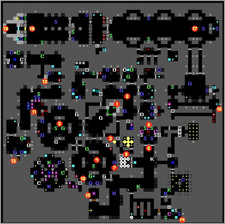 |  |
|---|---|

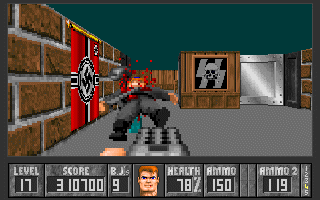

## Level 18: Destiny Awaits!

The final showdown between you and Baron von Schmitt is about to take place! There are no Artefacts of Invulnerability to help you this time around - just you, and your wits. As with Hyoto and Grau Adler, Baron von Schmitt will use any first aid items he comes across to boost his health - you've been warned. Defeat the Baron, and the Spear of Destiny awaits!

1: BJ starts here.

2: If you're starting the level with just a pistol, then eliminate the SS in here to grab a machine gun. This room provides a large storage of conventional machine gun ammo for you run back to should your ammo supplies be running low.

3: Eliminate the officers here, and there's a room full of roast dinners to come back to later should your health be failing you. There's also some hidden treasure nearby, but watch for that clone!

4: Eliminate the clones in this room, and this area will be another place you can visit afterwards should you need first aid. Don't forget that hidden room with first aid kits (and once again, watch for that clone)!

5: The two rooms off this hallway provide a small reserve of MCS ammo, plus there's a nice stash of first aid hidden off the toilet block here.

6: Grab the bronze key here.

7: Use the bronze key to access this room, and stock up on ammo - you'll need it! Remember the layout of the areas you've already visited, as you'll no doubt need to run back to them to stock up on first aid. Now it's time to jump into the Artefact of Displacement here and meet Baron von Schmitt!

8: The Baron! Quick - grab that blood key, and jump into the Artefact of Displacement to warp back to 7. But don't hang around - Baron von Schmitt's personal guard of officers and SS will most likely come looking for you, with the Baron not far behind them. Alternatively, as soon as you warp in to where the blood key is, push that secret pushwall to access a very nice treasure store room, which is a safe haven the enemies won't be able to get to. Peak around the corner and take pot shots at Baron von Schmitt from here if you wish - his rockets won't be able to harm you here as the columns will block them, but his MCS Mk3 fire will hurt like hell if you're too careless!

9: With the blood key, you'll be able to access Baron von Schmitt's lair. You'll find an MCS Mk4 here, as well as a hidden Artefact of Life.

10: Should your reserves of first aid be running low, the blood key will allow you to access this area, where a nice supply of roast dinners can be found. Just make sure you eliminate those officers straight away though, as if you hurt them, they'll use the meals to restore their own health. Grab the hidden treasure in here also if you wish.

11: Another area worth a visit once you have the blood key. First aid, ammo, plus some hidden Artefacts of Life and an MCS Mk4 and ammo await you here. Be careful though if the Baron is still on the loose - it's easy to get cornered in here! It's probably best to save this area til after you've killed the Baron though - consider it a "refuelling station" that you can visit before grabbing the Spear.

12: A hidden area that leads to some first aid and MCS goodies. And a Superclone to wipe that smile off your face...

13: The Spear of Destiny! Once you've killed Baron von Schmitt, grab his gold key. Explore whatever areas you haven't already if you wish, and then jump back into the Artefact of Displacement at 7 to warp you into area 8. You'll now be able to open the locked door behind you - proceed on through the "Hall of Heroes" to this point, and the Spear is yours! But all is not over yet - on to the Afterlife!

Enemies marked in blue appear in all difficulty levels. Enemies marked in green appear only in difficulty levels "I'm a Hero" & "Suicidal Tendencies". Enemies marked in white appear only in the difficulty level "Suicidal Tendencies". Locked doors appear in the colour of the key required to open them, whilst unlocked doors are coloured grey (or green if it's an unlocked elevator door).

**LEGEND**

| 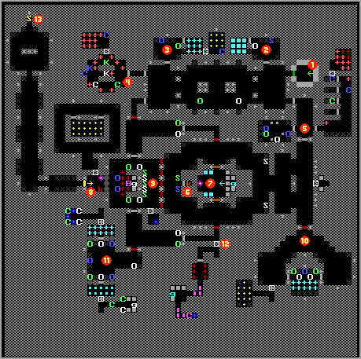 |  |
|---|---|

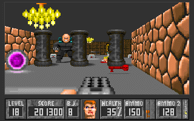

## Level 19

**The Final Battle - The Afterlife**

Taking possession of the Spear of Destiny comes at a cost. Your physical being will now have to challenge the spiritual "owners" of the Spear in order to break the evil grip they hold over its powers. You thought Adolf Hitler was dead? Think again - his partially resurrected being will try to haunt you to your grave in your trip here into the "afterlife".

1: BJ starts here.

2: As you make your way here, you'll notice Hitler's tomb no longer has a date of death! And where did those busts of fallen nazi "heroes" disappear to? And where there was once a room that opened into Baron von Schmitt's lair, there is now a caved in wall and an Artefact of Displacement. Jump in to warp to area 3 - the final battle awaits!

3: Welcome to the Afterlife! The ghosts of fallen nazi heroes haunt this realm. Hans and Trans Grosse, their sister Gretel, the evil Dr. Schabbs, General "Fatface" and Barnacle Wilhelm may have failed against BJ in life, but in death, they cannot be harmed! Not only this, but the haunting red spectre of the Angel of Death awaits to exact revenge upon you! Avoid these ghosts at all costs, for mere contact with them will cause considerable harm.

4: The ghost of Adolf Hitler! In a state of semi resurrection back to the physical world, Hitler's spectre is the only entity in this realm that can be harmed by your hail of bullets. Avoid his white blasts of ethereal energy, and don't focus so much on Adolf lest one of the other spectres in this level sneak up on you from behind. He'll take a lot of damage before you can bring him down, be patient, and you'll eventually succeed. And in case you haven't figured it out yet, just remember - the walls marked with skulls conceal hidden stores of ammo, whilst the walls marked with crosses conceal hidden stores of first aid. And the best hidden storages of ammo and health lie not far from where you first meet Adolf's spectre.

You're on your own now! Good luck, BJ!

Enemies marked in blue appear in all difficulty levels. Enemies marked in green appear only in difficulty levels "I'm a Hero" & "Suicidal Tendencies". Enemies marked in white appear only in the difficulty level "Suicidal Tendencies". Locked doors appear in the colour of the key required to open them, whilst unlocked doors are coloured grey (or green if it's an unlocked elevator door).

**LEGEND**

| 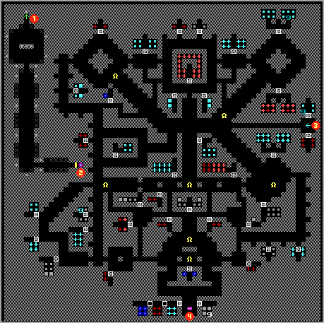 |  |
|---|---|

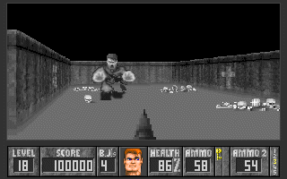

## Level 20

**Secret Level 1 - Ye Olde Dungeon**

This is the first of 4 secret levels. The entrance to this level is hidden off Level 3. This old catacomb area was initially set up by the nazis for use as a temporary prison, but flooding and structurally weak design saw them abandoned soon after. However, a few stores of stolen nazi treasure still remain behind, and the whole area is occupied by mindless clones to prevent curious intruders from exploring.

1: BJ starts here.

2: This secret area is the first place to visit if you're starting out with just a pistol.

3: You'll need to break a few stone columns to reach this point, but this is where you'll find the bronze key.

4: Use the bronze key to access this room where the blood key is kept. But, if you like looking for secret areas, you don't really need the blood key at all - see point 10...

5: The blood key will allow you to enter this little maze full of wonderful things such as suicide clones. Isn't it thrilling not knowing if there's one just around the next corner about to detonate itself? Medic!!! There is a way to avoid this maze area though - see point 10...

6: Once you've navigated the maze and found whatever treasure goodies there are within, exit at this point. There's the exit elevator right in front of you! But you still don't have the elevator key, so on to 7!

7: Use the explosive barrels in this area to assist in clone extermination, and don't forget to search behind all those columns, as there's some treasure items plus an Artefact of Life to be found. Once you're done, break the column at this point to proceed onwards.

8: A nice little treasure trove plus a hidden Artefact of Life - all you have to do is break a few stone columns to get to it (and eliminate that clone of course).

9: A few more columns to break, and on to point 11. And don't forget there's a hidden Artefact of Invulnerability off the side of the passage ahead!

10: Of course you could have bypassed steps 4 - 8 and arrived at point 9 using the shortcut here - that secret pushwall here will work twice (that is, after pushing it once, it should be able to be pushed back once again). You'll still have to go through some of the bypasses areas to get to the exit elevator, but you'll avoid that maze full of suicide clones.

11: There's a corridor full of Death Artefacts just ahead. Let any clones you see up ahead run into the Artefacts, saving you ammo. Then, bypass the corridor full of Death Artefacts by taking one of the side corridors, and make your way to point 12.

12: Yes - there's the gold key just ahead of you. But this is a deathtrap just waiting to happen! For, as soon as you rush in and grab that gold key, clones in the rooms to the sides will see you and you'll be in a spot of bother! You could try to outgun them, or you could do it the easy way - see step 13!

13: Yes! That's right! As soon as you grab the gold key, run like hell back to the Artefact of Displacement here and run straight into it - it'll warp you to point 11 just behind the Death Artefacts. Hide in this area, and all those clones following you should be stupid enough to blindly run into the corridor of death. Once that's done, head back to the rooms where those clones came from. With the gold key in your keeping, you'll now be able to access these rooms; there's some MCS weaponry and ammo, plus some nice hidden treasure to collect as a reward for your efforts!

14: The gold key will allow you to access the room with the elevator key - but don't go blindly running in as clones will attack from both sides if you do. Enter with caution, and step straight back to draw the clones out to you.

15: With the elevator key, make your way back to the exit elevator. Mission accomplished! On to level 4!

Enemies marked in blue appear in all difficulty levels. Enemies marked in green appear only in difficulty levels "I'm a Hero" & "Suicidal Tendencies". Enemies marked in white appear only in the difficulty level "Suicidal Tendencies". Locked doors appear in the colour of the key required to open them, whilst unlocked doors are coloured grey (or green if it's an unlocked elevator door).

**LEGEND**

| 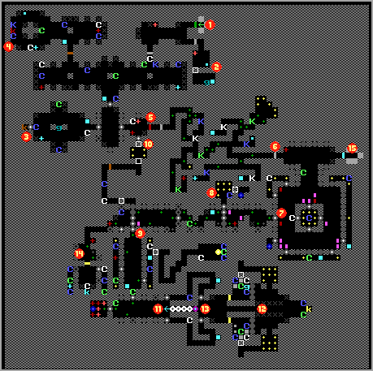 |  |
|---|---|

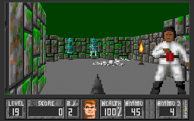

## Level 21

**Secret Level 2 - Secret Castle**

This secret fortified castle area is perhaps the hardest level in the whole of Spear Resurrection. The entrance to this level is hidden on level 13. If you're up for a challenge, then you've got one! This level is one of 2 levels designed by my (AReyeP's) 15 year old son, Daniel (Soulblighter). I'm sure he'd be disappointed if it doesn't kill you at least once!

1: BJ starts here.

2: As soon as you exit the elevator, you'll find there's a number of enemies patrolling the hallways. If you start shooting at them, you may alert other guards in adjoining rooms as patrolling guards open doors. If you have plenty of ammo, then go for it! But if you have only a pistol and 8 rounds, you'd be best to engage the enemy at close range to maximise damage, and attracting too many enemies in such a situation is likely to be perilous. As such, the best strategy is possibly to keep on the move and just run from here to points 3, 4, 5 & 6, laying waste to enemies before they have time to take aim! There should be enough ammo and first aid along this route to help you achieve this easily enough.

3: Grab the bronze key as you run through here.

4: Grab the blood key as you run through here.

5: Just a few more rooms now...

6: By the time you reach this point, you should have eliminated most of the enemies in the area, and the threat of being outnumbered and outgunned should now be minimal (unless you didn't kill any enemies on the way, in which case, you deserve to be killed)! But there will most likely be stragglers! Go through all the rooms again, taking a more systematic and thorough approach this time, and ensure all areas are clear. And grab those treasures in the central storerooms whilst you're mopping up! 7, 8 & 9: Now it's time to explore the outer corridors, and any rooms adjoining them (a few of the enemies from these outer corridors may have already patrolled into the central area earlier on, so it's possible some of the enemies marked have already been accounted for). It's not necessary to go to these rooms, but it may be wise to ensure all these inner areas are clear later on. Besides, there are some handy items of first aid and ammo you may need.

10: Now it's time to venture into the outer perimeter of this level. You can do so from any of the doors locked with the blood key (marked in red on the map), the choice is yours. But this is where things start to get tricky. Fire a shot, and certain enemies patrolling the outer perimeter of the level will hear it. End result? They could come running in to the central areas of the level looking for you, meaning you just don't know where active enemies may be. Not only this, but a number of cowardly clones are running around outside amongst the shrubbery taking potshots at you as they go, and it isn't easy knowing where these pests are at any particular time! You could waste heaps of ammo trying to eliminate them - it may be best to just keep on the move so they have little time to take aim.

11: Now this room is where things can start to go really wrong! Fire a shot in this room, or whilst the door to this room is open (which an enemy you've alerted earlier may do without your knowledge), and the two Superclones at point 12 will be alerted! And they'll come looking for you! You'll need the gold key from this room, so a visit here can't be avoided. If you can draw the enemy out and away from the room without firing a shot, then eliminate them, you've done well. My suggestion? Just blast 'em, grab the gold key, and make your way to area 12 in a round about fashion to hopefully avoid those two Superclones who may be anywhere!

12: You'll need the gold key to get through this corridor. If you haven't alerted the Superclones, they'll both be waiting for you here. Draw them away, and then run back to this corridor from another route. If they're NOT here, and you haven't seen 'em yet, well, I wouldn't be hanging around if I were you, OK? 13, 14, 15 & 16: Some secret areas that may be worth visiting should you need certain items.

17: You're about to go in for the elevator key, which is guarded by a third Superclone! The Artefact of Invulnerability here can make the difference between success and failure. Yes, it'll require blowing that barrel up at point blank range to get it, and risk a subsequent toxic residue, so you'll have to cop some damage, but it'll be worth it. If your health is so low though that even that first aid kit in front of the barrel won't bring your health up above 50%, you may find you can't afford to take any damage. In that case, you're in deep $#!+! Look for some first aid, and pray!

18: The elevator key! Come here immediately after grabbing the Artefact of Invulnerability, and waste the Superclone! Grab the elevator key, and run!

19: The exit elevator! Run here whilst the Invulnerability mode is still active. Yes, it's possible to waste the other two Superclones before the Invulnerability mode expires if you're quick enough, and if you run into them soon enough. But it's not necessary. Just exit the level, dammit, and move on to level 14!

Enemies marked in blue appear in all difficulty levels. Enemies marked in green appear only in difficulty levels "I'm a Hero" & "Suicidal Tendencies". Enemies marked in white appear only in the difficulty level "Suicidal Tendencies". Locked doors appear in the colour of the key required to open them, whilst unlocked doors are coloured grey (or green if it's an unlocked elevator door).

**LEGEND**

| 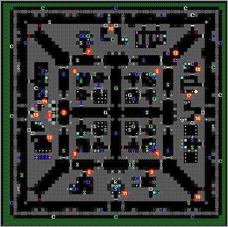 |  |
|---|---|

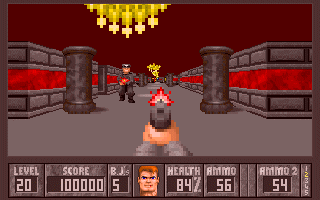

## Level 22

**Secret Level 3 - Funny Dunnies!**

Ahh yes, some toilet humour... If you thought Spear Resurrection tried to take matters too seriously, then this level (found in a hidden area off level 16) should put that idea to rest! A secret dunny level! Perverted. Weird. Warped! Dig those sound effects man! Hmmm, makes me think I can't hold on much longer - aren't you fortunate there's no smell editor for Wolfenstein?!!! This level is the second creation from AReyeP's 15 year old son Daniel (Soulblighter). Perhaps we could explain this level as another "mystery of the spear"...

1: BJ starts here.

2: Visit all the rooms off this hallway, as there are valuable stores of ammo and first aid to be found.

3: Ahah! A hidden Artefact of Invulnerability! Save this for after...

4: Make your way to this open area, and eliminate all the clones defecating in the area. There's 5 large first aid kits in this area - generous!

5: The bronze key!

6: This pushwall leads to a large secret forest area. Explore the area thoroughly, because there's an MCS Mk4, plus an Artefact of Invulnerability to be found, among other things. Plus don't forget that there's another secret room full of treasure just near the Artefact of Displacement located near the end of the forest.

7: Open the door, shoot the barrels, and if any of those clones are lucky enough to survive the blast, finish 'em. Then, grab the blood key, being careful not to step in any toxic sludge residue left behind from the barrels.

8: Now may be a good time to use one of those Artefacts of Invulnerability mentioned earlier. The Superclone that guards this area possesses the gold key - run in and eliminate him, along with all other clones, and the gold key is yours. If you don't have an Artefact of Invulnerability, or you feel the one you're using is about to expire, then run for the extra one up near the Superclone's throne area (the area enclosed in a ring of dunnies, that is...)! Don't forget the wealth of ammo and first aid hidden in those secret rooms off the "throne" room!

9: Whew! It's easy for the S#!+ to hit the fan in this dunny level, ain't it? Well, if you're prepared to cop some more, explore this secret area. There's some treasure, plus an Artefact of Life as a reward.

10: Nasty, nasty deathtrap. But the elevator key is here, so you have no choice but to enter. If you shoot that clone in the back (he's facing away from you as you enter the room), then 3 Superclones will open those doors to fry your butt for daring to hurt their little buddy! You could engage the clone with a knife (not good as their quick reflexes will mean you'll still be hurt or killed), or you could perhaps lure the clone away from this room, then eliminate him, which means the elevator key (and those treasures) are easy to get, provided you stay quiet, and sneak out like a coward! But, if you want to do it like BJ would, then now's the time for for an Artefact of Invulnerability! Grab the one at point 3 (provided you saved it, that is), and run back here. Open fire! Eliminate the clone, then the Superclone that comes out of the room with the extra Artefact of Invulnerability. Grab this extra Artefact if you need to, and eliminate the other two Superclones. Two Artefacts of Life are the rewards for your trouble. And, don't run out of ammo in the middle of this exercise, OK?

11: Make your way here - the exit elevator is just ahead!

12: On to level 17!

Enemies marked in blue appear in all difficulty levels. Enemies marked in green appear only in difficulty levels "I'm a Hero" & "Suicidal Tendencies". Enemies marked in white appear only in the difficulty level "Suicidal Tendencies". Locked doors appear in the colour of the key required to open them, whilst unlocked doors are coloured grey (or green if it's an unlocked elevator door).

**LEGEND**

| 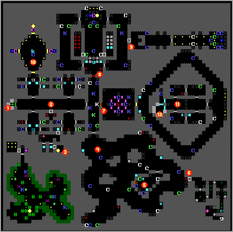 |  |
|---|---|

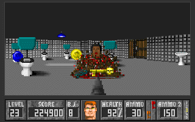

## Level 23

**Ultra Secret Level - Ramparts**

So, you've found your way to the castle ramparts, have you? The entrance to this level is hidden in level 10 (Hiroshima Hyoto's level). If you've found it, you've done well! This level is worth a lot of points, and is not a level that's meant to be taken seriously! A bit of fun as per the original Pac Man style hidden level of the original Wolfenstein.

1: BJ starts here.

2: There are four locked doors in front of you, each requiring a different key. To find them, you'll have to jump into the Artefact of Displacement in this room to warp to the ramparts area at point 3. But before you do, stock up on ammo and first aid from the hidden rooms just to the sides of those locked doors.

3: This is where you'll warp to - and there's a rather angry looking Pac Man ghost heading your way. Make that a number of Pac Man ghosts! Oh, hell! There's heaps of the damned things! But, thankfully, these ghosts can be eliminated with a few shots from your trusty firearm. They're worth a decent pointscore each, too, so fire away! Just don't let 'em touch you, OK? It's best to eliminate all the "eliminatable" Pac Men first. Just continuously run around the outer rim of the rampart area (don't go into the central areas straight away), so that the Pac Men don't have a chance to catch up with you, and eliminate them as you go. There's plenty of ammo scattered around this outer rim, so running out shouldn't be a problem. Don't use MCS ammo - what a waste! And if you should have a close encounter or two, there are a number of Artefacts of Life located in alcoves behind explosive barrels should you need a first aid boost. Once all the Pac Men have been eliminated, grab all those treasure items - it's a reward for having found the Ultra Secret Level! 4, 5, 6 & 7: The 4 keys you'll require are located at these areas. But, there's a hitch! The ghosts guarding these areas are invincible! They may appear as a Grim Reaper, or they may be disguised as a normal type Pac Man to throw you off. The good news? They're trapped behind explosive barrels, and can't get out. The bad news? You'll have to let 'em out if you want those keys! You really want to make sure you've eliminated all those "standard" type Pac Men before you let these dudes out... (perhaps those Artefacts of Invulnerability near the centre of the level may assist?)  
8 & 9: Some very nice treasure items for the greedy, and some more "super ghosts" as a punishment for being so greedy...

10: Once you've got all 4 keys (and provided you've grabbed all the loot you wish to), jump into the Artefact of Displacement here, and you'll warp back to point 2.

11: On to level 11!

Enemies marked in blue appear in all difficulty levels. Enemies marked in green appear only in difficulty levels "I'm a Hero" & "Suicidal Tendencies". Enemies marked in white appear only in the difficulty level "Suicidal Tendencies". Locked doors appear in the colour of the key required to open them, whilst unlocked doors are coloured grey (or green if it's an unlocked elevator door).

**LEGEND**

| 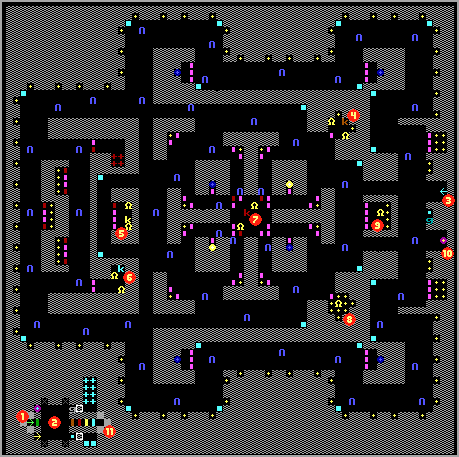 |  |
|---|---|

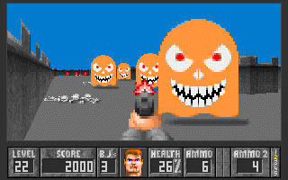
