# Spear Resurrection: Game Manual

*From [areyep.com](https://www.areyep.com/RIPandMCS-Spearres-Manual.html), by AReyeP and MCS, reproduced here for players of the TC port. Text and pictures are theirs; the links to downloads go to their site.*

"In the dark empire's final days, it's true essence shall be secretly moved to the west.

When essence and spear unite, so shall the process of resurrection commence.

Fear the resurrection of the essence! For, should it be fulfilled, the dark empire shall be reborn, and shall sweep the Earth.

Only one shall have the wisdom to see this, and upon their actions shall the fate of the world rest..."
- Nostradamus: The Lost Quatrains.

**Spear Resurrection - The Story**  
The following information will give you a full outline of the storyline behind Spear Resurrection, and the information you'll need to  
complete your mission.

The "Spear of Destiny".  
Important religious artefact? Or something more?  
Some believe a nation that possesses the "Spear" will prosper. Some believe the armies of such a nation will be all conquering. Some believe the leader of such a nation to be invincible.

Some even believe the Spear's power is such that it can resurrect the dead...

**1942:** The Third Reich is at it's peak. With the Spear of Destiny in Hitler's possession, it seems the Axis armies have a vice like grip on Europe, and this grip is tightening.

But, you, B.J Blazkowicz, had foiled the Third Reich's plans for world domination. Sent in to capture the Spear of Destiny from the nazis in order to deny Hitler and his Reich a psychological advantage, you took on overwhelming odds and secured the Spear for the Allies. The tide of the war turned.

Like Allied High Command, you too had thought the stories surrounding the Spear were just mumbo jumbo. But it was only after your narrow escape from the Spear's ultimate guardian, the Angel of Death, that you had realised the stories were not stories at all. The Spear was a powerful artefact that, in the wrong hands, could allow evil to dominate the Earth. But, despite your first hand experience, you'd never recounted your stories to your peers for fear they think your brush with death had driven you mad.

**April 1945:** The Third Reich is in ruins. As Russian armies advance on Berlin, in the depths of Hitler's Berlin bunker, a sombre group of German officers are gathered, engaged in quiet conversation. One among them stands out from the rest - it is a solidly built man dressed in the uniform of a Russian officer.

But, despite this, there is no alarm among the group, for this "Russian" is known to them as Hitler's most trusted covert agent, the "Grau Adler".

A German by birth, the Grau Adler was a master in a variety of languages and accents, and could sound more Russian than Josef Stalin, and more American than apple pie. He had served the Third Reich well in a variety of guises, gathering intelligence and sabotaging Allied interests along the way. And he, as did the others gathered, knew he had been called here for something of great importance. All those present awaited for the Fuehrer to appear. And all knew it would be the Grau Adler whom he wished to see.

Finally, the Fuehrer emerged from his private quarters. Acknowledging those gathered with a nod, he made his way straight towards the Grau Adler, and motioned for him to come with him. The others watched on, wondering just what it would be that the Fuehrer would speak of with his trusted agent...

Alone with the Grau Adler, Hitler spoke quietly.  
"My loyal servant, you have served the Fatherland well. But, I must ask of you one more thing. Time is short, so you must listen carefully - I will only say these things once".

The Grau Adler nodded, and listened intently. The Fuehrer continued... "Escape for me is not an option. You, however, are the only one here with the ability to move through enemy lines without detection. Within the hour, I shall be dead. The others here have been briefed by myself as to what they must do with my body upon my death. You will remain here until just before sunrise tomorrow, upon which time the others shall give you a parcel."

Handing the Grau Adler a folded map, the Fuehrer continued...  
"You must make your way to Spain. Upon your arrival there, this map has detailed directions as to where you must take this parcel. Once at the intended destination, you shall hand it to Baron von Schmitt, who will then give you the information needed in order for you to carry out my final order. And I shall issue you that order now..."

A brief pause followed before the Fuehrer spoke again...

"My loyal servant", he said, "you cannot fail me in this mission. In the midst of all this hopelessness, one glimmer of hope remains, and it is you whom I have entrusted to seize this opportunity, and turn it into reality! My final order is - Recapture the Spear!"

And with that, the Fuehrer turned away, and retreated again into his private quarters. An hour later, Adolf Hitler was dead.

The following morning, shortly before sunrise, a solidly built figure emerged from the Berlin bunker. Wearing the uniform of a Russian officer, and carrying a small parcel under his arms, the figure moved stealthily among the burnt out ruins and disappeared into the darkness...

When the Russian army breached the bunker a short time later, they found that their "prize" had somehow eluded them. There was no trace of Hitler, or his body. The German officers present pointed out some burnt human remains, but there was no conclusive evidence as to whether these remains were Hitler's, or someone else's. The Russians knew Hitler could not have escaped - Berlin had been surrounded and only a genuine member of the Russian forces could ever have had any chance of passing through the Soviet frontlines. Or, perhaps, someone who could convincingly pass as a member of the Russian forces...

Following the directions on the map given to him by the Fuehrer, the Grau Adler made his way successfully to the old Spanish castle where Baron von Schmitt awaited. His week long journey had seen him take a number of guises - Russian officer; French peasant; British corporal; and finally, that of a Spanish farmer.

He had never questioned what was in the parcel the Fuehrer had entrusted him to deliver to Baron von Schmitt - the Fuehrer would have given him that information if he had needed to know. But, he had his suspicions. When shaken lightly, the contents of the parcel could be heard moving around inside, much like it were a box full of gravel. He suspected, though, that it was not gravel, but human remains. Burnt human remains. The cremated remains of Adolf Hitler...

**July 1945:** The "Spear of Destiny", held at a storage facility in Britain, mysteriously "disappears". An investigation into the incident reveals that a British army officer had been conducting an audit of the storage facility during the week leading up to the Spear's disappearance. Further investigation revealed that this "officer" had been an imposter, as there were no British army records of any such person. The officer had himself just "disappeared" along with the Spear. And the only description that could be given by others working at the facility was that the officer had a very distinctive British accent, and was a "solidly built" man.

But Allied nations attached little importance to the incident. To them, it was just an unfortunate theft. After all, the stories surrounding the Spear were just that - stories. Or, so they believed...

Of course you, B.J. Blazkowicz, know otherwise. The disappearance of the Spear worries you. Who could have it? You knew you could never rest until the Spear's whereabouts was discovered.

Unbeknown to you, the imposter who'd stolen the Spear was none other than the Grau Adler himself. He'd carried out the Fuehrer's last order masterfully. Within days of the theft, he had returned to the Spanish castle with the Spear. Baron von Schmitt was ecstatic. Born into a wealthy German family who had been supportive of the Reich, Baron von Schmitt was a fanatic who was determined to rebuild the "nazi dream". And now, with the Spear once again in their possession, their plans could be set in motion.

In the upper reaches of the castle, at the end of a "Hall of Heroes" honouring deceased defenders of the Third Reich such as Hans and Gretel Grosse, the cremated remains of the Fuehrer had been interred in a tomb. Baron von Schmitt placed the Spear behind the tomb, and trusted it would remain safe here. None would be able to access the area without first dealing with him. With the Spear of Destiny once again in the nazis possession, its powers would enable their evil cause to flourish. Hitler's final wish would become reality.

And that final wish? Hitler had believed the powers of the Spear were such that it was capable of resurrecting not only the Reich, but the dead as well. And with his remains interred in close proximity to the Spear, it was only a matter of time before Hitler himself would be resurrected from the dead. Baron von Schmitt knew any such resurrection would not happen over night. It could take months, even a year. But the Baron was a patient man. Besides, it would give him time to build their forces...

**March 1946:** After having no luck with Allied authorities, an old British agent friend of yours makes contact with you. He had managed to track down the location of the Spear, but the news was not good. He had discovered that a large group of fanatical nazis had fled to Spain just prior to the Reich's demise. Posing as a nazi "refugee" himself, he had tracked down and infiltrated the location of this group.

They were occupying an old Spanish castle in a heavily wooded remote country region of Spain. Certain Spanish authorities, sympathetic to the nazis as a result of the help they had received from Germany during the Spanish Civil War, had turned a blind eye to the presence of these nazis. And although there had been reports of large numbers of Spanish peasants disappearing in the area, a few bribes of stolen nazi gold ensured the silence of these corrupt officials.

The story your agent friend told you sent cold shivers up your spine.

Tales of kidnapped Spanish peasants being used for slave labour to rebuild the castle to a state befitting it's "glorious" new role as the headquarters of nazi operations.

Tales of peasants forced to work until exhaustion in a small underground mining operation to extract diamonds to help fund the rebuilding of a new nazi Reich.

Perhaps the most hideous tale though involved the "accelerated cloning" of selected peasants in order to build a new slave labour force, and to provide an army of "expendable" fighters. With the war over, there was no steady supply of "fresh" dead bodies that had enabled the creation of Dr. Schabbs' hideous undead mutants. It was for this reason the nazis had turned to kidnapping local Spanish peasants to use for slave labour. But the peasants, despising their nazi captors, were rebellious, and the nazis turned once again to the experiments of Dr Schabbs to determine if there were some other way of creating an army of mindlessly loyal abominations.

Using the strongest peasants as "guinea pigs", the nazis worked on a way to "clone" mindless copies of the peasants that would not question authority. But the cloning process was time consuming. A faster method was needed.

With the power of the Spear on their side, coupled with Dr Schabbs' diabolical research, the nazis found they were able to accelerate the cloning process by using waste human organic material as a basis for creating the "bodies" of these clones. And with no war, there was only one readily available steady supply of "waste" human organic material...

With the ability to now churn out these hideous clones at an alarming rate, the nazis imprisoned their previous "workforce" of peasants. Most were eventually tortured or killed, or used in vile "experiments" conducted by the SS.

You'd thought you'd heard the worst of it. But there was one more tale that defied imagination...

According to your agent friend, the nazis were using the Spear in an attempt to resurrect not only the Reich, but Adolf Hitler himself...

Knowing action had to be taken to stop the nazis, the agent had fled the castle to report his findings to Allied authorities. But the response he had received was disappointing to say the least. As far as Allied authorities were concerned, the rebuilding of a wartorn Europe was of prime concern. Besides, the Russians were now perceived as a serious threat. A few nazis holed up in a remote Spanish castle with some religious artefact were something that could be worried about later. A lot later...

As a last hope, the agent had approached you - his old friend, B.J. Blazkowicz. You'd captured the Spear from the nazis before. Perhaps you would believe his tale. And believe him you did. If the Allies wouldn't act, you knew you had to. The one man army called B.J. Blazkowicz was ready for action! But time was critical.

From what your agent friend had told you, Baron von Schmitt believed the resurrection of Adolf Hitler was not far away. There was no time for a proper preparation. According to your agent friend, the main entrance to the castle is heavily guarded; it would be suicidal to attempt to gain entry there.

It seems the best way to access the castle is to parachute under the cover of night into the heavily wooded forest surrounding the area, and make your way towards a small mining operation being conducted near the castle's base. This would lead to the lower castle catacombs, and from there, you could make your way to the lower levels of the castle itself. Care would still have to be taken, for the forest, mines and catacombs were inhabited by mindless cloned peasants and guarded by nazi guards. Knowing the sound of a firearm discharging in a forest would travel, alerting God knows how many enemies, you equip yourself with only your trusty knife.

Chartering a plane to take you to Spain, you contemplate what lies ahead. You'd battled the odds before, and won. You knew you could do it again. Thankfully, your night time parachute drop into the darkness of the forest surrounding the castle goes without incident. As the distant sound of thunder rumbles through the forest, you unsheathe your knife, and prepare to make your way through the enemy infested woods to find the entrance to the mine at the castle's base.

But one thought terrified you more than any other. When you'd last captured the Spear of Destiny, you faced your most terrifying enemy ever - the Angel of Death. But you'd defeated it - obviously, it could no longer be the guardian of the Spear.

Thoughts of horror raced through your mind - just what nightmarish being would you face if you could take possession of the Spear this time?

Putting your fears out of your mind, you ready yourself for action.

"It's time to put the spectre of Adolf Hitler to rest once and for all", you mutter quietly to yourself.

You never intended that last statement to be a literal one...

**Spear Resurrection - Game Manual**  
*Please note - As you could appreciate, it has taken a lot of time to make the new graphics etc for "Spear Resurrection". Due to certain images from Spear Resurrection previously posted on my site being "borrowed" for other projects without permission, I would ask that people please NOT use the images displayed in this manual for other projects. Rest assured, when this site hosts the "Wolfenstein Texture Library" in the near future, there will be hundreds of images I will make freely available. Thanks, and I hope you understand - AReyeP.

**Weapons/Ammunition:**  
Although you'll start the game with only a knife, you'll need to find weapons and ammunition to survive. There are 5 weapon types in Spear Resurrection - Knife, Pistol, Machine gun, MCS Mk3, and MCS Mk4.

**KNIFE:** In Spear Resurrection, the knife isn't just there as a fallback weapon for when you run out of ammunition. It can be used as a "silent" weapon when you want to dispatch an enemy without alerting others nearby. Mind you, against certain enemy types (described later), the knife is useless!  
If you have only a knife, and can't find another weapon, then it's possible to get a gun by killing a guard, or a machine gun by killing an SS.

**AMMUNITION TYPES:** There are 2 types of ammunition you'll find in Spear Resurrection. The player is able to carry up to 150 rounds of each type.

**PISTOL:** The pistol is suitable weapon for dealing with a single enemy. It uses ammo type 1.

**MACHINE GUN:** The machine gun is a good all purpose weapon ideal for situations where small groups of enemies are encountered. Uses ammo type 1.

**AMMO TYPE 1:** Comes in both clips and crates of 25.

**MCS WEAPONS:** The MCS (Multi Cannon Shredder) weapons use the second kind of ammunition which is of a larger calibre than that used in the pistol and machine gun.

**MCS Mk3:** This is a 3 barrelled prototype weapon that packs a similar punch to a chaingun - ideal for large enemy groups. Uses ammo type 2.

**MCS Mk4:** This is a rare 4 barrelled version of the Mk3. It uses ammunition at an almost frightening rate, but is the weapon of choice when the odds are stacked against you.

**AMMO TYPE 2:** Comes in both clips and crates of 25.

**Health/First Aid:**  
There are numerous items that can boost (or reduce) your health up to a maximum 100% in Spear Resurrection.

Small medkits add 5% health to a wounded B.J.  
Steak dinners add 10% (must be good cooking)!  
Large medkits add 25%.  
In outdoor areas, certain berry bushes can add 10% health. But beware, some berry bushes are poisonous and can take away 16% health!

**NOTE:** In Spear Resurrection, injured enemies (excepting clones) **are capable of using meals and first aid kits to restore their health!** It's a wise policy to ensure you shoot to kill - firing a few shots and running off could mean that available first aid kits could be grabbed up by enemies you've just wounded!  
In addition, certain Boss enemies **are capable of using health items to boost their health to over 100%.** Luring bosses to rooms where large amounts of health are stored is not always a wise policy!

**Keys:**  
To progress through each level, you will need to find various keys located within the level in order to open certain locked doors.

There are 4 key types - the gold key, the bronze key, the blood key, and the elevator key. Locked doors have locks which match the colour of the key required to open them.

**NOTE:** Necessary keys are never hidden in secret areas.

**Treasures:**  
In order to provide funding for the building of a new Reich, the nazis brought plenty of stolen treasure along with them when they fled  
Germany. Deprive them of their ill gotten wealth (and line your own  
pockets in the process)! A cross is worth 100 points, a goblet 500, a chest 1000, a black diamond 2500, and a crown 5000 points.  
Remember, you get an extra life every 40000, 60000, 75000 or 100000  
points (depending on skill level)

**NOTE:** Diamonds are mainly found outdoors.

**Artefacts:**  
Whilst the Spear is being used by the nazis for evil purposes, it is important to note that the Spear itself is not necessarily an evil artefact. If the Spear is being used primarily for an evil cause, it attempts to counter this by creating artefacts that are designed to assist the forces of good. In such a situation, these artefacts can only be seen and used by those who oppose the evil for which the Spear is being used.  
There are 4 "Artefacts of the Spear" which can be found in Spear Resurrection.

The Artefact of Life: Raises your health to 125% (multiple artefacts can raise it to 200%). Sometimes gives you 1 extra life.

The Artefact of Invulnerability: Grants you invulnerability for a limited time.

The Artefact of Displacement: Teleports you to another location within a level.

The Artefact of Death: Kills anyone who moves over it, including you! This is the only artefact that has a direct impact on enemies.

**Interactive objects:**

Barrels: Certain barrels contain explosive vapours that can trigger an explosion if the barrel is damaged. The explosion will hurt nearby  
enemies, and you too if you're too close! Some exploded barrels  
will also leave behind a toxic green sludge that will harm you  
if stepped on.

Toxic pools: Toxic waste chemicals stored in many barrels have sometimes been spilt on to the ground by their clumsy nazi handlers. These  
chemicals form a green sludge puddle on the ground - avoid  
stepping on them as they detract from your health.

Stone Columns: Some stone columns in the castle are rather crumbly, and can be destroyed to allow access to other areas. If you're low on ammo, it  
may be wise to use your knife to weaken the column instead of  
wasting valuable ammo (definitely not recommended for barrels though)! Bear in mind that not all stone columns are destructible.

**NOTE:** Destroying a stone column will not cause any harm to you or enemies.

Landmines: The nazis have planted landmines in several outdoor areas. Stepping on one can hurt considerably, and, as they are difficult to see, caution must be taken when taking a stroll through certain forest areas. Although they are a hazard, they can be used to advantage in certain situations as **they will kill enemies who inadvertently step on one. NOTE:**Landmines are NEVER found anywhere indoors - after all, the nazis wouldn't want their castle being blown up by careless oafs, would they?!!!

**Enemies:**  
There are 4 main enemy types you will encounter in the game. Most will drop ammo clips when killed. And don't forget - wounded enemies (excepting clones) can use health items!

1. Guards - Easy enough to dispatch of individually, but  
potentially dangerous in groups.

2. Clones:  - Disgusting abominations created from waste  
human organic material. Kill 'em, and they  
revert back to their waste form!

3. SS: - Equipped with machine guns, the SS are, needless  
to say, very tough, and extremely dangerous in groups.

4. Officers: - Very agile and accurate opponents. Although  
equipped with only a pistol, officers wear bullet  
resistant vests that make them almost as tough  
as an SS.

Although there are 4 standard enemy types, the clone comes in 2 forms.

The standard and more common form is the one armed with a pistol. With their silent approach, these are dangerous enough as it is. But the second variant of clone has the potential to be far more dangerous...

Known as a "Suicide Clone", this clone variant is not armed, but instead has an explosive device strapped to its waste. Suicide clones home in on any intruder, and once within arm's reach, detonate the explosive, destroying themselves in the process, but inflicting serious harm on their target at the same time. Encountered in large groups, these abominations are deadly. Do NOT attempt to engage them if you have only a knife!

**Boss Enemies:**

Superclone: The "Superclone" is a new clone variant only recently developed by the nazis. It is twice the size of a standard clone, but is many  
times stronger. Equipped with an MCS Mk3, it is a fast and  
dangerous enemy that guards the lower reaches of the  
Spanish castle.

**NOTE:** It is believed the nazis may have produced a small number  
of additional "Superclones" to help protect the upper castle reaches.

Hiroshima Hyoto: A "refugee" from Imperial Japan, Hyoto fled his homeland after the atomic bomb attack on Hiroshima. Offering his services to the nazis  
in the hope that they would help restore honour to his nation should  
Hitler's resurrection succeed, Hyoto has his own private area in the  
middle castle levels. Armed with a rocket launcher and MCS Mk3, he would like nothing better than to turn you into sushi!

Grau Adler: The "Grau Adler" was Hitler's most trusted covert agent. Responsible for having resecured the Spear for the nazis, he now acts as Baron  
von Schmitt's most loyal henchman and guards an upper level in the  
Spanish castle. Having a preference for traditonal chainguns, he is  
armed with 2 of them, and would like nothing better than to add the  
killing of B.J. Blazkowicz to his "job resume".

Baron von Schmitt: Big, bad, and bald! Baron von Schmitt is the leader of the new nazi regime, or at least until Hitler is resurrected. He is a fanatical nazi who spends his entire time ensuring the Spear never escapes their  
clutches again. Armed with twin shoulder mounted flame throwers  
and two MCS Mk3's, he doesn't know the meaning of fear, and will  
turn you into charcoal unless you take extreme care!

**END OF MANUAL**

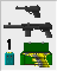

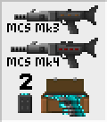

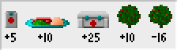

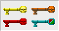

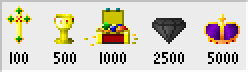

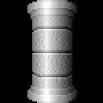

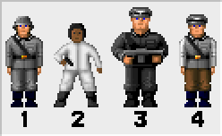

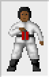

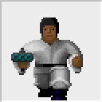

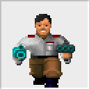

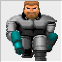

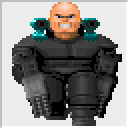
