# Spear Resurrection

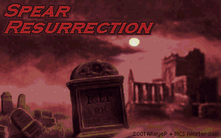 

AReyeP and MCS's 2001 sequel to *Spear of Destiny*: B.J. goes after the Spear
again, into Baron von Schmitt's castle in Spain. The TC plays both mapsets:
the original 2001 maps, and the new maps from the 2011 SDL release.

**[Manual](MANUAL.md)** · **[Hint book](HINTS.md)** (spoilers) · **[Tactics](TACTICS.md)** · [Hall of Fame](HALL-OF-FAME.md) ·
[areyep.com page](https://www.areyep.com/RIPandMCS-Spearres-Main.html) · [back to the TC](../../../README.md)

## In the TC

<table>
<tr><td width="50%">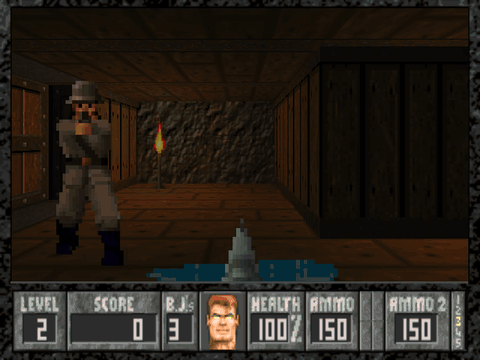 Subterranean: machine gun against the guards</td><td width="50%">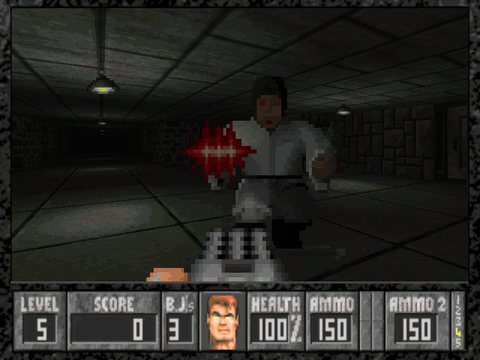 The Superclone, taken down with the MCS Mk3</td></tr>
<tr><td width="50%">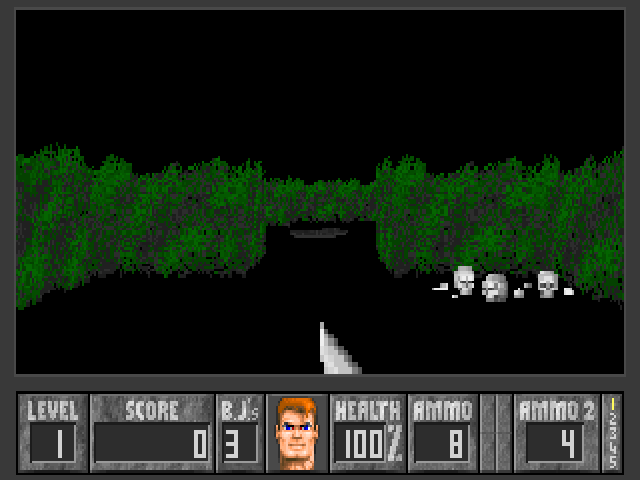 Black Forest, DOS original</td><td width="50%">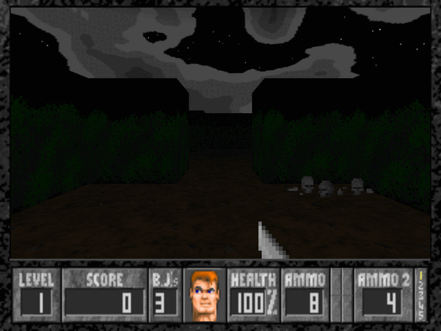 Black Forest, in the TC</td></tr>
<tr><td width="50%">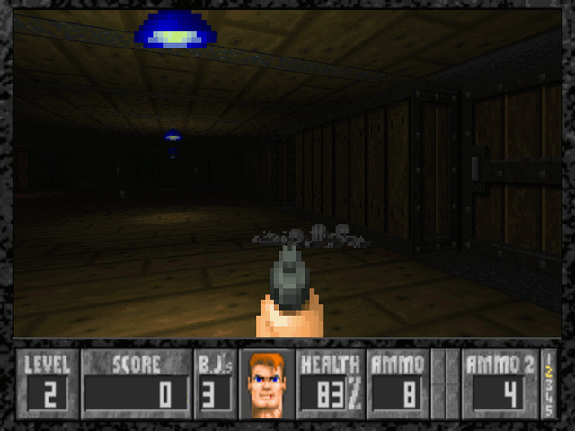 Floor and ceiling textures (TC option)</td><td width="50%">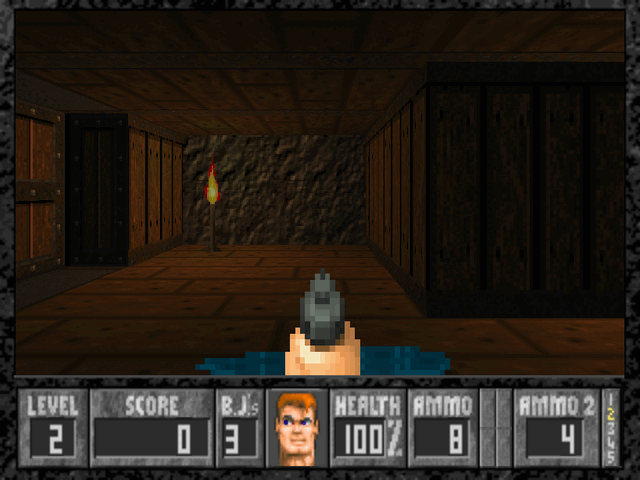 Dynamic lights (TC option)</td></tr>
</table>

*The sections below are from [areyep.com](https://www.areyep.com/RIPandMCS-Spearres-Main.html), by AReyeP and MCS, reproduced for players of the TC port. Text and pictures are theirs.*

## About the game

Wolfenstein 3D had a sequel in the form of "Spear of Destiny".  
Ever wondered what a sequel to Spear of Destiny may have been like?

Well, now you'll be able to stop wondering, and find out...

**"Spear Resurrection" is here!**

What really did happen to Hitler?  
Why was his body never found?  
What became of the "Spear of Destiny"?  
Where did those nazis that fled after the war go into hiding?  
Who is "Baron von Schmitt"?  
What are the Spear's true powers, if any?  
And, where does B.J. Blazkowicz fit into all of this?

All these questions, plus more, will be answered, but only if you have the guts and determination it takes to take on the role of B.J. Blazkowicz in his toughest mission yet!

But before you embark on this critical mission, you'd be best to plan your course of action! Click [here](MANUAL.md) for the game storyline - and if you should decide that you have the right stuff required to take on the role of B.J. Blazkowicz (you'd better if you want to be a hero - you do, don't you?) - then you're ready to take on "Spear Resurrection"!

**What is "Spear Resurrection"?**

"Spear Resurrection" was created by 2 Wolfenstein 3D fans - namely  
"MCS Amsterdam", and myself (AReyeP - pronounced as R.I.P).

After joining the "Wolf Community" in late 2000, and seeing all the great new add ons and total conversions being made by Wolf fans utilizing the original Wolfenstein 3D source code made freely available by id software, my interest in this classic old game was renewed. I decided it would be nice to give my old add ons (one of which is called "Wolfendoom") a "facelift", and then, make a completely new add on. But I wanted it to be special. Something that would be new and fresh, yet still retain that "classic" Wolf 3D feel.

I had an idea - to make a sequel to Wolfenstein 3D "Spear of Destiny" - the storyline and ideas for it were quite clear in my mind. I was reasonably adept in the graphics department, and knew that would be no problem. But the source coding? That was one area I was new to. I'm no programmer! There were people out there making add ons with great features implemented through source code modifications, and I was a complete newbie in this department!

Enter MCS Amsterdam (yep, as his "name" implies, he's from Holland). After asking for help on various programming topics, MCS was only too happy to provide me with the answers. And, after a few exchanges, I asked if he would be willing to help me make an add on that would do the original Spear of Destiny justice. Thankfully, he accepted!

Our goal was to make a Total Conversion (TC) that was as good as a finished commercial product. Something that id themselves would have been proud of if it had been released a few months after the original Spear of Destiny. Hopefully, we've succeeded. MCS and I worked extremely well together as a team, and I suppose we constantly inspired each other to do better as the project proceeded. And this jointly owned website is a result of this very same teamwork.

MCS and I put a lot of time and effort into Spear Resurrection, 11 months to be precise where our limited spare time was used to create this Wolfenstein TC. We feel it will be a very worthwhile addition to any Wolf fans collection.

## Features

These are just some of the features you will find in Spear Resurrection. But bear in mind that we haven't listed everything here - to do so would ruin some surprises we have in store for you in the game!

The graphics in Spear Resurrection are either completely new and original (as in the case of all wall graphics and many sprites), or heavily modified versions of the original Wolf graphics (as you'll see looking at the various screenshots). Check out the screenshots section to get an idea of what they're like. Our goal here was simple: "if it don't look as good or better than the original, it won't be used"!

- New menu and title graphics
- New sounds
- New music
- New storyline
- New and challenging levels

**Spear Resurrection coding features** (MCS Amsterdam's department)

- Original Spear code used
- Copy protection removed
- Original Spear palette and Spear sign on screen used
- "Read This!" added
- Extra weapon with seperate ammo added
- Easycheat (no more Shift-Alt-Backspace to enter cheat mode)
- Get Current Ratio option added to cheats
- No Clipping added to cheats
- No red damage flash when in God mode
- 2 extra keys added
- Landmines added - random damage that is also dependent on skill level being played
- Exploding Barrels that, depending on range, hurt you and the enemy. Amount of damage also depends on skill level being played
- Breakable Columns
- Maximum 200% health, and 150 of each ammo type (total of 300 ammo)
- External demo support
- Help Text, Intermission text, and End text
- Ambient sounds
- 2 extra unlocked doors
- Locked elevator door
- Animated objects such as torches that can act as normal blocking objects
- Godmode artefact
- Teleportation Artefact
- Locked doors colour coded to required key

And the list goes on, but, as I stated earlier, we won't give away  
everything here. We feel that would ruin the fun just a little!

## Screenshots from areyep.com

These screenshots are taken from within the actual game, and should give you a good indication as to some of the things you can expect to find whilst playing.

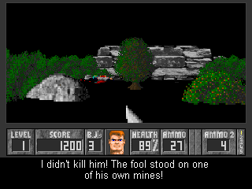

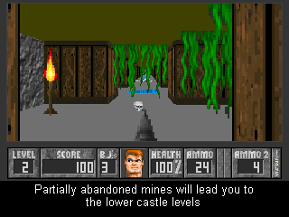

| 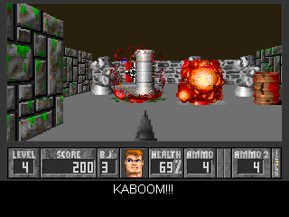 | 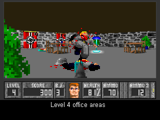 |
|---|---|

| 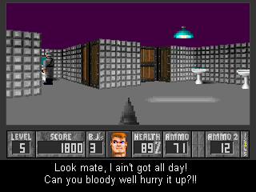 | 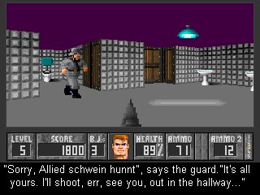 |
|---|---|

| 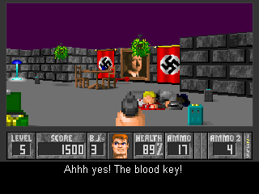 | 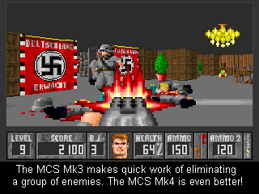 |
|---|---|

| 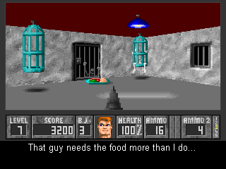 | 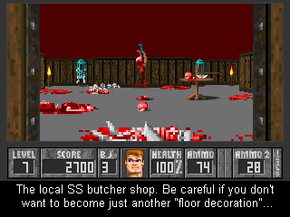 |
|---|---|

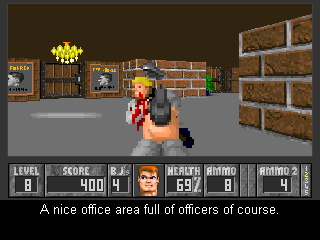

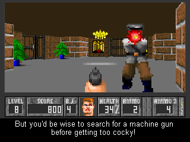

| 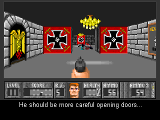 | 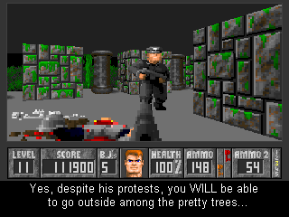 |
|---|---|

| 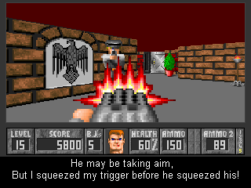 | 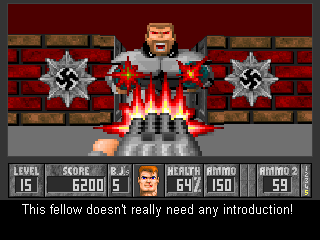 |
|---|---|
