# Spear Resurrection: Tactics

*From [areyep.com](https://www.areyep.com/RIPandMCS-Spearres-Tactics.html), by AReyeP and MCS, reproduced here for players of the TC port. Text and pictures are theirs; the links to downloads go to their site.*

> **Spoilers** for some levels.

How would you deal with a particular situation? MCS has his own strategy suggestions. See if you would do as he would in any of the situations below!  
Just click on one of the boxes below to review the situation depicted:

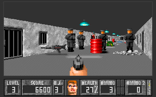

[**A Tricky Situation!**](TACTICS.md#trickysituation)

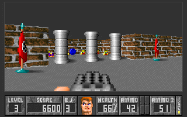

[**Hard to get stuff!**](TACTICS.md#hardtogetstuff)

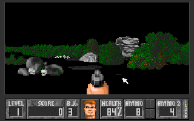

[**A walk through the Black Forest...**](TACTICS.md#blackforest)

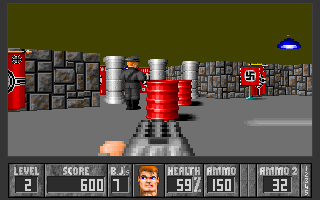

[**Blowing things up!**](TACTICS.md#blowingupstuff)

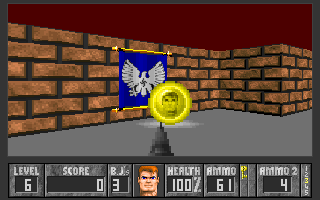

[**Invulnerability Artefact**](TACTICS.md#godmode)

## A Tricky Situation!

**A Tricky Situation!**

Whilst playing Spear Resurrection, you round a corner to find the situation as pictured to the right! You're low on health, and have only 3 ammo left!  
You've already backtracked through the level to look for ammo/health you may have missed, but there ain't none! What in blazes are you going to do? Would you:

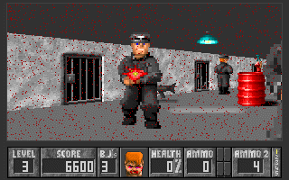

**A:** Fire your last 3 shots into  
the back of the closest SS, but risk having the other 3 descend upon you?

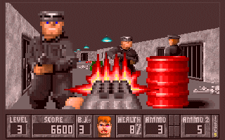

**B:** Rush in and grab the MCS Mk 4 Multi Cannon and go out  
in a blaze of glory?

**C:** Play run and hide with the nasty SS?

**D:** Wimp out and play Unreal Tournament with the  
bots set on "novice" mode?

| 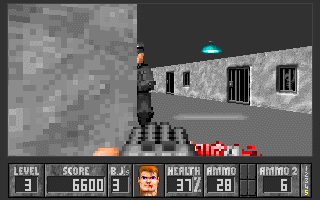 |  |
|---|---|

Well, if you answered yes to any of the above, YOU WERE WRONG! (Although the Unreal Tournament option ain't a bad pick :) And, why may you be wrong?  
Because you failed to take into account the Spear Resurrection MCS strategy factor! And what would MCS do in such a situation?

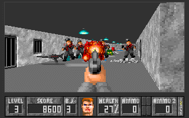

He'd shoot the barrel!

Yep, thanks to MCS, some barrels in Spear Resurrection can go off with a bang, not only hurting you if you're too close, but any poor sod that happens to be standing nearby. Not that that's a bad thing if that nearby sod happens to be an enemy! So, don't just go blowing barrels up for fun - if you're being chased by a dozen gun toting SS, you may just need 'em!

## Hard to get stuff!

**Hard to get stuff!**

A juicy treasure trove sits  
temptingly behind some stone columns. You've searched for secret walls all through the level. What would you do?  
Would you:

A: Have another leisurely stroll through the level running along walls with the spacebar depressed (and you getting depressed)?

B: Forget the treasure and move on to  
the next level?

C: Fire up Mapedit or Floedit and  
try to cheat?

D: Write it off as poor level design?

Well, if you answered yes to any of the above, YOU WERE WRONG (of course you knew that, didn't you? :)

OK then, so what would MCS recommend you do in such a situation?

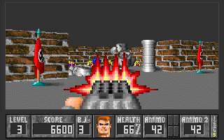

He'd shoot  
the crap outta  
those columns!

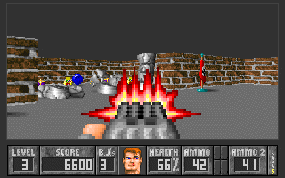

Yep, as you can see, some columns in  
Spear Resurrection  
are a little crumbly

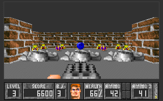

The treasure's all yours!  
But, just be careful - you  
never know what could be  
lurking around the corner!

## A walk through the Black Forest...

**A walk through the Black Forest**

A hazard you will encounter  
in the forests around the nazi occupied Spanish fortress are landmines. Planted quite liberally by the nazis, these  
mines are hard to see.  
See the arrow in the picture?  
It's pointing to a landmine.  
But, walk carefully, and you  
should be OK. Better still, get an enemy to set off  
his own trap!

But, you just had to find out  
the hard way, didn't you?  
That's it, walk right  
into the mine.  
Ouch - yep, it hurts.  
A lot.  
MEDIC!

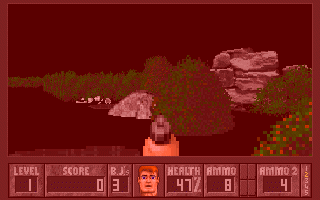

Although the nazis wouldn't conveniently leave first aid kits  
just lying around in the forest, there are other sources of  
healing that B.J. can look  
for - berry bushes!  
The two small berry bushes in  
the picture to the right are  
exactly the kind of thing B.J.  
needs when he's hurt.

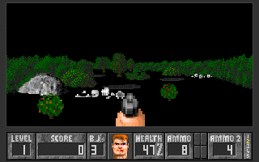

| 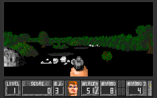 | 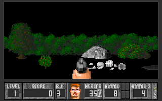 |
|---|---|

But, choose carefully! Some berry bushes  
will raise your health...

...while other poisonous varieties will  
reduce your health.

## Blowing things up!

**Blowing up stuff!**

Ahhh, nothing like  
blowing stuff up!!!  
But, don't let your trigger happy finger get the better of you!

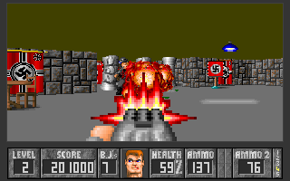

Stand back a few paces before you start pumping lead!

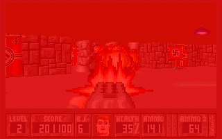

...of course if you like to be closer to the action, well, feel welcome. Just don't expect to live long and prosper...

## Invulnerability Artefact

**Invulnerability Artefact**One of the 4 "Artefacts of the Spear"

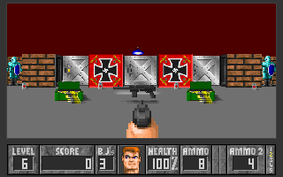

Oh, a machine gun and some bullets :) And some littly wittly health packs near the doors. There must be a few SS behind those doors :)

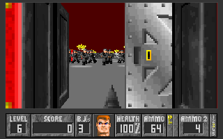

Gottim bloody Himmel!!!  
There's more than 3 SS!!!  
There's a whole horde!!!  
Stupid AReyeP and his stupid level design... how can I  
survive this stupid scenario?

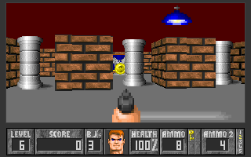

Ahhh - wait a sec! Think B.J!  
I seem to remember some artefact just behind me that's hidden behind some stone columns... wait - yes! It's an Invulnerability Artefact!!!

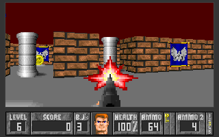

Quick! Blast the columns to pieces - the SS are coming!!! Damn - this column isn't going to give!!!

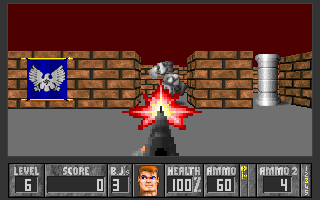

Try another column - ah yes!  
This one's a bit chalky - but quick
- I can hear those doors
opening behind me...

Run inside - ahh wonderful!  
God mode, B.J., grab it now
- you need it!

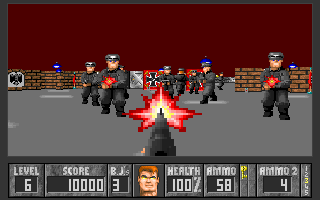

...and just in the nick of time  
too - those SS are pouring in behind you with machine guns blazing. Deal 'em some death while your god mode lasts, but don't muck around - it  
won't last forever!

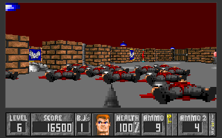

Well, the god mode ran out, but not before you've given the SS their daily diet of lead. You should be a  
nutritionist, B.J.!!!

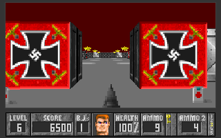

Corridor is empty, and on with  
the mission.  
"Piece of cake really you know..." you whisper to yourself as  
you march onwards...  
Good show ol' chap!!!

Yes - the "Invulnerability Artefact", whilst rare, is an item not to be used lightly! Although the above scenario is a simplified situation, if you should ever encounter an area where the odds are stacked against you, you just never know - is there an "Invulnerability Artefact" nearby that could make life a little easier?
