# Wolfendoom

AReyeP's 1995-96 Wolfenstein 3D add-on with Doom's look, rebuilt in 2001 as a
total conversion: B.J. Blazkowicz Jnr against six portals to the "Doom
Dimension", across six UAC-site episodes.

[areyep.com page](https://www.areyep.com/RIPandMCS-Wolfendoom-Main.htm) · [back to the TC](../../../README.md)

*The sections below are from [areyep.com](https://www.areyep.com/RIPandMCS-Wolfendoom-Main.htm), by AReyeP and MCS, reproduced for players of the TC port. Text and pictures are theirs.*

## About the game

"Wolfendoom" started out as an add on for the original full version of id software's Wolfenstein 3D. Back in 1995-96, when it was created, not many good add ons existed. I (AReyeP) borrowed the theme, and graphics, from id software's newer classic at the time, "Doom", created a completely new storyline, and thus "Wolfendoom" came to be. But, Wolfenstein was an old game by then, and so "Wolfendoom" did little more than sit forgotten on some back up disks for the next few years after that.

Then, in late 2000, I discovered a whole Wolf 3D fan base on the Internet. With devoted fans creating new and original add ons, and recompiling the original Wolf 3D source code (made freely available by id software) to create even better add ons, I decided it was time to give "Wolfendoom" a bit of a facelift.

Thanks to a recompiling of the source code, and an editor for Wolf 3D called "Floedit", Wolfendoom is now a proper total conversion of the original Wolfenstein, rather than just an "add on".

"Wolfendoom" is more than just Wolfenstein 3D with Doom graphics - level design, graphics and storyline blend together to make something akin to a new game altogether!

In "Wolfendoom", you play B.J. Blazkowicz Jnr, son of the legendary World War II hero of the same name. Employed as a military consultant at the Union Aerospace Corporation (UAC), you become involved in a race to close down 6 portals to another dimension, nicknamed the "Doom Dimension", opened up inadvertently by UAC Research personnel.

The full story is available from the main game menu, and unfolds as each episode is completed.

To download "Wolfendoom" now, [click here!](https://www.areyep.com/Wolfdoom.zip)[(and HERE for SDL Windows supported version)](https://www.areyep.com/wolfdoomSDL.zip)

| 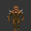 |  | 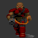 | 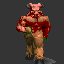 | 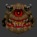 | 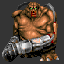 |
|---|---|---|---|---|---|

## Screenshots from areyep.com

<table>
<tr><td width="50%">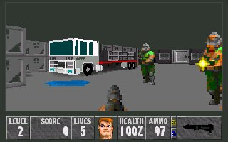 UAC Site 1 - Freight Storage</td><td width="50%">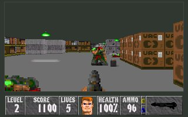 UAC Site 1 - Freight Storage</td></tr>
<tr><td width="50%">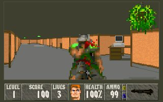 UAC Site 1 - Administration Offices</td><td width="50%">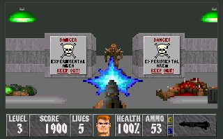 UAC Site 1 - Portal Entrance</td></tr>
<tr><td width="50%">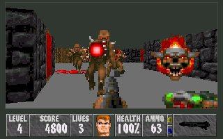 A Doom Dimension Welcoming Party</td><td width="50%">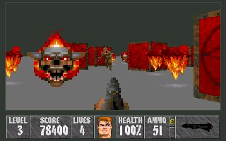 UAC6 Doom Dimension - Inner Portal</td></tr>
</table>
